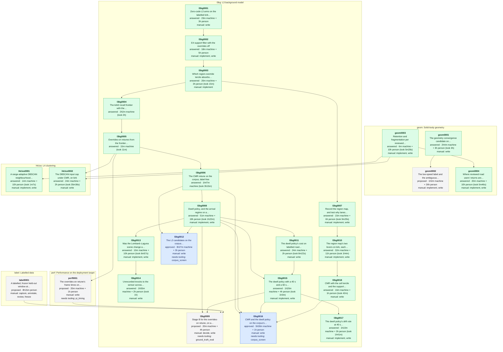

# Experiment dependencies

<!-- Generated by `make experiments-graph` from the specs under data/experiments. Do not edit: change a spec and regenerate. -->

Every experiment under this folder, by area. An arrow is `depends_on`: the experiment at its head needs the one at its tail answered first. Colour is the spec's status: grey dashed proposed, blue approved, green answered, pale retired. Each node gives the estimated machine time along its longest chain of steps, plus person time for manual steps, and for answered experiments what the run took. How to write a spec: [README](README.md); the design: [experiment queue plan](../../docs/plans/platform-experiment-queue-plan.md).

## Open experiments

- [geom0002](geom/geom0002.md) The low-speed label and the ambiguous row, rescreened on the young-track axis: proposed, awaiting approval; 1h2m machine + 26h person; after geom0001; asks [geometry-convergence-heldout-2026-10 #recommendations](../../docs/lidar/operations/geometry-convergence-heldout-2026-10.md#recommendations), [lidar-tracker-geometry-convergence-plan #checklist](../../docs/plans/lidar-tracker-geometry-convergence-plan.md#checklist).
- [l3bg0009](l3bg/l3bg0009.md) Stage B for the overrides-on retune, on a held-out labelled window: waiting on a dependency; 20m machine + 4h person; after l3bg0008, l3bg0015, label0001, perf0001; asks [20261011-beamwise-background-subtraction-review #7-a-decision-rule-that-can-be-p…](../../data/maths/proposals/20261011-beamwise-background-subtraction-review.md#7-a-decision-rule-that-can-be-pre-registered), [l3-region-override-attribution-kirk-2026-10 #8-recommendations](../../docs/lidar/operations/l3-region-override-attribution-kirk-2026-10.md#8-recommendations).
- [l3bg0012](l3bg/l3bg0012.md) The L3 candidates on the corpus, label-free, with the dwell policy: ready, but a step needs tooling; 3h27m machine + 3h person; after l3bg0006, l3bg0008; asks [l3-dwell-policy-arrival-2026-10 #recommendations](../../docs/lidar/operations/l3-dwell-policy-arrival-2026-10.md#recommendations), [l3-region-tercile-mechanism-2026-10 #recommendations](../../docs/lidar/operations/l3-region-tercile-mechanism-2026-10.md#recommendations).
- [l3bg0016](l3bg/l3bg0016.md) CMR and the dwell policy on the corpus's second segment, label-free: ready, but a step needs tooling; 5h30m machine + 1h person; after l3bg0006, l3bg0008, l3bg0015, l3bg0018; asks [l3-region-override-attribution-kirk-2026-10 #7-what-this-does-not-establish](../../docs/lidar/operations/l3-region-override-attribution-kirk-2026-10.md#7-what-this-does-not-establish), [l3-dwell-policy-arrival-2026-10 #recommendations](../../docs/lidar/operations/l3-dwell-policy-arrival-2026-10.md#recommendations).
- [label0001](label/label0001.md) A labelled, frozen held-out window at embarcadero-folsom: proposed, awaiting approval; 8h15m person; asks [20261011-beamwise-background-subtraction-review #7-a-decision-rule-that-can-be-p…](../../data/maths/proposals/20261011-beamwise-background-subtraction-review.md#7-a-decision-rule-that-can-be-pre-registered), [lidar-tracker-geometry-convergence-plan #6-work-to-scope-and-schedule](../../docs/plans/lidar-tracker-geometry-convergence-plan.md#6-work-to-scope-and-schedule).
- [perf0001](perf/perf0001.md) The overrides-on retune's frame times on the Pi: proposed, awaiting approval; 20m machine + 1h person; after l3bg0005; asks [l3-region-override-attribution-kirk-2026-10 #8-recommendations](../../docs/lidar/operations/l3-region-override-attribution-kirk-2026-10.md#8-recommendations).

## Answered

- [geom0001](geom/geom0001.md) The geometry convergence candidate on held-out segments: [report](../../docs/lidar/operations/geometry-convergence-heldout-2026-10.md); estimated 2h4m, took 3h on m1pro; asked [solid-body-rectangle-heading-2026-10 #recommendations](../../docs/lidar/operations/solid-body-rectangle-heading-2026-10.md#recommendations).
- [geom0003](geom/geom0003.md) Retention and fragmentation per reviewed mask (W3): [report](../../docs/lidar/operations/w3-retention-fragmentation-kirk0-2026-10.md); estimated 6m, took 5m28s on m1pro; asked [lidar-tracker-geometry-convergence-plan #6-work-to-scope-and-schedule](../../docs/plans/lidar-tracker-geometry-convergence-plan.md#6-work-to-scope-and-schedule).
- [geom0004](geom/geom0004.md) Where reviewed road users' returns are lost, return by return, on kirk0: [report](../../docs/lidar/operations/w3-return-fate-kirk0-2026-10.md); estimated 20m, took 5m46s on m1pro; asked [w3-retention-fragmentation-kirk0-2026-10 #recommendations](../../docs/lidar/operations/w3-retention-fragmentation-kirk0-2026-10.md#recommendations), [l4-range-adaptive-eps-2026-10 #recommendations](../../docs/lidar/operations/l4-range-adaptive-eps-2026-10.md#recommendations).
- [l3bg0001](l3bg/l3bg0001.md) Zero-code L3 arms on the labelled kirk captures: [report](../../docs/lidar/operations/l3-zero-code-arms-kirk-2026-10.md); asked [20261011-beamwise-background-subtraction-review #6-order-and-cost-of-the-steps-s…](../../data/maths/proposals/20261011-beamwise-background-subtraction-review.md#6-order-and-cost-of-the-steps-section-62).
- [l3bg0002](l3bg/l3bg0002.md) E4 support filter with the overrides off: [report](../../docs/lidar/operations/l3-zero-code-arms-kirk-2026-10.md); asked [l3-zero-code-arms-kirk-2026-10 #6-recommendations](../../docs/lidar/operations/l3-zero-code-arms-kirk-2026-10.md#6-recommendations).
- [l3bg0003](l3bg/l3bg0003.md) Which region-override tercile absorbs road users, and a road-height floor: [report](../../docs/lidar/operations/l3-region-override-attribution-kirk-2026-10.md); estimated 20m, took 15m on m1pro; asked [l3-zero-code-arms-kirk-2026-10 #83-reading](../../docs/lidar/operations/l3-zero-code-arms-kirk-2026-10.md#83-reading).
- [l3bg0004](l3bg/l3bg0004.md) The kirk0 recall frontier with the overrides on and off: [report](../../docs/lidar/operations/l3-region-override-attribution-kirk-2026-10.md); estimated 2h2m, took 2h on m1pro; asked [l3-zero-code-arms-kirk-2026-10 #83-reading](../../docs/lidar/operations/l3-zero-code-arms-kirk-2026-10.md#83-reading).
- [l3bg0005](l3bg/l3bg0005.md) Overrides-on retunes from the frontier, through the harness: [report](../../docs/lidar/operations/l3-region-override-attribution-kirk-2026-10.md); estimated 15m, took 11m on m1pro; asked [l3-zero-code-arms-kirk-2026-10 #83-reading](../../docs/lidar/operations/l3-zero-code-arms-kirk-2026-10.md#83-reading).
- [l3bg0006](l3bg/l3bg0006.md) The CMR retune on the corpus, label-free: [report](../../docs/lidar/operations/l3-region-override-attribution-kirk-2026-10.md); estimated 1h47m, took 3h15m on m1pro; asked [l3-region-override-attribution-kirk-2026-10 #7-what-this-does-not-establish](../../docs/lidar/operations/l3-region-override-attribution-kirk-2026-10.md#7-what-this-does-not-establish).
- [l3bg0007](l3bg/l3bg0007.md) Record the region map, and test why lanes land in the volatile tercile: [report](../../docs/lidar/operations/l3-region-tercile-mechanism-2026-10.md); estimated 15m, took 9m29s on m1pro; asked [l3-region-override-attribution-kirk-2026-10 #8-recommendations](../../docs/lidar/operations/l3-region-override-attribution-kirk-2026-10.md#8-recommendations).
- [l3bg0008](l3bg/l3bg0008.md) Dwell policy, and the arrival regime on a long capture: [report](../../docs/lidar/operations/l3-dwell-policy-arrival-2026-10.md); estimated 51m, took 1h22m on m1pro; asked [20261011-beamwise-background-subtraction-review #51-arrival-is-bistable-and-its-…](../../data/maths/proposals/20261011-beamwise-background-subtraction-review.md#51-arrival-is-bistable-and-its-clock-is-the-backgrounds-age), [l3-region-override-attribution-kirk-2026-10 #8-recommendations](../../docs/lidar/operations/l3-region-override-attribution-kirk-2026-10.md#8-recommendations).
- [l3bg0010](l3bg/l3bg0010.md) The region map's two levers on kirk, each cell's own tercile and a volatile window bounded in metres: [report](../../docs/lidar/operations/l3-region-levers-kirk-2026-10.md); estimated 32m, took 1h4m on m1pro; asked [l3-region-tercile-mechanism-2026-10 #recommendations](../../docs/lidar/operations/l3-region-tercile-mechanism-2026-10.md#recommendations).
- [l3bg0011](l3bg/l3bg0011.md) The dwell policy's cost on labelled road users, on kirk: [report](../../docs/lidar/operations/l3-dwell-policy-labelled-cost-2026-10.md); estimated 24m, took 8m22s on m1pro; asked [l3-dwell-policy-arrival-2026-10 #recommendations](../../docs/lidar/operations/l3-dwell-policy-arrival-2026-10.md#recommendations).
- [l3bg0013](l3bg/l3bg0013.md) Was the Lombard–Laguna scene change a sensor pose step?: [report](../../docs/lidar/operations/l3-scene-change-pose-step-2026-10.md); estimated 10m, took 6m57s on m1pro; asked [lombard-laguna-scene-change-recovery #hypothesis](../../data/experiments/try/lombard-laguna-scene-change-recovery.md#hypothesis), [lidar-scene-change-recovery-sprint-plan #work-packages](../../docs/plans/lidar-scene-change-recovery-sprint-plan.md#work-packages).
- [l3bg0014](l3bg/l3bg0014.md) Unrecorded knocks to the sensor across the corpus placements: [report](../../docs/lidar/operations/l3-corpus-pose-sweep-2026-10.md); estimated 1h55m, took 1h on m1pro; asked [l3-scene-change-pose-step-2026-10 #recommendations](../../docs/lidar/operations/l3-scene-change-pose-step-2026-10.md#recommendations).
- [l3bg0015](l3bg/l3bg0015.md) The dwell policy with a 40 s and a 60 s clock, over the Lombard–Laguna placement: [report](../../docs/lidar/operations/l3-dwell-policy-clock-2026-10.md); estimated 1h20m, took 1h3m on m1pro; asked [l3-dwell-policy-arrival-2026-10 #what-this-does-not-establish](../../docs/lidar/operations/l3-dwell-policy-arrival-2026-10.md#what-this-does-not-establish), [l3-dwell-policy-labelled-cost-2026-10 #recommendations](../../docs/lidar/operations/l3-dwell-policy-labelled-cost-2026-10.md#recommendations).
- [l3bg0017](l3bg/l3bg0017.md) The dwell policy's drift rule at 40 s, over the Lombard–Laguna placement: [report](../../docs/lidar/operations/l3-dwell-policy-drift-2026-10.md); estimated 1h10m, took 1h41m on m1pro; asked [l3-dwell-policy-clock-2026-10 #recommendations](../../docs/lidar/operations/l3-dwell-policy-clock-2026-10.md#recommendations).
- [l3bg0018](l3bg/l3bg0018.md) CMR with the cell tercile and the support filter, on kirk: [report](../../docs/lidar/operations/l3-region-levers-kirk-2026-10.md); estimated 16m, took 42m on m1pro; asked [l3-region-levers-kirk-2026-10 #recommendations](../../docs/lidar/operations/l3-region-levers-kirk-2026-10.md#recommendations).
- [l4clus0001](l4clus/l4clus0001.md) A range-adaptive DBSCAN neighbourhood, scored on fragmentation: [report](../../docs/lidar/operations/l4-range-adaptive-eps-2026-10.md); estimated 14m, took 1m7s on m1pro; asked [D-28](../../docs/DECISIONS.md), [research-briefing-2025-01-to-2026-10](../../docs/lidar/operations/brief/research-briefing-2025-01-to-2026-10.md).
- [l4clus0002](l4clus/l4clus0002.md) The DBSCAN input cap under CMR, on kirk: [report](../../docs/lidar/operations/l4-dbscan-input-cap-2026-10.md); estimated 24m, took 35m36s on m1pro; asked [w3-retention-fragmentation-kirk0-2026-10 #recommendations](../../docs/lidar/operations/w3-retention-fragmentation-kirk0-2026-10.md#recommendations).

## Totals

- 6 open experiments: 10h39m machine + 43h15m person estimated.
- Longest chain of open work, machine and person time together: geom0002, 27h2m.
