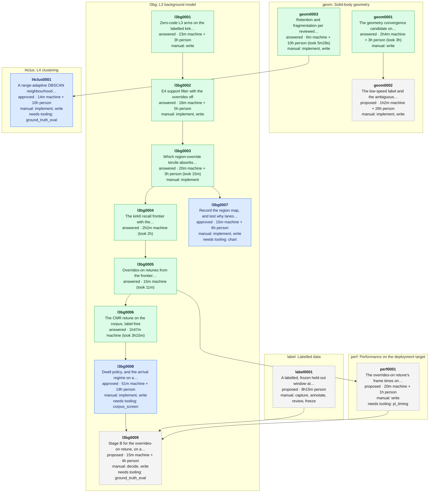

# Experiment dependencies

<!-- Generated by `make experiments-graph` from the specs under data/experiments. Do not edit: change a spec and regenerate. -->

Every experiment under this folder, by area. An arrow is `depends_on`: the experiment at its head needs the one at its tail answered first. Colour is the spec's status: grey dashed proposed, blue approved, green answered, pale retired. Each node gives the estimated machine time along its longest chain of steps, plus person time for manual steps, and for answered experiments what the run took. How to write a spec: [README](README.md); the design: [experiment queue plan](../../docs/plans/platform-experiment-queue-plan.md).

## Open experiments

- [geom0002](geom/geom0002.md) The low-speed label and the ambiguous row, rescreened on the young-track axis: proposed, awaiting approval; 1h2m machine + 26h person; after geom0001; asks [geometry-convergence-heldout-2026-10 #recommendations](../../docs/lidar/operations/geometry-convergence-heldout-2026-10.md#recommendations), [lidar-tracker-geometry-convergence-plan #checklist](../../docs/plans/lidar-tracker-geometry-convergence-plan.md#checklist).
- [l3bg0007](l3bg/l3bg0007.md) Record the region map, and test why lanes land in the volatile tercile: ready, but a step needs tooling; 15m machine + 6h person; after l3bg0003; asks [l3-region-override-attribution-kirk-2026-10 #8-recommendations](../../docs/lidar/operations/l3-region-override-attribution-kirk-2026-10.md#8-recommendations).
- [l3bg0008](l3bg/l3bg0008.md) Dwell policy, and the arrival regime on a long capture: ready, but a step needs tooling; 51m machine + 19h person; after l3bg0006; asks [20261011-beamwise-background-subtraction-review #51-arrival-is-bistable-and-its-…](../../data/maths/proposals/20261011-beamwise-background-subtraction-review.md#51-arrival-is-bistable-and-its-clock-is-the-backgrounds-age), [l3-region-override-attribution-kirk-2026-10 #8-recommendations](../../docs/lidar/operations/l3-region-override-attribution-kirk-2026-10.md#8-recommendations).
- [l3bg0009](l3bg/l3bg0009.md) Stage B for the overrides-on retune, on a held-out labelled window: waiting on a dependency; 15m machine + 4h person; after l3bg0008, label0001, perf0001; asks [20261011-beamwise-background-subtraction-review #7-a-decision-rule-that-can-be-p…](../../data/maths/proposals/20261011-beamwise-background-subtraction-review.md#7-a-decision-rule-that-can-be-pre-registered), [l3-region-override-attribution-kirk-2026-10 #8-recommendations](../../docs/lidar/operations/l3-region-override-attribution-kirk-2026-10.md#8-recommendations).
- [l4clus0001](l4clus/l4clus0001.md) A range-adaptive DBSCAN neighbourhood, scored on fragmentation: ready, but a step needs tooling; 14m machine + 10h person; after geom0003; asks [D-28](../../docs/DECISIONS.md), [research-briefing-2025-01-to-2026-10](../../docs/lidar/operations/brief/research-briefing-2025-01-to-2026-10.md).
- [label0001](label/label0001.md) A labelled, frozen held-out window at embarcadero-folsom: proposed, awaiting approval; 8h15m person; asks [20261011-beamwise-background-subtraction-review #7-a-decision-rule-that-can-be-p…](../../data/maths/proposals/20261011-beamwise-background-subtraction-review.md#7-a-decision-rule-that-can-be-pre-registered), [lidar-tracker-geometry-convergence-plan #6-work-to-scope-and-schedule](../../docs/plans/lidar-tracker-geometry-convergence-plan.md#6-work-to-scope-and-schedule).
- [perf0001](perf/perf0001.md) The overrides-on retune's frame times on the Pi: proposed, awaiting approval; 20m machine + 1h person; after l3bg0005; asks [l3-region-override-attribution-kirk-2026-10 #8-recommendations](../../docs/lidar/operations/l3-region-override-attribution-kirk-2026-10.md#8-recommendations).

## Answered

- [geom0001](geom/geom0001.md) The geometry convergence candidate on held-out segments: [report](../../docs/lidar/operations/geometry-convergence-heldout-2026-10.md); estimated 2h4m, took 3h on m1pro; asked [solid-body-rectangle-heading-2026-10 #recommendations](../../docs/lidar/operations/solid-body-rectangle-heading-2026-10.md#recommendations).
- [geom0003](geom/geom0003.md) Retention and fragmentation per reviewed mask (W3): [report](../../docs/lidar/operations/w3-retention-fragmentation-kirk0-2026-10.md); estimated 6m, took 5m28s on m1pro; asked [lidar-tracker-geometry-convergence-plan #6-work-to-scope-and-schedule](../../docs/plans/lidar-tracker-geometry-convergence-plan.md#6-work-to-scope-and-schedule).
- [l3bg0001](l3bg/l3bg0001.md) Zero-code L3 arms on the labelled kirk captures: [report](../../docs/lidar/operations/l3-zero-code-arms-kirk-2026-10.md); asked [20261011-beamwise-background-subtraction-review #6-order-and-cost-of-the-steps-s…](../../data/maths/proposals/20261011-beamwise-background-subtraction-review.md#6-order-and-cost-of-the-steps-section-62).
- [l3bg0002](l3bg/l3bg0002.md) E4 support filter with the overrides off: [report](../../docs/lidar/operations/l3-zero-code-arms-kirk-2026-10.md); asked [l3-zero-code-arms-kirk-2026-10 #6-recommendations](../../docs/lidar/operations/l3-zero-code-arms-kirk-2026-10.md#6-recommendations).
- [l3bg0003](l3bg/l3bg0003.md) Which region-override tercile absorbs road users, and a road-height floor: [report](../../docs/lidar/operations/l3-region-override-attribution-kirk-2026-10.md); estimated 20m, took 15m on m1pro; asked [l3-zero-code-arms-kirk-2026-10 #83-reading](../../docs/lidar/operations/l3-zero-code-arms-kirk-2026-10.md#83-reading).
- [l3bg0004](l3bg/l3bg0004.md) The kirk0 recall frontier with the overrides on and off: [report](../../docs/lidar/operations/l3-region-override-attribution-kirk-2026-10.md); estimated 2h2m, took 2h on m1pro; asked [l3-zero-code-arms-kirk-2026-10 #83-reading](../../docs/lidar/operations/l3-zero-code-arms-kirk-2026-10.md#83-reading).
- [l3bg0005](l3bg/l3bg0005.md) Overrides-on retunes from the frontier, through the harness: [report](../../docs/lidar/operations/l3-region-override-attribution-kirk-2026-10.md); estimated 15m, took 11m on m1pro; asked [l3-zero-code-arms-kirk-2026-10 #83-reading](../../docs/lidar/operations/l3-zero-code-arms-kirk-2026-10.md#83-reading).
- [l3bg0006](l3bg/l3bg0006.md) The CMR retune on the corpus, label-free: [report](../../docs/lidar/operations/l3-region-override-attribution-kirk-2026-10.md); estimated 1h47m, took 3h15m on m1pro; asked [l3-region-override-attribution-kirk-2026-10 #7-what-this-does-not-establish](../../docs/lidar/operations/l3-region-override-attribution-kirk-2026-10.md#7-what-this-does-not-establish).

## Totals

- 7 open experiments: 2h57m machine + 74h15m person estimated.
- Longest chain of open work, machine and person time together: geom0002, 27h2m.
