# Experiment dependencies

<!-- Generated by `make experiments-graph` from the specs under data/experiments. Do not edit: change a spec and regenerate. -->

Every experiment under this folder, by area. An arrow is `depends_on`: the experiment at its head needs the one at its tail answered first. Colour is the spec's status: grey dashed proposed, blue approved, green answered, pale retired. Each node gives the estimated machine time along its longest chain of steps, plus person time for manual steps, and for answered experiments what the run took. How to write a spec: [README](README.md); the design: [experiment queue plan](../../docs/plans/platform-experiment-queue-plan.md).

```mermaid
flowchart TB
  classDef proposed fill:#f4f4f5,stroke:#71717a,stroke-dasharray:4 3,color:#18181b
  classDef approved fill:#dbeafe,stroke:#2563eb,color:#172554
  classDef answered fill:#dcfce7,stroke:#16a34a,color:#052e16
  classDef retired fill:#fafafa,stroke:#d4d4d8,color:#71717a
  subgraph area_geom ["geom: Solid-body geometry"]
    geom0001["<b>geom0001</b><br/>The geometry convergence candidate on…<br/>answered · 2h4m machine + 3h person (took 3h)<br/>manual: write"]:::answered
    geom0002["<b>geom0002</b><br/>The low-speed label and the ambiguous…<br/>proposed · 1h2m machine + 26h person<br/>manual: implement, write"]:::proposed
    geom0003["<b>geom0003</b><br/>Retention and fragmentation per reviewed…<br/>answered · 6m machine + 10h person (took 5m28s)<br/>manual: implement, write"]:::answered
    geom0004["<b>geom0004</b><br/>Where reviewed road users' returns are…<br/>answered · 20m machine + 10h person (took 5m46s)<br/>manual: implement, write"]:::answered
    geom0005["<b>geom0005</b><br/>A published box that holds its points and…<br/>answered · 2h16m machine + 6h person (took 5h)<br/>manual: implement, write"]:::answered
    geom0006["<b>geom0006</b><br/>Refining the published box: turn lag…<br/>answered · 53m machine + 5h person (took 2h)<br/>manual: implement, write"]:::answered
    geom0007["<b>geom0007</b><br/>The published box's length: a memory that…<br/>answered · 43m machine + 4h person (took 1h)<br/>manual: implement, write"]:::answered
    geom0008["<b>geom0008</b><br/>An exclusive published box: the unseen…<br/>answered · 43m machine + 3h person (took 1h)<br/>manual: implement, write"]:::answered
    geom0009["<b>geom0009</b><br/>The published box's merge guard: letting…<br/>answered · 43m machine + 2h person (took 30m)<br/>manual: implement, write"]:::answered
    geom0010["<b>geom0010</b><br/>The published box's held extents yield to…<br/>answered · 43m machine + 2h person (took 30m)<br/>manual: implement, write"]:::answered
    geom0011["<b>geom0011</b><br/>Centre against extent: how much of the…<br/>answered · 9m machine + 3h person (took 4m)<br/>manual: implement, write"]:::answered
    geom0012["<b>geom0012</b><br/>Three centres a frame: the tracked…<br/>proposed · 5h3m machine + 6h person<br/>manual: implement, write<br/>needs tooling: box_eval, ground_truth_eval"]:::proposed
  end
  subgraph area_ground ["ground: Ground model and the plane the tracks live in"]
    ground0001["<b>ground0001</b><br/>Where the ground is: each site's surface…<br/>approved · 1h9m machine + 4h person<br/>manual: implement, write"]:::approved
    ground0002["<b>ground0002</b><br/>The vertical clip follows the ground: the…<br/>proposed · 6h20m machine + 6h person<br/>manual: implement, write<br/>needs tooling: ground_truth_eval"]:::proposed
    ground0003["<b>ground0003</b><br/>The planar state in the ground's frame: x…<br/>proposed · 56m machine + 6h person<br/>manual: implement, write<br/>needs tooling: ground_truth_eval"]:::proposed
    ground0004["<b>ground0004</b><br/>The published box on the ground: its base…<br/>proposed · 1h24m machine + 3h person<br/>manual: implement, write<br/>needs tooling: box_eval, ground_truth_eval"]:::proposed
    ground0005["<b>ground0005</b><br/>What the published scene draws: the trail…<br/>proposed · 3h45m machine + 3h person<br/>manual: implement, write<br/>needs tooling: scene_variants"]:::proposed
  end
  subgraph area_host ["host: Roles, hosts and reproducibility"]
    host0001["<b>host0001</b><br/>What each role costs on the Pi 4 and the…<br/>proposed · 1h20m machine + 6h person<br/>manual: implement, write<br/>needs tooling: pi_timing"]:::proposed
    host0002["<b>host0002</b><br/>A kind compiled into the binary against…<br/>proposed · 3h20m machine + 10h person<br/>manual: implement, write"]:::proposed
    host0003["<b>host0003</b><br/>One capture under one fingerprint on the…<br/>proposed · 5h40m machine + 3h person<br/>manual: write<br/>needs tooling: pi_timing"]:::proposed
    host0004["<b>host0004</b><br/>A pure-Go capture reader against libpcap…<br/>proposed · 2h machine + 9h person<br/>manual: implement, write<br/>needs tooling: pi_timing"]:::proposed
  end
  subgraph area_l3bg ["l3bg: L3 background model"]
    l3bg0001["<b>l3bg0001</b><br/>Zero-code L3 arms on the labelled kirk…<br/>answered · 23m machine + 3h person<br/>manual: write"]:::answered
    l3bg0002["<b>l3bg0002</b><br/>E4 support filter with the overrides off<br/>answered · 18m machine + 5h person<br/>manual: implement, write"]:::answered
    l3bg0003["<b>l3bg0003</b><br/>Which region-override tercile absorbs…<br/>answered · 20m machine + 3h person (took 15m)<br/>manual: implement"]:::answered
    l3bg0004["<b>l3bg0004</b><br/>The kirk0 recall frontier with the…<br/>answered · 2h2m machine (took 2h)"]:::answered
    l3bg0005["<b>l3bg0005</b><br/>Overrides-on retunes from the frontier…<br/>answered · 15m machine (took 11m)"]:::answered
    l3bg0006["<b>l3bg0006</b><br/>The CMR retune on the corpus, label-free<br/>answered · 1h47m machine (took 3h15m)"]:::answered
    l3bg0007["<b>l3bg0007</b><br/>Record the region map, and test why lanes…<br/>answered · 15m machine + 6h person (took 9m29s)<br/>manual: implement, write"]:::answered
    l3bg0008["<b>l3bg0008</b><br/>Dwell policy, and the arrival regime on a…<br/>answered · 51m machine + 19h person (took 1h22m)<br/>manual: implement, write"]:::answered
    l3bg0009["<b>l3bg0009</b><br/>Stage B for the overrides-on retune, on a…<br/>proposed · 25m machine + 4h person<br/>manual: decide, write<br/>needs tooling: ground_truth_eval"]:::proposed
    l3bg0010["<b>l3bg0010</b><br/>The region map's two levers on kirk, each…<br/>answered · 32m machine + 11h person (took 1h4m)<br/>manual: implement, write"]:::answered
    l3bg0011["<b>l3bg0011</b><br/>The dwell policy's cost on labelled road…<br/>answered · 24m machine + 2h person (took 8m22s)<br/>manual: write"]:::answered
    l3bg0012["<b>l3bg0012</b><br/>The L3 candidates on the corpus…<br/>answered · 3h27m machine + 3h person (took 3h13m)<br/>manual: write"]:::answered
    l3bg0013["<b>l3bg0013</b><br/>Was the Lombard–Laguna scene change a…<br/>answered · 10m machine + 10h person (took 6m57s)<br/>manual: implement, write"]:::answered
    l3bg0014["<b>l3bg0014</b><br/>Unrecorded knocks to the sensor across…<br/>answered · 1h55m machine + 2h person (took 1h)<br/>manual: write"]:::answered
    l3bg0015["<b>l3bg0015</b><br/>The dwell policy with a 40 s and a 60 s…<br/>answered · 1h20m machine + 4h person (took 1h3m)<br/>manual: implement, write"]:::answered
    l3bg0016["<b>l3bg0016</b><br/>CMR and the dwell policy on the corpus's…<br/>answered · 5h30m machine + 1h person (took 4h)<br/>manual: write"]:::answered
    l3bg0017["<b>l3bg0017</b><br/>The dwell policy's drift rule at 40 s…<br/>answered · 1h10m machine + 3h person (took 1h41m)<br/>manual: implement, write"]:::answered
    l3bg0018["<b>l3bg0018</b><br/>CMR with the cell tercile and the support…<br/>answered · 16m machine + 1h person (took 42m)<br/>manual: write"]:::answered
    l3bg0019["<b>l3bg0019</b><br/>Where the Stage B arms lose a reviewed…<br/>answered · 16m machine + 1h person (took 2m)<br/>manual: write"]:::answered
    l3bg0020["<b>l3bg0020</b><br/>Why a replay depends on the server's…<br/>answered · 32m machine + 1h person (took 4h)<br/>manual: write"]:::answered
    l3bg0021["<b>l3bg0021</b><br/>A replay that starts from nothing, the…<br/>answered · 1h28m machine + 6h person (took 3h)<br/>manual: implement, decide, write"]:::answered
    l3bg0022["<b>l3bg0022</b><br/>Does the background converge by its own…<br/>proposed · 58m machine + 2h person<br/>manual: write<br/>needs tooling: corpus_screen, ground_truth_eval"]:::proposed
    l3bg0023["<b>l3bg0023</b><br/>One L3 for every replay, without losing…<br/>answered · 5h52m machine + 2h person (took 9h)<br/>manual: write"]:::answered
    l3bg0024["<b>l3bg0024</b><br/>Where a vehicle's lower body goes: the…<br/>approved · 2h21m machine + 6h person<br/>manual: implement, write<br/>needs tooling: box_eval, corpus_screen"]:::approved
    l3bg0025["<b>l3bg0025</b><br/>The best L3 currently known, chosen for…<br/>answered · 1h42m machine + 1h person (took 15m)<br/>manual: write"]:::answered
    l3bg0026["<b>l3bg0026</b><br/>A boundary vote on the L3 grid: the…<br/>proposed · 4h6m machine + 5h30m person<br/>manual: implement, write<br/>needs tooling: corpus_screen, ground_truth_eval"]:::proposed
  end
  subgraph area_l4clus ["l4clus: L4 clustering"]
    l4clus0001["<b>l4clus0001</b><br/>A range-adaptive DBSCAN neighbourhood…<br/>answered · 14m machine + 10h person (took 1m7s)<br/>manual: implement, write"]:::answered
    l4clus0002["<b>l4clus0002</b><br/>The DBSCAN input cap under CMR, on kirk<br/>answered · 24m machine + 2h person (took 35m36s)<br/>manual: write"]:::answered
    l4clus0003["<b>l4clus0003</b><br/>CMR's minimum cluster size against the…<br/>answered · 10m machine + 1h person (took 2m)<br/>manual: write"]:::answered
    l4clus0004["<b>l4clus0004</b><br/>The subsampled frames: DBSCAN's threshold…<br/>approved · 3h4m machine + 3h30m person<br/>manual: implement, write<br/>needs tooling: corpus_screen, ground_truth_eval"]:::approved
  end
  subgraph area_l5est ["l5est: L5 state estimation"]
    l5est0001["<b>l5est0001</b><br/>The trail's noise model: what the…<br/>proposed · 2h30m machine + 5h person<br/>manual: implement, write<br/>needs tooling: box_eval, ground_truth_eval"]:::proposed
    l5est0002["<b>l5est0002</b><br/>The published trail as the whole-track…<br/>proposed · 10h44m machine + 4h person<br/>manual: implement, write<br/>needs tooling: scene_variants"]:::proposed
  end
  subgraph area_l5id ["l5id: L5 identity"]
    l5id0001["<b>l5id0001</b><br/>One vehicle, one track: the identity…<br/>answered · 2h40m machine + 3h person (took 1h)<br/>manual: implement, write"]:::answered
    l5id0002["<b>l5id0002</b><br/>One vehicle, one track: ending a coasting…<br/>answered · 2h machine + 2h person (took 1h)<br/>manual: implement, write"]:::answered
    l5id0003["<b>l5id0003</b><br/>One vehicle, one track: the overlap end…<br/>answered · 2h2m machine + 2h person (took 1h)<br/>manual: implement, write"]:::answered
    l5id0004["<b>l5id0004</b><br/>One vehicle, one track: the overlap end…<br/>answered · 1h55m machine + 2h person (took 1h)<br/>manual: implement, write"]:::answered
    l5id0005["<b>l5id0005</b><br/>One vehicle, one track: replicating…<br/>answered · 40m machine + 30m person (took 25m)<br/>manual: write"]:::answered
    l5id0006["<b>l5id0006</b><br/>One vehicle, one track: the survivor's…<br/>proposed · 2h24m machine + 4h person<br/>manual: implement, write<br/>needs tooling: box_eval, ground_truth_eval"]:::proposed
    l5id0007["<b>l5id0007</b><br/>Fragment endpoints on kirk: how many…<br/>proposed · 14m machine + 6h person<br/>manual: implement, write<br/>needs tooling: ground_truth_eval"]:::proposed
    l5id0008["<b>l5id0008</b><br/>Offline fragment links on kirk: a…<br/>proposed · 44m machine + 22h person<br/>manual: implement, write<br/>needs tooling: ground_truth_eval"]:::proposed
    l5id0009["<b>l5id0009</b><br/>Links through a merge: a second placement…<br/>proposed · 12m machine + 24h30m person<br/>manual: implement, capture, review, write"]:::proposed
    l5id0010["<b>l5id0010</b><br/>Fragment links on the frozen held-out…<br/>proposed · 22m machine + 6h person<br/>manual: implement, write<br/>needs tooling: ground_truth_eval"]:::proposed
    l5id0011["<b>l5id0011</b><br/>The likelihood cost with the box's…<br/>approved · 2h8m machine + 6h person<br/>manual: implement, write<br/>needs tooling: box_eval, ground_truth_eval"]:::approved
  end
  subgraph area_l6cls ["l6cls: L6 classification"]
    l6cls0001["<b>l6cls0001</b><br/>How much following the class gate holds…<br/>answered · 1h9m machine + 1h person (took 30m)<br/>manual: write"]:::answered
  end
  subgraph area_l8fol ["l8fol: L8 following"]
    l8fol0001["<b>l8fol0001</b><br/>Both parties observed (B1): following…<br/>answered · 1h24m machine + 2h person (took 2h31m)<br/>manual: write"]:::answered
    l8fol0002["<b>l8fol0002</b><br/>Class evidence for the following gate…<br/>answered · 12m machine + 5h person (took 5m)<br/>manual: implement, write"]:::answered
    l8fol0003["<b>l8fol0003</b><br/>The published box as the physical…<br/>answered · 55m machine + 7h person (took 4h30m)<br/>manual: implement, write"]:::answered
    l8fol0004["<b>l8fol0004</b><br/>The following limits, predeclared on…<br/>approved · 6m machine + 12h person<br/>manual: annotate, implement, decide, write<br/>needs tooling: ground_truth_eval"]:::approved
    l8fol0005["<b>l8fol0005</b><br/>The first held-out following score, on…<br/>proposed · 18m machine + 3h person<br/>manual: write<br/>needs tooling: ground_truth_eval"]:::proposed
  end
  subgraph area_label ["label: Labelled data"]
    label0001["<b>label0001</b><br/>A labelled, frozen held-out window at…<br/>proposed · 8h15m person<br/>manual: capture, annotate, review, freeze"]:::proposed
    label0002["<b>label0002</b><br/>Physical references and following records…<br/>proposed · 5h15m person<br/>manual: annotate, freeze"]:::proposed
  end
  subgraph area_lane ["lane: Lane segments"]
    lane0001["<b>lane0001</b><br/>Hand-drawn lane segments at kirk: how…<br/>proposed · 9m machine + 16h person<br/>manual: implement, write<br/>needs tooling: ground_truth_eval"]:::proposed
  end
  subgraph area_perf ["perf: Performance on the deployment target"]
    perf0001["<b>perf0001</b><br/>The Pi's frame times under the defaults'…<br/>approved · 30m machine + 1h person<br/>manual: write<br/>needs tooling: pi_timing"]:::approved
    perf0002["<b>perf0002</b><br/>Which replay speed a published scene…<br/>answered · 10h machine + 5h person (took 5h30m)<br/>manual: implement, write"]:::answered
    perf0003["<b>perf0003</b><br/>Pacing does not change a replay, asked…<br/>proposed · 5h machine + 1h person<br/>manual: write<br/>needs tooling: scene_variants"]:::proposed
    perf0004["<b>perf0004</b><br/>The near-edge arm's frame times on the…<br/>approved · 1h30m machine + 1h person<br/>manual: write<br/>needs tooling: pi_timing"]:::approved
  end
  subgraph area_pose ["pose: Sensor pose: registering the static sites against the public reference"]
    pose0001["<b>pose0001</b><br/>Register the 24 archive sites: the…<br/>answered · 46m machine + 6h person (took 4h)<br/>manual: implement, write"]:::answered
  end
  geom0001 --> geom0002
  geom0003 --> geom0004
  geom0005 --> geom0006
  geom0006 --> geom0007
  geom0007 --> geom0008
  geom0007 --> geom0009
  l5id0004 --> geom0009
  geom0009 --> geom0010
  ground0001 --> ground0003
  ground0002 --> ground0003
  ground0002 --> ground0004
  ground0004 --> ground0005
  l3bg0021 --> host0003
  perf0003 --> host0003
  l3bg0001 --> l3bg0002
  l3bg0002 --> l3bg0003
  l3bg0003 --> l3bg0004
  l3bg0004 --> l3bg0005
  l3bg0005 --> l3bg0006
  l3bg0003 --> l3bg0007
  l3bg0006 --> l3bg0008
  l3bg0008 --> l3bg0009
  l3bg0015 --> l3bg0009
  l3bg0016 --> l3bg0009
  label0001 --> l3bg0009
  perf0001 --> l3bg0009
  l3bg0007 --> l3bg0010
  l3bg0008 --> l3bg0011
  l3bg0006 --> l3bg0012
  l3bg0008 --> l3bg0012
  l3bg0008 --> l3bg0013
  l3bg0013 --> l3bg0014
  l3bg0008 --> l3bg0015
  l3bg0011 --> l3bg0015
  l3bg0006 --> l3bg0016
  l3bg0008 --> l3bg0016
  l3bg0015 --> l3bg0016
  l3bg0018 --> l3bg0016
  l3bg0015 --> l3bg0017
  l3bg0010 --> l3bg0018
  geom0004 --> l3bg0019
  l3bg0018 --> l3bg0019
  perf0002 --> l3bg0020
  l3bg0020 --> l3bg0021
  l3bg0021 --> l3bg0022
  perf0002 --> l3bg0023
  l3bg0023 --> l3bg0025
  geom0003 --> l4clus0001
  geom0003 --> l4clus0002
  l3bg0005 --> l4clus0002
  l4clus0002 --> l4clus0003
  l4clus0002 --> l4clus0004
  geom0008 --> l5id0001
  l5id0001 --> l5id0002
  l5id0002 --> l5id0003
  l5id0003 --> l5id0004
  l5id0004 --> l5id0005
  l5id0005 --> l5id0006
  l5id0007 --> l5id0008
  lane0001 --> l5id0008
  l5id0008 --> l5id0009
  l5id0009 --> l5id0010
  label0001 --> l5id0010
  label0002 --> l5id0010
  geom0005 --> l5id0011
  label0001 --> l5id0011
  l8fol0003 --> l6cls0001
  l8fol0004 --> l8fol0005
  label0002 --> l8fol0005
  label0001 --> label0002
  l3bg0005 --> perf0001
  l3bg0025 --> perf0001
  l3bg0021 --> perf0003
  l3bg0023 --> perf0003
  perf0001 --> perf0004
```

## Open experiments

- [geom0002](geom/geom0002.md) The low-speed label and the ambiguous row, rescreened on the young-track axis: proposed, awaiting approval; 1h2m machine + 26h person; after geom0001; asks [geometry-convergence-heldout-2026-10 #recommendations](../../docs/lidar/operations/geometry-convergence-heldout-2026-10.md#recommendations), [lidar-tracker-geometry-convergence-plan #checklist](../../docs/plans/lidar-tracker-geometry-convergence-plan.md#checklist).
- [geom0012](geom/geom0012.md) Three centres a frame: the tracked position, the cluster and the published box, against each other and the references: proposed, awaiting approval; 5h3m machine + 6h person; asks [state-estimation-e1-lateral-error #verdict](../../docs/lidar/operations/state-estimation-e1-lateral-error.md#verdict), [d2-medoid-obb-current-solver-2026-10 #answer](../../docs/lidar/operations/d2-medoid-obb-current-solver-2026-10.md#answer), [lidar-web-scene-export-plan](../../docs/plans/lidar-web-scene-export-plan.md), [geometry-convergence-criteria](../../docs/lidar/operations/geometry-convergence-criteria.md).
- [ground0001](ground/ground0001.md) Where the ground is: each site's surface against the sensor's plane, and how far the tracks leave it: ready, a person goes first; 1h9m machine + 4h person; asks [BACKLOG](../../docs/BACKLOG.md), [lidar-state-estimation-plan #21-p11-is-a-correctness-problem…](../../docs/plans/lidar-state-estimation-plan.md#21-p11-is-a-correctness-problem-not-a-future-refinement), [paper-implementation-gap-analysis #8-patchwork-lim-et-al-2022](../../data/maths/paper-implementation-gap-analysis.md#8-patchwork-lim-et-al-2022), [state-estimation-phase01-corpus-baseline #p11-ground-plane-fit-measured-p…](../../docs/lidar/operations/state-estimation-phase01-corpus-baseline.md#p11-ground-plane-fit-measured-per-site).
- [ground0002](ground/ground0002.md) The vertical clip follows the ground: the surface clip against the height band, on jitter, the labelled score and cost: proposed, awaiting approval; 6h20m machine + 6h person; asks [BACKLOG](../../docs/BACKLOG.md), [lidar-state-estimation-plan #21-p11-is-a-correctness-problem…](../../docs/plans/lidar-state-estimation-plan.md#21-p11-is-a-correctness-problem-not-a-future-refinement), [paper-implementation-gap-analysis #8-patchwork-lim-et-al-2022](../../data/maths/paper-implementation-gap-analysis.md#8-patchwork-lim-et-al-2022), [l5-tracking-noise-parameter-sweep](../../data/experiments/try/l5-tracking-noise-parameter-sweep.md).
- [ground0003](ground/ground0003.md) The planar state in the ground's frame: x and y of the fitted surface instead of the sensor's horizontal plane: waiting on a dependency; 56m machine + 6h person; after ground0001, ground0002; asks [lidar-state-estimation-plan #54-what-is-in-the-state-and-wha…](../../docs/plans/lidar-state-estimation-plan.md#54-what-is-in-the-state-and-what-is-not), [research-briefing-2025-01-to-2026-10 #schäfer-alrifaee-and-hashemi-ad…](../../docs/lidar/operations/brief/research-briefing-2025-01-to-2026-10.md#schäfer-alrifaee-and-hashemi-advanced-intelligent-systems-2026), [BACKLOG](../../docs/BACKLOG.md).
- [ground0004](ground/ground0004.md) The published box on the ground: its base from the surface and its height from a held belief, not the frame's cluster: waiting on a dependency; 1h24m machine + 3h person; after ground0002; asks [lidar-state-estimation-plan #54-what-is-in-the-state-and-wha…](../../docs/plans/lidar-state-estimation-plan.md#54-what-is-in-the-state-and-what-is-not), [published-box-refinement-2026-10 #recommendations](../../docs/lidar/operations/published-box-refinement-2026-10.md#recommendations), [BACKLOG](../../docs/BACKLOG.md).
- [ground0005](ground/ground0005.md) What the published scene draws: the trail and the box on the surface, not on each frame's lowest return: waiting on a dependency; 3h45m machine + 3h person; after ground0004; asks [lidar-web-scene-export-plan](../../docs/plans/lidar-web-scene-export-plan.md), [BACKLOG](../../docs/BACKLOG.md).
- [host0001](host/host0001.md) What each role costs on the Pi 4 and the Mac, the one binary against role-scoped builds: proposed, awaiting approval; 1h20m machine + 6h person; asks [platform-architecture-review-plan #package-and-role-structure-one-…](../../docs/plans/platform-architecture-review-plan.md#package-and-role-structure-one-binary-several-roles), [binary-size-reduction-plan](../../docs/plans/binary-size-reduction-plan.md), [D-09](../../docs/DECISIONS.md).
- [host0002](host/host0002.md) A kind compiled into the binary against the tool the worker builds from a checkout: proposed, awaiting approval; 3h20m machine + 10h person; asks [platform-architecture-review-plan #package-and-role-structure-one-…](../../docs/plans/platform-architecture-review-plan.md#package-and-role-structure-one-binary-several-roles), [lidar-worker-pool-and-results-hub-plan #12-one-queue-kinds-in-the-binar…](../../docs/plans/lidar-worker-pool-and-results-hub-plan.md#12-one-queue-kinds-in-the-binary-d-30), [analysis-worker](../../docs/lidar/operations/analysis-worker.md).
- [host0003](host/host0003.md) One capture under one fingerprint on the Mac, the blade and the Pi: waiting on a dependency; 5h40m machine + 3h person; after l3bg0021, perf0003; asks [platform-architecture-review-plan #failure-registry](../../docs/plans/platform-architecture-review-plan.md#failure-registry), [lidar-deterministic-track-identity-plan](../../docs/plans/lidar-deterministic-track-identity-plan.md), [lidar-clock-abstraction-and-time-domain-model-plan](../../docs/plans/lidar-clock-abstraction-and-time-domain-model-plan.md).
- [host0004](host/host0004.md) A pure-Go capture reader against libpcap, for a binary that needs no cgo: proposed, awaiting approval; 2h machine + 9h person; asks [deploy-single-binary-image-consolidation-plan #work-unit-g-roles-as-asserted-c…](../../docs/plans/deploy-single-binary-image-consolidation-plan.md#work-unit-g-roles-as-asserted-closures-d-30-m), [D-26](../../docs/DECISIONS.md).
- [l3bg0009](l3bg/l3bg0009.md) Stage B for the overrides-on retune, on a held-out labelled window: waiting on a dependency; 25m machine + 4h person; after l3bg0008, l3bg0015, l3bg0016, label0001, perf0001; asks [20261011-beamwise-background-subtraction-review #7-a-decision-rule-that-can-be-p…](../../data/maths/proposals/20261011-beamwise-background-subtraction-review.md#7-a-decision-rule-that-can-be-pre-registered), [l3-region-override-attribution-kirk-2026-10 #8-recommendations](../../docs/lidar/operations/l3-region-override-attribution-kirk-2026-10.md#8-recommendations).
- [l3bg0022](l3bg/l3bg0022.md) Does the background converge by its own criterion before the ceiling, on the corpus: proposed, awaiting approval; 58m machine + 2h person; after l3bg0021; asks [replay-speed-and-analysis-mode-2026-10 #recommendations](../../docs/lidar/operations/replay-speed-and-analysis-mode-2026-10.md#recommendations).
- [l3bg0024](l3bg/l3bg0024.md) Where a vehicle's lower body goes: the lowest foreground return climbs with range, and which of absorption, occlusion and dropout takes it: ready, but a step needs tooling; 2h21m machine + 6h person; asks [20261011-beamwise-background-subtraction-review #2-the-absorbed-height-derivatio…](../../data/maths/proposals/20261011-beamwise-background-subtraction-review.md#2-the-absorbed-height-derivation-section-5), [ground0005](../../data/experiments/ground/ground0005.md), [ground0004](../../data/experiments/ground/ground0004.md).
- [l3bg0026](l3bg/l3bg0026.md) A boundary vote on the L3 grid: the dilated foreground edge decided by 3-D distance to its neighbours, in both directions, scored on W3 retention against false foreground: proposed, awaiting approval; 4h6m machine + 5h30m person; asks [lidar-processing-v2-segmentation-review #refine-the-boundary-not-the-win…](../../docs/lidar/operations/lidar-processing-v2-segmentation-review.md#refine-the-boundary-not-the-window), [w3-return-fate-stage-b-kirk0-2026-10](../../docs/lidar/operations/w3-return-fate-stage-b-kirk0-2026-10.md), [lidar-tracker-geometry-convergence-plan #43-what-they-expose](../../docs/plans/lidar-tracker-geometry-convergence-plan.md#43-what-they-expose).
- [l4clus0004](l4clus/l4clus0004.md) The subsampled frames: DBSCAN's threshold rescaled to the kept fraction, against the shipped cap and no cap: ready, but a step needs tooling; 3h4m machine + 3h30m person; after l4clus0002; asks [paper-implementation-gap-analysis #gaps](../../data/maths/paper-implementation-gap-analysis.md#gaps), [decision-review-maths-2026-10 #e-06-q-06](../../docs/platform/operations/decision-review-maths-2026-10.md#e-06-q-06), [l4-dbscan-input-cap-2026-10 #recommendations](../../docs/lidar/operations/l4-dbscan-input-cap-2026-10.md#recommendations).
- [l5est0001](l5est/l5est0001.md) The trail's noise model: what the filter's process noise does to the published trail, and what it costs: proposed, awaiting approval; 2h30m machine + 5h person; asks [lidar-state-estimation-plan #54-what-is-in-the-state-and-wha…](../../docs/plans/lidar-state-estimation-plan.md#54-what-is-in-the-state-and-what-is-not), [adaptive-uncertainty-criteria #evidence-so-far](../../docs/lidar/operations/adaptive-uncertainty-criteria.md#evidence-so-far), [geom0012](../../data/experiments/geom/geom0012.md).
- [l5est0002](l5est/l5est0002.md) The published trail as the whole-track smoother's estimate, not the online posterior: proposed, awaiting approval; 10h44m machine + 4h person; asks [lidar-web-scene-export-plan](../../docs/plans/lidar-web-scene-export-plan.md), [retrospective-refinement-criteria #selection-rule](../../docs/lidar/operations/retrospective-refinement-criteria.md#selection-rule), [lidar-state-estimation-plan #10-retrospective-refinement](../../docs/plans/lidar-state-estimation-plan.md#10-retrospective-refinement).
- [l5id0006](l5id/l5id0006.md) One vehicle, one track: the survivor's box, and tentative priority with the overlap end: proposed, awaiting approval; 2h24m machine + 4h person; after l5id0005; asks [l5-duplicate-tracks-2026-10 #recommendations](../../docs/lidar/operations/l5-duplicate-tracks-2026-10.md#recommendations), [published-box-refinement-2026-10 #the-box-with-one-track-per-vehi…](../../docs/lidar/operations/published-box-refinement-2026-10.md#the-box-with-one-track-per-vehicle), [research-briefing-2025-01-to-2026-10 #fragment-stitching-dong-et-al-2…](../../docs/lidar/operations/brief/research-briefing-2025-01-to-2026-10.md#fragment-stitching-dong-et-al-2026-and-luo-et-al-2025).
- [l5id0007](l5id/l5id0007.md) Fragment endpoints on kirk: how many links truth holds, and what the gaps are made of: proposed, awaiting approval; 14m machine + 6h person; asks [dong2026-lane-stitching-review #recommendation-and-limits](../../docs/lidar/operations/dong2026-lane-stitching-review.md#recommendation-and-limits), [lidar-lane-stitching-plan #scope-and-sequence](../../docs/plans/lidar-lane-stitching-plan.md#scope-and-sequence), [research-briefing-2025-01-to-2026-10 #fragment-stitching-dong-et-al-2…](../../docs/lidar/operations/brief/research-briefing-2025-01-to-2026-10.md#fragment-stitching-dong-et-al-2026-and-luo-et-al-2025).
- [l5id0008](l5id/l5id0008.md) Offline fragment links on kirk: a Dong-like baseline against lane-gated assignment: waiting on a dependency; 44m machine + 22h person; after l5id0007, lane0001; asks [dong2026-lane-stitching-review #reproduction-questions-that-mus…](../../docs/lidar/operations/dong2026-lane-stitching-review.md#reproduction-questions-that-must-be-settled-first), [lidar-lane-stitching-plan #candidates-with-the-papers-equa…](../../docs/plans/lidar-lane-stitching-plan.md#candidates-with-the-papers-equations-made-dimensionally-consistent), [lidar-lane-stitching-plan #acceptance-rules-proposed](../../docs/plans/lidar-lane-stitching-plan.md#acceptance-rules-proposed).
- [l5id0009](l5id/l5id0009.md) Links through a merge: a second placement drawn, its links graded in the time-distance view: waiting on a dependency; 12m machine + 24h30m person; after l5id0008; asks [dong2026-lane-stitching-review #lane-and-merge-workflow](../../docs/lidar/operations/dong2026-lane-stitching-review.md#lane-and-merge-workflow), [lidar-lane-stitching-plan #review-view](../../docs/plans/lidar-lane-stitching-plan.md#review-view).
- [l5id0010](l5id/l5id0010.md) Fragment links on the frozen held-out window, and what counts and following read from them: waiting on a dependency; 22m machine + 6h person; after l5id0009, label0001, label0002; asks [lidar-lane-stitching-plan #output-and-consumers](../../docs/plans/lidar-lane-stitching-plan.md#output-and-consumers), [lidar-lane-stitching-plan #acceptance-rules-proposed](../../docs/plans/lidar-lane-stitching-plan.md#acceptance-rules-proposed), [lidar-behaviour-analytics-plan #92-coasting-is-not-observation](../../docs/plans/lidar-behaviour-analytics-plan.md#92-coasting-is-not-observation).
- [l5id0011](l5id/l5id0011.md) The likelihood cost with the box's containment as an input: who may claim a cluster, on held-out identity: waiting on a dependency; 2h8m machine + 6h person; after geom0005, label0001; asks [paper-implementation-gap-analysis #computed-s3](../../data/maths/paper-implementation-gap-analysis.md#computed-s3), [decision-review-maths-2026-10 #e-05-q-05](../../docs/platform/operations/decision-review-maths-2026-10.md#e-05-q-05), [BACKLOG](../../docs/BACKLOG.md).
- [l8fol0004](l8fol/l8fol0004.md) The following limits, predeclared on kirk0's pairs, and a scorer that reads the leader truth: ready, but a step needs tooling; 6m machine + 12h person; asks [lidar-physical-reference-review-plan #scoring-and-inspection](../../docs/plans/lidar-physical-reference-review-plan.md#scoring-and-inspection), [0.5.2-sprint-review #r6-the-held-out-gap-scorer-is-a…](../../docs/lidar/operations/0.5.2-sprint-review.md#r6-the-held-out-gap-scorer-is-a-component-not-a-complete-promotion-gate), [lidar-052-mvp-sprint-plan #evidence-and-promotion-ledger](../../docs/plans/lidar-052-mvp-sprint-plan.md#evidence-and-promotion-ledger), [geometry-convergence-criteria #criteria](../../docs/lidar/operations/geometry-convergence-criteria.md#criteria), [physical-reference-pilot-kirk0-2026-10 #recommendations](../../docs/lidar/operations/physical-reference-pilot-kirk0-2026-10.md#recommendations).
- [l8fol0005](l8fol/l8fol0005.md) The first held-out following score, on the labelled window's pairs: waiting on a dependency; 18m machine + 3h person; after l8fol0004, label0002; asks [lidar-behaviour-analytics-plan #104-first-headway-report](../../docs/plans/lidar-behaviour-analytics-plan.md#104-first-headway-report), [lidar-052-mvp-sprint-plan #evidence-and-promotion-ledger](../../docs/plans/lidar-052-mvp-sprint-plan.md#evidence-and-promotion-ledger), [experiment-review-2026-10-18 #the-next-seven-days](../../docs/lidar/operations/experiment-review-2026-10-18.md#the-next-seven-days).
- [label0001](label/label0001.md) A labelled, frozen held-out window at embarcadero-folsom: proposed, awaiting approval; 8h15m person; asks [20261011-beamwise-background-subtraction-review #7-a-decision-rule-that-can-be-p…](../../data/maths/proposals/20261011-beamwise-background-subtraction-review.md#7-a-decision-rule-that-can-be-pre-registered), [lidar-tracker-geometry-convergence-plan #6-work-to-scope-and-schedule](../../docs/plans/lidar-tracker-geometry-convergence-plan.md#6-work-to-scope-and-schedule).
- [label0002](label/label0002.md) Physical references and following records on the held-out window: waiting on a dependency; 5h15m person; after label0001; asks [lidar-tracker-geometry-convergence-plan #6-work-to-scope-and-schedule](../../docs/plans/lidar-tracker-geometry-convergence-plan.md#6-work-to-scope-and-schedule), [lidar-physical-reference-review-plan #checklist](../../docs/plans/lidar-physical-reference-review-plan.md#checklist), [end-on-truck-window-spike-2026-10 #the-capture-request](../../docs/lidar/operations/end-on-truck-window-spike-2026-10.md#the-capture-request), [l5-duplicate-tracks-2026-10 #recommendations](../../docs/lidar/operations/l5-duplicate-tracks-2026-10.md#recommendations), [experiment-review-2026-10-18 #labelling-and-annotation-priori…](../../docs/lidar/operations/experiment-review-2026-10-18.md#labelling-and-annotation-priorities).
- [lane0001](lane/lane0001.md) Hand-drawn lane segments at kirk: how much traffic they hold, and what one costs to draw: proposed, awaiting approval; 9m machine + 16h person; asks [dong2026-lane-stitching-review #lane-and-merge-workflow](../../docs/lidar/operations/dong2026-lane-stitching-review.md#lane-and-merge-workflow), [lidar-lane-stitching-plan #the-lane-map](../../docs/plans/lidar-lane-stitching-plan.md#the-lane-map).
- [perf0001](perf/perf0001.md) The Pi's frame times under the defaults' L3, the L3 before it, and CMR: ready, but a step needs tooling; 30m machine + 1h person; after l3bg0005, l3bg0025; asks [replay-l3-consolidation-2026-10 #recommendations](../../docs/lidar/operations/replay-l3-consolidation-2026-10.md#recommendations), [l3-region-override-attribution-kirk-2026-10 #8-recommendations](../../docs/lidar/operations/l3-region-override-attribution-kirk-2026-10.md#8-recommendations).
- [perf0003](perf/perf0003.md) Pacing does not change a replay, asked again on a server that starts each replay from nothing, under the consolidated L3: proposed, awaiting approval; 5h machine + 1h person; after l3bg0021, l3bg0023; asks [replay-speed-and-analysis-mode-2026-10 #recommendations](../../docs/lidar/operations/replay-speed-and-analysis-mode-2026-10.md#recommendations).
- [perf0004](perf/perf0004.md) The near-edge arm's frame times on the Pi, under the frame-level cost screen: waiting on a dependency; 1h30m machine + 1h person; after perf0001; asks [decision-review-maths-2026-10 #e-04-q-04](../../docs/platform/operations/decision-review-maths-2026-10.md#e-04-q-04), [near-edge-frame-cost-2026-10 #limitations](../../docs/lidar/operations/near-edge-frame-cost-2026-10.md#limitations).

## Answered

- [geom0001](geom/geom0001.md) The geometry convergence candidate on held-out segments: [report](../../docs/lidar/operations/geometry-convergence-heldout-2026-10.md); estimated 2h4m, took 3h on m1pro; asked [solid-body-rectangle-heading-2026-10 #recommendations](../../docs/lidar/operations/solid-body-rectangle-heading-2026-10.md#recommendations).
- [geom0003](geom/geom0003.md) Retention and fragmentation per reviewed mask (W3): [report](../../docs/lidar/operations/w3-retention-fragmentation-kirk0-2026-10.md); estimated 6m, took 5m28s on m1pro; asked [lidar-tracker-geometry-convergence-plan #6-work-to-scope-and-schedule](../../docs/plans/lidar-tracker-geometry-convergence-plan.md#6-work-to-scope-and-schedule).
- [geom0004](geom/geom0004.md) Where reviewed road users' returns are lost, return by return, on kirk0: [report](../../docs/lidar/operations/w3-return-fate-kirk0-2026-10.md); estimated 20m, took 5m46s on m1pro; asked [w3-retention-fragmentation-kirk0-2026-10 #recommendations](../../docs/lidar/operations/w3-retention-fragmentation-kirk0-2026-10.md#recommendations), [l4-range-adaptive-eps-2026-10 #recommendations](../../docs/lidar/operations/l4-range-adaptive-eps-2026-10.md#recommendations).
- [geom0005](geom/geom0005.md) A published box that holds its points and turns like a vehicle: [report](../../docs/lidar/operations/published-box-rotation-2026-10.md); estimated 2h16m, took 5h on m1pro; asked [lidar-tracker-geometry-convergence-plan #2-the-two-gaps-measured](../../docs/plans/lidar-tracker-geometry-convergence-plan.md#2-the-two-gaps-measured).
- [geom0006](geom/geom0006.md) Refining the published box: turn lag, slow labels and a cheaper axis: [report](../../docs/lidar/operations/published-box-refinement-2026-10.md); estimated 53m, took 2h on m1pro; asked [published-box-rotation-2026-10 #recommendations](../../docs/lidar/operations/published-box-rotation-2026-10.md#recommendations).
- [geom0007](geom/geom0007.md) The published box's length: a memory that keeps a truck whole, and a prior for one never seen whole: [report](../../docs/lidar/operations/published-box-refinement-2026-10.md); estimated 43m, took 1h on m1pro; asked [published-box-rotation-2026-10 #recommendations](../../docs/lidar/operations/published-box-rotation-2026-10.md#recommendations).
- [geom0008](geom/geom0008.md) An exclusive published box: the unseen part stops at a neighbour's returns: [report](../../docs/lidar/operations/published-box-refinement-2026-10.md); estimated 43m, took 1h on m1pro; asked [published-box-refinement-2026-10 #recommendations](../../docs/lidar/operations/published-box-refinement-2026-10.md#recommendations).
- [geom0009](geom/geom0009.md) The published box's merge guard: letting a growing body teach the box its length: [report](../../docs/lidar/operations/published-box-refinement-2026-10.md); estimated 43m, took 30m on m1pro; asked [published-box-refinement-2026-10 #recommendations](../../docs/lidar/operations/published-box-refinement-2026-10.md#recommendations).
- [geom0010](geom/geom0010.md) The published box's held extents yield to another object: the trucks' length without the merge's cost: [report](../../docs/lidar/operations/published-box-refinement-2026-10.md); estimated 43m, took 30m on m1pro; asked [geom0009](../../data/experiments/geom/geom0009.md).
- [geom0011](geom/geom0011.md) Centre against extent: how much of the reference centre error is the body's length (W9): [report](../../docs/lidar/operations/geometry-centre-extent-decomposition-2026-10.md); estimated 9m, took 4m on m1pro; asked [D-28](../../docs/DECISIONS.md), [lidar-tracker-geometry-convergence-plan #6-work-to-scope-and-schedule](../../docs/plans/lidar-tracker-geometry-convergence-plan.md#6-work-to-scope-and-schedule), [physical-reference-pilot-kirk0-2026-10 #interpretation](../../docs/lidar/operations/physical-reference-pilot-kirk0-2026-10.md#interpretation), [research-briefing-2025-01-to-2026-10 #schäfer-alrifaee-and-hashemi-ad…](../../docs/lidar/operations/brief/research-briefing-2025-01-to-2026-10.md#schäfer-alrifaee-and-hashemi-advanced-intelligent-systems-2026).
- [l3bg0001](l3bg/l3bg0001.md) Zero-code L3 arms on the labelled kirk captures: [report](../../docs/lidar/operations/l3-zero-code-arms-kirk-2026-10.md); asked [20261011-beamwise-background-subtraction-review #6-order-and-cost-of-the-steps-s…](../../data/maths/proposals/20261011-beamwise-background-subtraction-review.md#6-order-and-cost-of-the-steps-section-62).
- [l3bg0002](l3bg/l3bg0002.md) E4 support filter with the overrides off: [report](../../docs/lidar/operations/l3-zero-code-arms-kirk-2026-10.md); asked [l3-zero-code-arms-kirk-2026-10 #6-recommendations](../../docs/lidar/operations/l3-zero-code-arms-kirk-2026-10.md#6-recommendations).
- [l3bg0003](l3bg/l3bg0003.md) Which region-override tercile absorbs road users, and a road-height floor: [report](../../docs/lidar/operations/l3-region-override-attribution-kirk-2026-10.md); estimated 20m, took 15m on m1pro; asked [l3-zero-code-arms-kirk-2026-10 #83-reading](../../docs/lidar/operations/l3-zero-code-arms-kirk-2026-10.md#83-reading).
- [l3bg0004](l3bg/l3bg0004.md) The kirk0 recall frontier with the overrides on and off: [report](../../docs/lidar/operations/l3-region-override-attribution-kirk-2026-10.md); estimated 2h2m, took 2h on m1pro; asked [l3-zero-code-arms-kirk-2026-10 #83-reading](../../docs/lidar/operations/l3-zero-code-arms-kirk-2026-10.md#83-reading).
- [l3bg0005](l3bg/l3bg0005.md) Overrides-on retunes from the frontier, through the harness: [report](../../docs/lidar/operations/l3-region-override-attribution-kirk-2026-10.md); estimated 15m, took 11m on m1pro; asked [l3-zero-code-arms-kirk-2026-10 #83-reading](../../docs/lidar/operations/l3-zero-code-arms-kirk-2026-10.md#83-reading).
- [l3bg0006](l3bg/l3bg0006.md) The CMR retune on the corpus, label-free: [report](../../docs/lidar/operations/l3-region-override-attribution-kirk-2026-10.md); estimated 1h47m, took 3h15m on m1pro; asked [l3-region-override-attribution-kirk-2026-10 #7-what-this-does-not-establish](../../docs/lidar/operations/l3-region-override-attribution-kirk-2026-10.md#7-what-this-does-not-establish).
- [l3bg0007](l3bg/l3bg0007.md) Record the region map, and test why lanes land in the volatile tercile: [report](../../docs/lidar/operations/l3-region-tercile-mechanism-2026-10.md); estimated 15m, took 9m29s on m1pro; asked [l3-region-override-attribution-kirk-2026-10 #8-recommendations](../../docs/lidar/operations/l3-region-override-attribution-kirk-2026-10.md#8-recommendations).
- [l3bg0008](l3bg/l3bg0008.md) Dwell policy, and the arrival regime on a long capture: [report](../../docs/lidar/operations/l3-dwell-policy-arrival-2026-10.md); estimated 51m, took 1h22m on m1pro; asked [20261011-beamwise-background-subtraction-review #51-arrival-is-bistable-and-its-…](../../data/maths/proposals/20261011-beamwise-background-subtraction-review.md#51-arrival-is-bistable-and-its-clock-is-the-backgrounds-age), [l3-region-override-attribution-kirk-2026-10 #8-recommendations](../../docs/lidar/operations/l3-region-override-attribution-kirk-2026-10.md#8-recommendations).
- [l3bg0010](l3bg/l3bg0010.md) The region map's two levers on kirk, each cell's own tercile and a volatile window bounded in metres: [report](../../docs/lidar/operations/l3-region-levers-kirk-2026-10.md); estimated 32m, took 1h4m on m1pro; asked [l3-region-tercile-mechanism-2026-10 #recommendations](../../docs/lidar/operations/l3-region-tercile-mechanism-2026-10.md#recommendations).
- [l3bg0011](l3bg/l3bg0011.md) The dwell policy's cost on labelled road users, on kirk: [report](../../docs/lidar/operations/l3-dwell-policy-labelled-cost-2026-10.md); estimated 24m, took 8m22s on m1pro; asked [l3-dwell-policy-arrival-2026-10 #recommendations](../../docs/lidar/operations/l3-dwell-policy-arrival-2026-10.md#recommendations).
- [l3bg0012](l3bg/l3bg0012.md) The L3 candidates on the corpus, label-free, with the dwell policy: [report](../../docs/lidar/operations/l3-candidates-corpus-dwell-2026-10.md); estimated 3h27m, took 3h13m on m1pro; asked [l3-dwell-policy-arrival-2026-10 #recommendations](../../docs/lidar/operations/l3-dwell-policy-arrival-2026-10.md#recommendations), [l3-region-tercile-mechanism-2026-10 #recommendations](../../docs/lidar/operations/l3-region-tercile-mechanism-2026-10.md#recommendations).
- [l3bg0013](l3bg/l3bg0013.md) Was the Lombard–Laguna scene change a sensor pose step?: [report](../../docs/lidar/operations/l3-scene-change-pose-step-2026-10.md); estimated 10m, took 6m57s on m1pro; asked [lombard-laguna-scene-change-recovery #hypothesis](../../data/experiments/try/lombard-laguna-scene-change-recovery.md#hypothesis), [lidar-scene-change-recovery-sprint-plan #work-packages](../../docs/plans/lidar-scene-change-recovery-sprint-plan.md#work-packages).
- [l3bg0014](l3bg/l3bg0014.md) Unrecorded knocks to the sensor across the corpus placements: [report](../../docs/lidar/operations/l3-corpus-pose-sweep-2026-10.md); estimated 1h55m, took 1h on m1pro; asked [l3-scene-change-pose-step-2026-10 #recommendations](../../docs/lidar/operations/l3-scene-change-pose-step-2026-10.md#recommendations).
- [l3bg0015](l3bg/l3bg0015.md) The dwell policy with a 40 s and a 60 s clock, over the Lombard–Laguna placement: [report](../../docs/lidar/operations/l3-dwell-policy-clock-2026-10.md); estimated 1h20m, took 1h3m on m1pro; asked [l3-dwell-policy-arrival-2026-10 #what-this-does-not-establish](../../docs/lidar/operations/l3-dwell-policy-arrival-2026-10.md#what-this-does-not-establish), [l3-dwell-policy-labelled-cost-2026-10 #recommendations](../../docs/lidar/operations/l3-dwell-policy-labelled-cost-2026-10.md#recommendations).
- [l3bg0016](l3bg/l3bg0016.md) CMR and the dwell policy on the corpus's second segment, label-free: [report](../../docs/lidar/operations/l3-candidates-corpus-dwell-2026-10.md); estimated 5h30m, took 4h on m1pro; asked [l3-region-override-attribution-kirk-2026-10 #7-what-this-does-not-establish](../../docs/lidar/operations/l3-region-override-attribution-kirk-2026-10.md#7-what-this-does-not-establish), [l3-dwell-policy-arrival-2026-10 #recommendations](../../docs/lidar/operations/l3-dwell-policy-arrival-2026-10.md#recommendations).
- [l3bg0017](l3bg/l3bg0017.md) The dwell policy's drift rule at 40 s, over the Lombard–Laguna placement: [report](../../docs/lidar/operations/l3-dwell-policy-drift-2026-10.md); estimated 1h10m, took 1h41m on m1pro; asked [l3-dwell-policy-clock-2026-10 #recommendations](../../docs/lidar/operations/l3-dwell-policy-clock-2026-10.md#recommendations).
- [l3bg0018](l3bg/l3bg0018.md) CMR with the cell tercile and the support filter, on kirk: [report](../../docs/lidar/operations/l3-region-levers-kirk-2026-10.md); estimated 16m, took 42m on m1pro; asked [l3-region-levers-kirk-2026-10 #recommendations](../../docs/lidar/operations/l3-region-levers-kirk-2026-10.md#recommendations).
- [l3bg0019](l3bg/l3bg0019.md) Where the Stage B arms lose a reviewed return, return by return, on kirk0: [report](../../docs/lidar/operations/w3-return-fate-stage-b-kirk0-2026-10.md); estimated 16m, took 2m on m1pro; asked [l4-dbscan-input-cap-2026-10 #recommendations](../../docs/lidar/operations/l4-dbscan-input-cap-2026-10.md#recommendations), [w3-return-fate-kirk0-2026-10 #recommendations](../../docs/lidar/operations/w3-return-fate-kirk0-2026-10.md#recommendations), [l3-candidates-corpus-dwell-2026-10 #recommendations](../../docs/lidar/operations/l3-candidates-corpus-dwell-2026-10.md#recommendations).
- [l3bg0020](l3bg/l3bg0020.md) Why a replay depends on the server's history, the two L3 states isolated: [report](../../docs/lidar/operations/replay-determinism-2026-10.md); estimated 32m, took 4h on m1pro; asked [replay-speed-and-analysis-mode-2026-10 #recommendations](../../docs/lidar/operations/replay-speed-and-analysis-mode-2026-10.md#recommendations).
- [l3bg0021](l3bg/l3bg0021.md) A replay that starts from nothing, the settling state reset and the region store kept out of replays: [report](../../docs/lidar/operations/replay-determinism-2026-10.md); estimated 1h28m, took 3h on m1pro; asked [replay-speed-and-analysis-mode-2026-10 #recommendations](../../docs/lidar/operations/replay-speed-and-analysis-mode-2026-10.md#recommendations).
- [l3bg0023](l3bg/l3bg0023.md) One L3 for every replay, without losing tracks, which of the once-substituted keys the defaults should carry: [report](../../docs/lidar/operations/replay-l3-consolidation-2026-10.md); estimated 5h52m, took 9h on m1pro; asked [replay-speed-and-analysis-mode-2026-10 #recommendations](../../docs/lidar/operations/replay-speed-and-analysis-mode-2026-10.md#recommendations).
- [l3bg0025](l3bg/l3bg0025.md) The best L3 currently known, chosen for the defaults from the substituted replay L3 and CMR: [report](../../docs/lidar/operations/replay-l3-consolidation-2026-10.md); estimated 1h42m, took 15m on m1pro; asked [replay-l3-consolidation-2026-10 #recommendations](../../docs/lidar/operations/replay-l3-consolidation-2026-10.md#recommendations).
- [l4clus0001](l4clus/l4clus0001.md) A range-adaptive DBSCAN neighbourhood, scored on fragmentation: [report](../../docs/lidar/operations/l4-range-adaptive-eps-2026-10.md); estimated 14m, took 1m7s on m1pro; asked [D-28](../../docs/DECISIONS.md), [research-briefing-2025-01-to-2026-10](../../docs/lidar/operations/brief/research-briefing-2025-01-to-2026-10.md).
- [l4clus0002](l4clus/l4clus0002.md) The DBSCAN input cap under CMR, on kirk: [report](../../docs/lidar/operations/l4-dbscan-input-cap-2026-10.md); estimated 24m, took 35m36s on m1pro; asked [w3-retention-fragmentation-kirk0-2026-10 #recommendations](../../docs/lidar/operations/w3-retention-fragmentation-kirk0-2026-10.md#recommendations).
- [l4clus0003](l4clus/l4clus0003.md) CMR's minimum cluster size against the mid-range fragments, on kirk: [report](../../docs/lidar/operations/l4-min-cluster-size-kirk-2026-10.md); estimated 10m, took 2m on m1pro; asked [w3-return-fate-kirk0-2026-10 #recommendations](../../docs/lidar/operations/w3-return-fate-kirk0-2026-10.md#recommendations), [l4-dbscan-input-cap-2026-10 #recommendations](../../docs/lidar/operations/l4-dbscan-input-cap-2026-10.md#recommendations).
- [l5id0001](l5id/l5id0001.md) One vehicle, one track: the identity options against duplicate tracks: [report](../../docs/lidar/operations/l5-duplicate-tracks-2026-10.md); estimated 2h40m, took 1h on m1pro; asked [published-box-refinement-2026-10 #recommendations](../../docs/lidar/operations/published-box-refinement-2026-10.md#recommendations), [BACKLOG](../../docs/BACKLOG.md).
- [l5id0002](l5id/l5id0002.md) One vehicle, one track: ending a coasting track that lies on a live one: [report](../../docs/lidar/operations/l5-duplicate-tracks-2026-10.md); estimated 2h, took 1h on m1pro; asked [l5id0001](../../data/experiments/l5id/l5id0001.md).
- [l5id0003](l5id/l5id0003.md) One vehicle, one track: the overlap end, kept to the vehicles it observes: [report](../../docs/lidar/operations/l5-duplicate-tracks-2026-10.md); estimated 2h2m, took 1h on m1pro; asked [l5id0002](../../data/experiments/l5id/l5id0002.md).
- [l5id0004](l5id/l5id0004.md) One vehicle, one track: the overlap end on the body's returns, keeping the older track: [report](../../docs/lidar/operations/l5-duplicate-tracks-2026-10.md); estimated 1h55m, took 1h on m1pro; asked [l5id0003](../../data/experiments/l5id/l5id0003.md).
- [l5id0005](l5id/l5id0005.md) One vehicle, one track: replicating l5id0004 on the third segments: [report](../../docs/lidar/operations/l5-duplicate-tracks-2026-10.md); estimated 40m, took 25m on m1pro; asked [l5id0004](../../data/experiments/l5id/l5id0004.md).
- [l6cls0001](l6cls/l6cls0001.md) How much following the class gate holds back on the corpus, and how much a size-and-motion car rule would release: [report](../../docs/lidar/operations/following-class-release-corpus-2026-10.md); estimated 1h9m, took 30m on m1pro; asked [following-box-endpoints-2026-10 #recommendations](../../docs/lidar/operations/following-box-endpoints-2026-10.md#recommendations).
- [l8fol0001](l8fol/l8fol0001.md) Both parties observed (B1): following opportunity on the corpus, label-free: [report](../../docs/lidar/operations/following-opportunity-corpus-2026-10.md); estimated 1h24m, took 2h31m on m1pro; asked [lidar-behaviour-analytics-plan #13-open-research-questions](../../docs/plans/lidar-behaviour-analytics-plan.md#13-open-research-questions), [0.5.2-sprint-review #r5-encounter-totals-are-not-uni…](../../docs/lidar/operations/0.5.2-sprint-review.md#r5-encounter-totals-are-not-unique-follower-opportunity), [experiment-review-2026-10-18 #the-next-seven-days](../../docs/lidar/operations/experiment-review-2026-10-18.md#the-next-seven-days), [D-28](../../docs/DECISIONS.md).
- [l8fol0002](l8fol/l8fol0002.md) Class evidence for the following gate: reviewed road users' tracks and the class they end with: [report](../../docs/lidar/operations/following-class-evidence-kirk-2026-10.md); estimated 12m, took 5m on m1pro; asked [headway-report-oracle #provisional-field-run](../../docs/lidar/operations/headway-report-oracle.md#provisional-field-run), [lidar-behaviour-analytics-plan #104-first-headway-report](../../docs/plans/lidar-behaviour-analytics-plan.md#104-first-headway-report), [experiment-review-2026-10-18 #the-next-seven-days](../../docs/lidar/operations/experiment-review-2026-10-18.md#the-next-seven-days), [D-28](../../docs/DECISIONS.md).
- [l8fol0003](l8fol/l8fol0003.md) The published box as the physical endpoint source: kirk0's reference gaps and the field run's paths: [report](../../docs/lidar/operations/following-box-endpoints-2026-10.md); estimated 55m, took 4h30m on m1pro; asked [physical-reference-pilot-kirk0-2026-10 #recommendations](../../docs/lidar/operations/physical-reference-pilot-kirk0-2026-10.md#recommendations), [headway-report-oracle #provisional-field-run](../../docs/lidar/operations/headway-report-oracle.md#provisional-field-run), [lidar-052-mvp-sprint-plan #s5-and-s7-one-explainable-measu…](../../docs/plans/lidar-052-mvp-sprint-plan.md#s5-and-s7-one-explainable-measurement-population), [published-box-refinement-2026-10 #recommendations](../../docs/lidar/operations/published-box-refinement-2026-10.md#recommendations), [experiment-review-2026-10-18 #the-next-seven-days](../../docs/lidar/operations/experiment-review-2026-10-18.md#the-next-seven-days).
- [perf0002](perf/perf0002.md) Which replay speed a published scene should use, and whether analysis mode loses anything: [report](../../docs/lidar/operations/replay-speed-and-analysis-mode-2026-10.md); estimated 10h, took 5h30m on m1pro; asked [README #replay-speed](../../tools/s2-archive/README.md#replay-speed).
- [pose0001](pose/pose0001.md) Register the 24 archive sites: the outcomes table, and which search settings move it: [report](../../docs/lidar/operations/gerardus-static-registration-2026-10.md); estimated 46m, took 4h on m1pro; asked [lidar-visualiser-gerardus-alignment-plan #item-4-write-the-accepted-pose-…](../../docs/plans/lidar-visualiser-gerardus-alignment-plan.md#item-4-write-the-accepted-pose-to-velocityreport), [l3-track-guard-kirk-2026-10](../../docs/lidar/operations/l3-track-guard-kirk-2026-10.md).

## Totals

- 32 open experiments: 69h44m machine + 228h person estimated.
- Longest chain of open work, machine and person time together: lane0001 → l5id0008 → l5id0009 → l5id0010, 69h57m.
