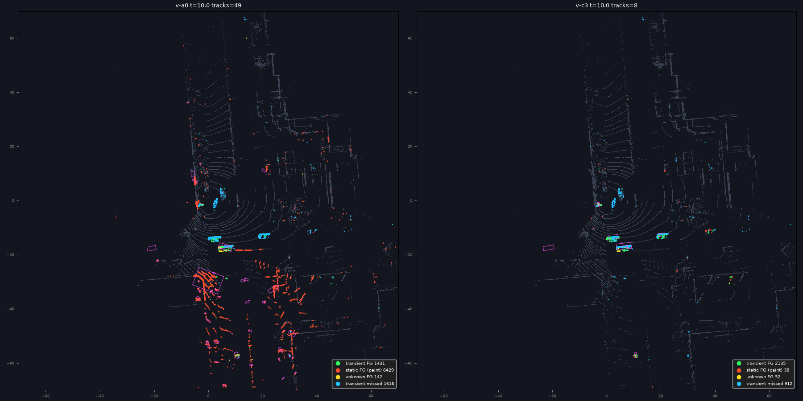
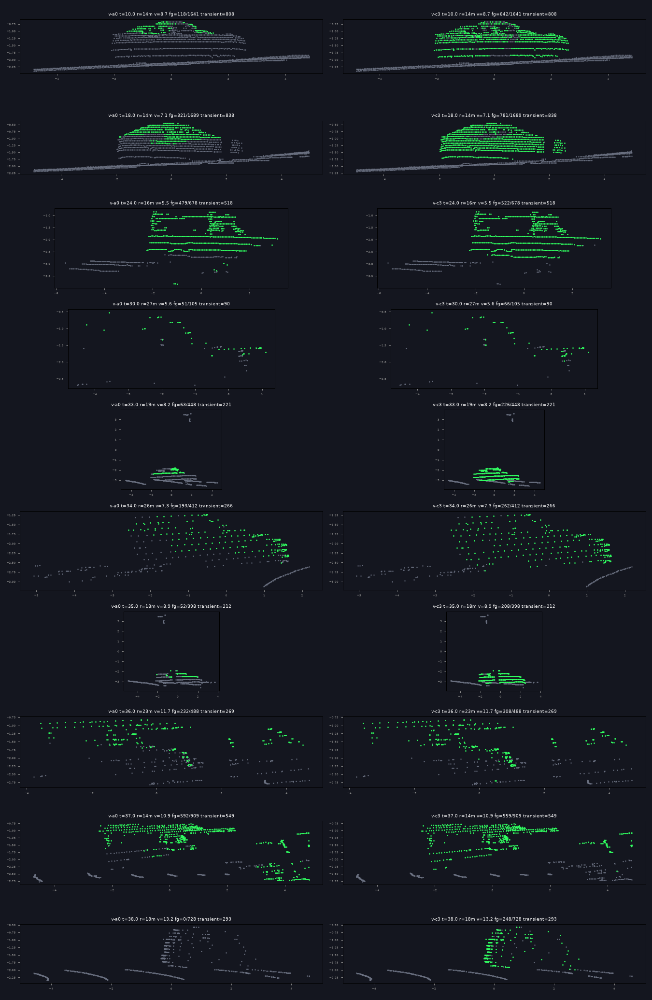
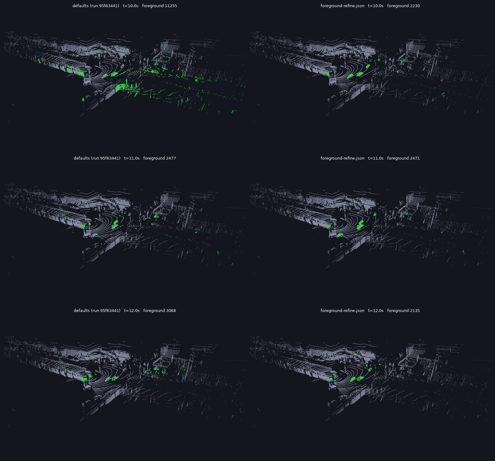

# Foreground refinement: painted background and partial objects, October 2026

Full-frame recordings such as run `95f63441` show two faults by eye: vehicles part foreground and
part background, and walls and road turning foreground as objects pass. This report checks that
the recording is telling the truth, finds the mechanisms, and tests a change that gives the
per-return decision evidence a window depth cannot.

- **Status:** Measured, November 1, 2026 (experiment
  [l3bg0029](../../../data/experiments/l3bg/l3bg0029.md)). The rule's target and quality clauses pass
  on five held-out placements; its replay cost clause fails. Defaults are unchanged. The candidate
  is a parameter set, [foreground-refine.json](../../../config/experiments/foreground-refine.json)
- **Layers:** L3 background, L4 clustering, L5 coasting, the published mask
- **Related:** [region levers](l3-region-levers-kirk-2026-10.md),
  [track guard](l3-track-guard-kirk-2026-10.md),
  [W3 retention](w3-retention-fragmentation-kirk0-2026-10.md),
  [beam-wise comparison](../../../data/maths/proposals/20261011-beamwise-background-subtraction-comparison.md)

## Summary

- **The visualiser shows what the pipeline decided.** It colours each point by the recorded
  classification bit, and that bit is the published mask. Both faults are real pipeline output, not
  a display artefact. A fresh replay of the same window reproduces the recording's geometry exactly
  and 97.4 % of its point classes at the current commit.
- **Painted background has three causes.** A vehicle that stood through settling and left, whose
  revealed road and walls read as foreground (763 of 820 painted returns in the frame examined were
  5 to 24 m _behind_ the surface the cell had learned). Frozen cells, which call every return
  foreground for 5 s whether or not it matches. And edge follow, which publishes a tracked box's
  contents: on lombard-broderick that alone took paint from 905 to 6,440 returns a frame. Boxes then
  form on the paint, so the fault feeds tracking: at 0:10 of the recording, 49 tracks fall to 7.
- **Partial objects come from window width, and traffic widens the window.** A vehicle within a
  cell's acceptance window is background. Each such return also feeds the cell's spread at the
  boosted re-acquisition rate, so the cell widens for the next vehicle: remaining misses sat in cells
  with a median spread of 2.1 m.
- **The fix adds evidence rather than moving a window.** A return beyond the learned surface is
  background, and an agreed run of them relearns the cell. A return in front of the surface but
  accepted by the window is weak: it joins connected foreground, or comes in as a patch if enough of
  it is new to its cells. Freeze and edge follow are switched off.
- **Five held-out placements, against the defaults:** coherent moving returns kept 0.62 to 0.91,
  moving-track time ×1.97, median moving-track life ×1.86, structure paint ×0.12, stationary tracks
  ×0.68, median medoid jitter ×0.87 and p90 ×0.81. Replay time rose 17 to 19 %, which fails the
  rule's 10 % clause.
- **On kirk0's reviewed objects:** ID switches 440 to 117, identity recall 0.59 to 0.70, truck
  fragmentation 48 % to 21 %, the bus 0.65 to 0.98 of returns clustered. The labelled road users are
  covered by 23 tracks instead of 47, with median life 14.5 s against 6.4 s.
- **HOTA and false positives get worse and should not be read as a loss.** The pack labels only the
  objects a reviewer selected. 24 of the unlabelled tracks the candidate adds travel at least 10 m,
  and the track-by-track reading below shows the ones checked are queueing cars and pedestrians.
- **A real bug on the way.** `max_cluster_diameter`, `min_cluster_diameter` and
  `max_cluster_aspect_ratio` never reached L4 from a tuning file: only the embedded defaults did. A
  whole bus side, 14 m long and 36:1, was discarded by a limit no parameter set could change.

## The recording against the pipeline

Run `95f63441` is lombard-laguna from 60 s to 150 s of the capture, 901 full frames at build
0.5.1-pre47, under the then defaults. Its grid is 10 s old at the frames in question, because a
replay that starts at 60 s starts its background there.

- **Display.** The visualiser passes each point's classification to the shader and draws class 1
  green. It applies no decimation of its own in this view.
- **Recording.** `adaptFullFrame` writes the classification from the mask it is given, which is the
  published mask: L3's own plus edge follow.
- **Replay.** Frames 95 to 125 from the VRLOG match a replay at the current commit point for point in
  position, and differ in class on 2.6 % of returns, the difference between the two builds.

So the fault is in the mask. To say which rule decided each return, L3 gained a decision trace
(`BackgroundManager.SetDecisionTrace`, off by default) and a new tool,
[lidar-fg-diag](../../../cmd/tools/lidar-fg-diag/main.go), dumps any frame of a VRLOG or a replay with the
rule, cell state and window per return.

## Measuring without labels

Only kirk0 has labels, and they are partial, so the tool builds an independent reference per
capture. `lidar-fg-diag oracle` collects each cell's range samples over up to 6 minutes of capture
and finds its persistent surfaces: ranges the cell returns from in at least 8 % of frames. It reads
no L3 state.

- A return on a surface present in at least half the frames is **structure**. Foreground on it is
  structure paint. A surface present less often may be a vehicle queueing, which is an object, so
  it is counted apart as other paint.
- A return in front of every surface, in a cell whose returns are mostly on surfaces, with at least
  three such neighbours, is **coherent transient**. Recall is the share L3 keeps. Vegetation cells
  and returns beyond every surface are unknown and left out.
- Tracks are confirmed tracks. **Moving** means at least 5 m net in at least 1 s; **stationary** means
  under 2 m. **Medoid jitter** is the RMS residual of each measured medoid from a quadratic fitted to
  its ten neighbours, the median and p90 taken over tracks.

This is observed evidence about a capture, not physical truth. Its limits are listed below.

_Lombard-laguna at 0:10, from above. Red is published foreground on a persistent surface, green on a
moving return, blue a moving return missed, magenta a track's box. Defaults left, 8,429 static
returns and 49 tracks; an earlier stage of the candidate right, 38 and 8._

## What decided each return

Lombard-laguna 60 to 150 s under the defaults, mean returns a frame after the first 8 s, by the rule
that decided and the oracle's label. Coherent transient returns are about 3,040 a frame.

| Rule                 | Static | Coherent transient |
| -------------------- | -----: | -----------------: |
| Inside base window   | 59,941 |                308 |
| Same, guard held     |  3,013 |                140 |
| Foreground, held     |    256 |              1,473 |
| Foreground           |    180 |                346 |
| Widened window       |     68 |                122 |
| Widened window, held |     48 |                139 |
| Locked baseline      |     49 |                296 |
| Neighbour confirmed  |     15 |                157 |
| Frozen, cell matches |     98 |                 13 |
| Frozen, diverges     |     36 |                 41 |

L3 keeps 62 % of coherent transient returns. Static foreground is 571 returns a frame in L3's mask
and 1,054 in the published mask, the difference being edge follow.

## The change

An optional tuning block, `l3.ema_baseline_v1.foreground_refine`, absent from the defaults so their
fingerprint does not move. Code: [foreground_refine.go](../../../internal/lidar/l3grid/foreground_refine.go).

1. **One-sided decision.** A return beyond the cell's surface by more than the window is background.
   Ten consecutive far returns agreeing on one range relearn the cell. The agreement matters: without
   it, cells seeing through foliage relearned to a far range and every near return became foreground.
2. **Weak returns.** A background return more than `0.5 m + 2 spreads + 0.5 % of range` in front of
   the surface is weak. Its contribution to the cell's spread is capped at 0.5 m.
3. **Hysteresis.** Weak returns connected to foreground through similar-range neighbours (two rings,
   three bins) become foreground. A weak patch with no such neighbour stays background.
4. **Novelty.** Each cell keeps a near envelope: how close its background returns have recently come,
   moving 30 % of the way to a nearer return and 0.5 % to a farther one. A weak patch with ten returns
   in front of their envelope comes in by itself. Flicker teaches its cells within a few returns;
   foreground teaches the envelope nothing, so a passing vehicle stays new to the next one.
5. **The support filter** runs on the result, at its shipped parameters.

The parameter set also changes five existing keys. Freeze goes: `freeze_duration` 0s. Edge follow
goes: `edge_follow_cluster` false. The filters open, `max_cluster_diameter` 20 and
`max_cluster_aspect_ratio` 60, because a whole bus is what they used to reject. And three values
retune on the fuller masks: `foreground_dbscan_eps` 1.0, `foreground_min_cluster_points` 8 and
`max_misses_confirmed` 25. `max_cluster_*` are startup-only on the server, so run the set with
`--config config/experiments/foreground-refine.json`, not from the replay form's dropdown.

_Vehicles in the recording's window, seen side on. L3 mask, green foreground, grey background;
defaults left, candidate right._

## Development set

Everything was chosen on seven captures: kirk0, the 90 s of the recording, and the first 200 s of
five placements, scoring from 30 s. The rule was written before the held-out read. Results for the
final candidate, defaults → candidate:

| Site                    | Recall      | Structure paint | Moving track s | Median life s | Stationary | Unassoc/frame | Jitter m      | Jitter p90 m  |
| ----------------------- | ----------- | --------------- | -------------- | ------------- | ---------- | ------------- | ------------- | ------------- |
| lombard-laguna 60–150 s | 0.62 → 0.91 | 965 → 0         | 509 → 951      | 4.6 → 9.1     | 99 → 19    | 1.73 → 0.62   | 0.364 → 0.259 | 0.672 → 0.482 |
| embarcadero-folsom      | 0.59 → 0.93 | 52 → 18         | 1474 → 3220    | 6.1 → 9.5     | 104 → 63   | 0.51 → 0.48   | 0.248 → 0.197 | 0.599 → 0.444 |
| haight-divisadero       | 0.62 → 0.92 | 644 → 26        | 252 → 479      | 3.6 → 5.3     | 45 → 18    | 0.30 → 0.08   | 0.164 → 0.143 | 0.347 → 0.200 |
| howard-6th              | 0.35 → 0.84 | 128 → 1         | 764 → 2010     | 5.3 → 8.2     | 58 → 46    | 0.41 → 0.26   | 0.265 → 0.186 | 0.515 → 0.455 |
| lombard-broderick       | 0.41 → 0.81 | 5921 → 31       | 1891 → 3014    | 4.3 → 7.6     | 129 → 52   | 1.48 → 0.71   | 0.370 → 0.322 | 0.658 → 0.503 |
| 3rd-folsom              | 0.44 → 0.87 | 52 → 1          | 1046 → 2619    | 5.3 → 7.5     | 95 → 111   | 0.53 → 0.41   | 0.260 → 0.179 | 0.637 → 0.340 |
| kirk0                   | 0.78 → 0.99 | 292 → 187       | 423 → 677      | 6.8 → 10.5    | 43 → 20    | 0.31 → 0.18   | 0.173 → 0.169 | 0.370 → 0.306 |

kirk0's remaining structure paint is mostly the parked car, which is an object sitting on a
persistent surface by the oracle's definition. Length jitter fell by 31 % on the mean of site ratios,
and tracks travelling over 20 m rose from 492 to 730. Broken links, a moving track ending and another
starting nearby within 2 s, rose 24 %, in line with 27 % more moving tracks.

### What each part earns

Removing one part from an earlier candidate of the same design, before the L4 and L5 retune, as the
mean of site ratios against that candidate:

| Change                    | All paint | Stationary | Unassoc/frame | Moving track s | Jitter p90 |       Recall |
| ------------------------- | --------: | ---------: | ------------: | -------------: | ---------: | -----------: |
| No one-sided decision     |     ×2.11 |      ×1.22 |         ×1.30 |          ×1.04 |      ×1.21 | 0.86 to 0.82 |
| No novelty                |     ×0.93 |      ×0.92 |         ×0.86 |          ×0.76 |      ×1.02 | 0.86 to 0.82 |
| Edge follow on            |     ×3.38 |      ×1.00 |         ×1.00 |          ×1.00 |      ×1.00 |    no change |
| Freeze paints as it did   |     ×1.23 |      ×1.25 |         ×1.08 |          ×1.01 |      ×0.99 |    no change |
| Freeze removed altogether |     ×0.81 |      ×1.00 |         ×0.97 |          ×0.97 |      ×1.02 | 0.86 to 0.85 |

That candidate kept freeze but classed a matching return in a frozen cell as background. Removing
freeze outright is as good and is one mechanism fewer, so the parameter set does that. Edge follow
adds no tracking value because L4 never sees it, and now that the mask is whole it adds mostly walls.

### What was tried and left out

| Arm                                            | Why it is out                                                                    |
| ---------------------------------------------- | -------------------------------------------------------------------------------- |
| Direct envelope veto                           | Recall 0.92 on lombard-laguna, but clusters +42 %: it needs the patch test       |
| Tight window inside held boxes                 | HOTA 0.50 to 0.47 on kirk0 alone; overlaps hysteresis                            |
| Temporal hysteresis (last frame as a seed)     | Moving time +10 %, stationary tracks +10 %, no jitter gain                       |
| Deferred learning for promoted returns         | Recall 0.92, but stopped vehicles stay foreground for minutes and paint ×2 to ×3 |
| No re-acquisition boost on weak returns        | Worse than the spread cap on every measure                                       |
| Spread cap on all returns                      | Moving time +9 %, structure paint ×1.8 against the weak-only cap                 |
| Rare-return cells as weak                      | No measurable change                                                             |
| `eps` 0.6 m, `eps` 1.2 m, `range_adaptive_eps` | Each behind `eps` 1.0 m on unassociated clusters, jitter or stationary tracks    |
| Height band floor −2.0 m                       | Jitter better, moving track life 10 % worse                                      |
| `hits_to_confirm` 3                            | Stationary tracks +68 %                                                          |
| `obb_centre_v1`                                | Medoid jitter p90 +12 %, broken links +8 %                                       |
| `overlap_end_*`                                | Stationary tracks +45 %, moving time −10 %                                       |
| `cascade`, `likelihood_cost`, `dwell_policy`   | No gain on these measures                                                        |

Parameters are flat. Halving or doubling any of the grow, envelope and margin values moved recall by
under a point and every other measure by under 5 %, with `novel_min_returns` and `weak_spreads` the
two exceptions, each trading found objects for stationary tracks along one curve.

## Held-out placements

Five placements read once, after the rule and the parameter set were committed: the first 200 s of
each, scored from 30 s, with an oracle built per capture from `config/profiles/l3-only.json`.

| Site                 | Recall      | Structure paint | Moving track s | Median life s | Stationary | Unassoc/frame | Jitter m      | Jitter p90 m  |
| -------------------- | ----------- | --------------- | -------------- | ------------- | ---------- | ------------- | ------------- | ------------- |
| bush-powell          | 0.49 → 0.86 | 1490 → 3        | 1111 → 2284    | 7.5 → 13.8    | 103 → 88   | 0.41 → 0.29   | 0.148 → 0.154 | 0.337 → 0.306 |
| marina-webster-beach | 0.74 → 0.95 | 1870 → 2        | 1014 → 1007    | 10.7 → 16.2   | 54 → 26    | 0.27 → 0.21   | 0.212 → 0.189 | 0.318 → 0.272 |
| van-ness-sacramento  | 0.69 → 0.93 | 842 → 107       | 1597 → 2829    | 5.5 → 10.0    | 201 → 107  | 1.95 → 0.52   | 0.296 → 0.187 | 0.581 → 0.321 |
| embarcadero-bryant   | 0.68 → 0.91 | 259 → 107       | 1263 → 3303    | 5.5 → 9.3     | 184 → 169  | 1.06 → 1.69   | 0.222 → 0.211 | 0.479 → 0.513 |
| 1st-mission          | 0.48 → 0.90 | 431 → 26        | 2890 → 6903    | 6.2 → 15.0    | 245 → 146  | 1.01 → 1.00   | 0.192 → 0.159 | 0.514 → 0.329 |

| Clause                                 | Bound               | Result                   | Verdict  |
| -------------------------------------- | ------------------- | ------------------------ | -------- |
| Coherent transient recall              | +0.15               | +0.29                    | Pass     |
| Moving-track seconds                   | +20 %               | +97 %                    | Pass     |
| Structure paint                        | −30 %               | −88 %                    | Pass     |
| Sites improving on moving seconds      | 4 of 5              | 4 of 5, one level at −1% | Pass     |
| Sites improving on structure paint     | 4 of 5              | 5 of 5                   | Pass     |
| Stationary tracks                      | at most +10 %       | −32 %                    | Pass     |
| Unassociated clusters a frame          | at most +15 %       | −13 %                    | Pass     |
| Median and p90 medoid jitter           | no higher           | −13 %, −19 %             | Pass     |
| kirk0 ID switches, parked car left out | no higher           | 440 to 117               | Pass     |
| kirk0 false negatives                  | at most +10 %       | 511 to 536, +5 %         | Pass     |
| kirk0 W3 fragmented instants           | no higher           | 496 to 215               | Pass     |
| kirk0 identity recall                  | no lower than −0.02 | 0.592 to 0.697           | Pass     |
| kirk0 pedestrian retention             | no lower than −0.10 | 0.915 to 0.869           | Pass     |
| Replay wall time on the Mac            | at most +10 %       | +17 to +19 %             | **Fail** |

Embarcadero-bryant is the exception to read: unassociated clusters rise 1.06 to 1.69 and p90 jitter
rises, on a site where moving-track time more than doubles. It is the worst case in this set.

Replay time is measured serially, three repeats each of kirk0 and embarcadero-bryant: 12.9 to 15.2 s
and 29.7 to 35.4 s, CPU time +10 %. On embarcadero-bryant L3 takes 2.2 ms more a frame on the M1,
about half of it refinement and the rest the guard's extra boxes, and DBSCAN 0.8 ms more with more
foreground. Mean frame time stays well under the 98 ms budget on the Mac; the Pi is unmeasured.

## kirk0 labels

The reviewed pack ad8b9438, whole capture, with the parked car `obj_788622b5` left out of scoring, as
the [W3 report](w3-retention-fragmentation-kirk0-2026-10.md) asked. It is labelled in 773 frames, and
the defaults keep it foreground only through freeze. Scoring it counts a correct background as a miss.

| Measure         | Defaults | Candidate |
| --------------- | -------: | --------: |
| ID switches     |      440 |       117 |
| Fragmentations  |       50 |        48 |
| False negatives |      511 |       536 |
| Identity recall |    0.592 |     0.697 |
| AssA            |    0.662 |     0.845 |
| False positives |    1,913 |     4,200 |
| DetA            |    0.356 |     0.217 |
| HOTA            |    0.454 |     0.401 |
| IDF1            |    0.477 |     0.426 |

| W3, by group | Retention    | Missed instants | Fragmented instants |
| ------------ | ------------ | --------------- | ------------------- |
| All          | 0.864, 0.852 | 199, 166        | 22 %, 9 %           |
| Bus          | 0.646, 0.983 | 5, 0            | 13 %, 12 %          |
| Car          | 0.979, 0.980 | 82, 43          | 4 %, 1 %            |
| Pedestrian   | 0.915, 0.869 | 46, 69          | none                |
| Truck        | 0.796, 0.770 | 66, 54          | 48 %, 21 %          |

Most returns lost by trucks are the `foreground_max_input_points` cap, not L3: return fate gives
19.6 % of truck returns to the cap under the defaults. Two of the five pedestrians lose most of the
pedestrian figure; they are near surfaces and small, and the defaults held them through freeze.

**The false positives are mostly real objects.** Confirmed tracks on kirk0, by what they match in
the broader September ground truth, which still lists only objects an earlier run found:

| Tracks                      | Defaults: tracks, obs, median life, median net travel, median points | Candidate                      |
| --------------------------- | -------------------------------------------------------------------- | ------------------------------ |
| Match a labelled road user  | 47, 3,146, 6.4 s, 13.6 m, 44                                         | 23, 3,267, 14.5 s, 44.1 m, 119 |
| Match labelled noise        | 6, 896, 1.4 s, 0.9 m, 12                                             | 3, 396, 3.3 s, 0.0 m, 9        |
| Unlabelled, moved 10 m+     | 5, 205, 3.7 s, 12.2 m, 10                                            | 24, 2,229, 10.2 s, 20.4 m, 67  |
| Unlabelled, moved 5–10 m    | 8, 292, 3.9 s, 7.7 m, 21                                             | 11, 379, 2.2 s, 6.3 m, 25      |
| Unlabelled, moved 2–5 m     | 11, 118, 1.2 s, 3.7 m, 12                                            | 5, 91, 1.2 s, 2.9 m, 17        |
| Unlabelled, moved under 2 m | 31, 191, 0.4 s, 0.3 m, 6                                             | 15, 295, 0.8 s, 0.6 m, 16      |

Followed through time at an earlier stage of the candidate, unlabelled tracks included one crossing
from (−40.6, −12.3) to (−29.1, −21.7) at 1.5 m/s with a 3.6 × 1.3 m box, one from (26, 59) to (2, 16)
at about 5 m/s, and two at a steady 1.4 m/s over 20 m. Those are road users the pack does not hold.
This is motion evidence, not a label: the count of how many of the 24 are real is not established.

_Run `95f63441` against a server run of the candidate, both read from VRLOG, 10 s to 12 s._

## What remains

- **Medoid jitter is now mostly composition.** On long tracks the residual steps with the cluster's
  membership: a vehicle partly occluded loses most of its points in one frame, and the medoid moves
  along the body by a metre. That is an L4 and L5 problem; better masks made it the larger share.
- **Recall is lowest at long range and in cells with wide spreads.** Beyond 45 m on howard-6th it
  was 18 % at the stage measured.
- **Stopped vehicles.** A vehicle that stops is learned by the window as before. Nothing here changes
  how soon, and `dwell_policy` made no difference to these measures.

## What this does not establish

- No physical validation: the oracle is a statistic of the capture, and no measure here says where a
  vehicle was.
- Precision is argued from motion, not measured against complete labels. A complete label set for
  even one capture would settle it.
- kirk0 is development data, and all pedestrian evidence is five objects on that one capture.
- Held-out placements were 200 s each, in daylight, with no rain. A long-running deployment's
  envelope and relearning are unmeasured. Nothing in this run lasted more than six minutes.
- The first 30 s of each replay is unscored, so the behaviour of a grid in its first seconds is
  outside the held-out numbers, though the recording's 10 s frames show it improved.
- The near envelope and far-run state are not persisted, so a restart relearns them. That cost is
  unmeasured.

## Recommendations

1. **Decide on adoption.** The candidate passes every quality clause and fails the replay cost clause.
   Before it can become the default it needs Pi timing (perf0001), a decision to accept motion evidence
   or a complete label set, and a recapture of the perf baselines.
2. **Fix the bug regardless.** The L4 filter fix in this change is independent of the candidate.
3. **Retire edge follow's published box** or restrict it to returns in front of the surface. It costs
   nothing to L4 and is the largest single source of paint on some sites.
4. **Remove freeze** if the candidate is adopted. Keep it otherwise: alone, removing it costs pedestrian
   retention, because it holds them against the window.
5. **Complete kirk0's labels.** Partial labels now score a better detector as worse.
6. **Next for jitter:** the [mean of the cluster's returns](l4-cluster-mean-centre-2026-11.md), measured
   after this report. Splits and duplicates turned out small: 1 to 6 % of moving track-frames, and 0 to
   4 pairs a capture.

## Provenance

- **Code:** branch `claude/vrlog-foreground-extraction-f1a9a3`, from `3b49a1ac7`. Replays and scores at
  `7d2527ea0`; the scoring binaries were built from that tree just before it was committed and are
  stamped `f0d1db883`. The server recording is stamped `7d2527ea0`, version 0.5.1-pre50.
- **Parameter sets:** [foreground-refine.json](../../../config/experiments/foreground-refine.json),
  SHA-256 `cb37e11e7d96c1ad…`; defaults `aefcc10ca9ed1e3c…`.
- **Captures:** kirk0 `2864ebde38e736b4…`; `sf-street-speeds/raw/lidar` placements named above, stage
  copies read from the internal disk.
- **Reference:** pack ad8b9438, `kirk0-reference-tuning-r1.json`, `-ignore-objects obj_788622b5`;
  `kirk0-tuning/ground-truth.json` for the track attribution.
- **Recordings:** run `95f63441` (build `ab787541c`), and its counterpart `0f0d37a9` from a server
  started with `--config config/experiments/foreground-refine.json`, 901 full frames.
- **Tools:** [lidar-fg-diag](../../../cmd/tools/lidar-fg-diag/main.go): `oracle`, `score`, `replay`, `vrlog`;
  [render_frames.py](../../../tools/lidar-fg-diag/render_frames.py) draws its dumps.
- **Raw output:** `~/vr-scratch/fg-20261031/`, untracked: score JSON per arm and case, frame dumps,
  kirk0 evidence, rendered frames.
