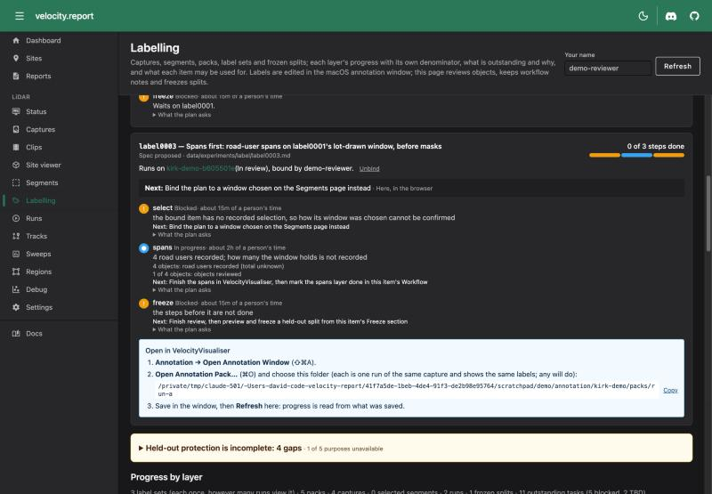
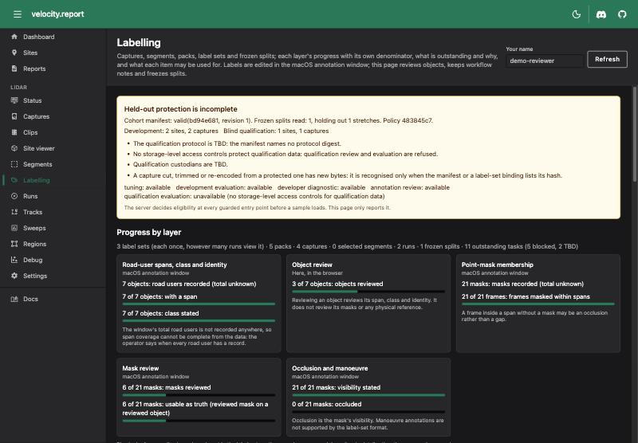
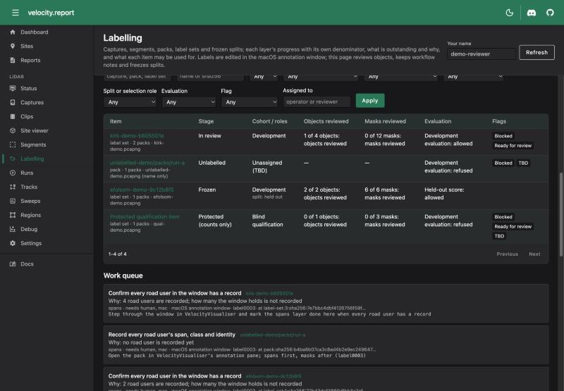
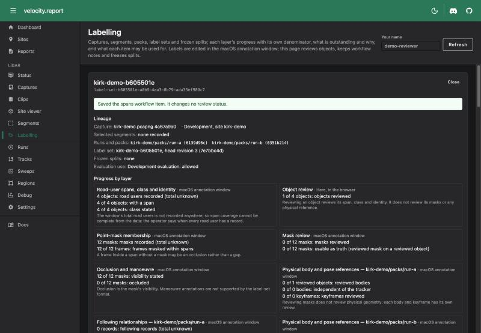
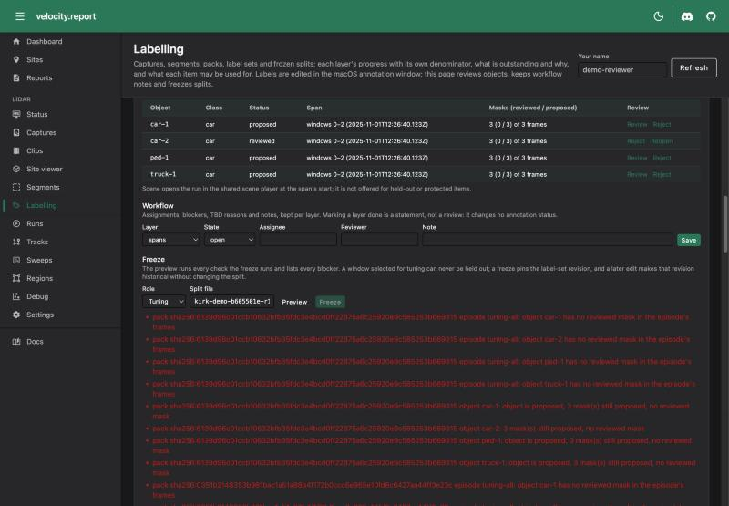
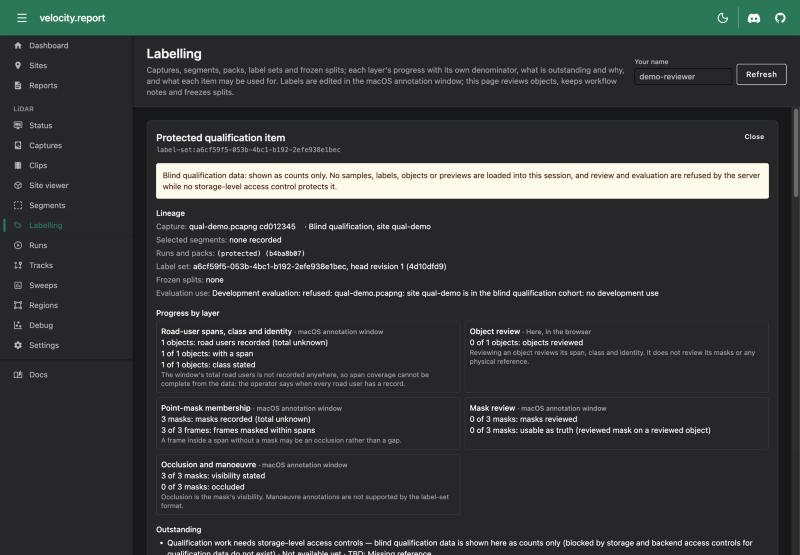

# Labelling workspace

The labelling workspace (`/app/lidar/labelling`, **Labelling** under LiDAR in the navigation)
shows what captures, segments, clips, runs, packs, label sets and frozen splits exist; how far
each layer of labelling and review has got; what is outstanding, blocked or TBD and why; and what
each item may be used for. It sits beside the
[development eligibility guard](#development-eligibility), which decides at the server's entry
points, before a sample loads, whether a capture may be used for tuning, sweeps, development
evaluation or diagnostics.

- **Status:** delivered for the browser workflow below; cohort assignments, qualification access
  controls and several evaluators remain [outstanding](#outstanding-prerequisites)
- **Plan:** [qualification cohort isolation](../../plans/lidar-qualification-cohort-isolation-plan.md)
  (in progress, not complete)
- **Code:** `internal/lidar/eligibility` (with `eligibilitycli`), `internal/lidar/labelwork`,
  `internal/lidar/storage/labelworkdb` (the tables),
  `internal/lidar/server/workspace_api.go`, `internal/lidar/server/eligibility_api.go`,
  `web/src/routes/lidar/labelling/+page.svelte`



## Expected work

The page opens on the labelling plans the repository expects, `data/experiments/label/*.md`
(label0001 masks and review, label0002 physical references and following, label0003 spans first).
A plan says what is to be done on one window; it is never evidence that labelling happened.

Each plan is **bound** to the window it is run on (the item's key, kept in `lidar_plan_bindings`,
revision-checked, with its history). Every step's status is then read from that window's stores:

| Step        | Done when                                                                                                                                                                                                         |
| ----------- | ----------------------------------------------------------------------------------------------------------------------------------------------------------------------------------------------------------------- |
| `select`    | The window has a recorded selection that meets the plan (drawn by the random finder, in the held-out role, for a plan "by lot"), and its pack is cut. A tuning selection is blocked: it can never become held out |
| `spans`     | Road users are recorded and the operator has marked the spans layer done (the window's total is not recorded)                                                                                                     |
| `propose`   | Every frame inside every span has a mask and the operator has marked masks done                                                                                                                                   |
| `review`    | Every object and every mask is reviewed                                                                                                                                                                           |
| `fit`       | Every reviewed object has a reviewed body in one of the window's packs, with no stale record                                                                                                                      |
| `following` | Every following record is reviewed and the operator has marked following done                                                                                                                                     |
| `freeze`    | A split pins the current label-set revision with the plan's role (held out), and for label0002 the physical references; a split pinning an older revision is in progress                                          |

A step no store records is shown as not tracked. A plan that depends on another (label0002 on
label0001) is blocked until that one is done. The card's **Next** is the first step not done, and
where it is done: here, in the macOS annotation window, or on the command line. label0001 and
label0003 are one window, so both are bound to the same item.

### What to open in VelocityVisualiser

Every bound plan and every item says exactly what to load:

1. **Annotation → Open Annotation Window** (⇧⌘A).
2. **Open Annotation Pack…** (⌘O) and choose the pack folder the page shows, with a copy button. A
   label set's views are runs of the same capture and show the same labels; any will do.
3. To follow the frames in the main window, replay the run's recording (the VRLOG path shown).
4. Save in the window, then **Refresh** the page: progress is read from what was saved.

An item with no pack yet says so: queue the clip's pack on the Windows page.



## Data and sources of truth

```text
capture file (SHA-256 of its bytes)
  └─ selected segment (lidar_segment_selections: role, finder, selector, window)
       └─ clip (lidar_clips) ── run (lidar_runs, VRLOG)
            └─ pack (<capture>/packs/<run>, <capture>/<set>/views/<view>, clip-<job>/pack)
                 └─ label set (labels.json + journal; one per capture, shared by every run's pack)
                      └─ frozen split (<annotation root>/splits/*.json, write-once)
                           └─ evaluation use (lidar_data_uses)
```

| Record                                    | Source of truth                                                                 | The workspace reads                                     |
| ----------------------------------------- | ------------------------------------------------------------------------------- | ------------------------------------------------------- |
| Objects, masks, their review              | The label set ([format](../../../internal/lidar/annotation/labelset/README.md)) | Its head, cached against `labels.json` and the journal  |
| Physical bodies, keyframes, following     | The pack's `physical-references.json`                                           | Per pack, cached against the document and the label set |
| Held-out and tuning partitions, pins      | Frozen splits beneath the annotation root                                       | Every split file, every request                         |
| Segment selections, clips, runs           | The database                                                                    | The newest 2,000 selections with their pack jobs        |
| Cohort assignment                         | The cohort manifest (`--lidar-cohort-manifest`)                                 | On every decision                                       |
| Use and exposure history                  | `lidar_data_uses` (migration 70), append-only                                   | Per capture and measure family                          |
| Assignments, blockers, TBD reasons, notes | `lidar_workflow_items` and `lidar_workflow_events` (migration 70)               | Every item, and an item's history                       |
| Plans                                     | `data/experiments/label/*.md`                                                   | As planned work, never as evidence                      |

A label set cites a capture's returns by packet, so it applies to every run of the capture. The
workspace makes it one row however many runs' packs view it, and counts its objects and masks
once: two views are not two labelled datasets, and reviewing an object once is not two reviews.
Physical references are the exception: they live in each pack, so they are shown per pack and
never summed across views.

Workflow state is not annotation truth. Annotation review statuses are `proposed`, `reviewed` and
`rejected`; `open`, `in_progress`, `blocked`, `tbd` and `done` are workflow states kept beside
them. Saving a workflow item, or marking a layer done, changes no review status. Every workflow
write names the revision it was based on and is refused (409) when someone saved since; the page
reloads instead of overwriting them.

## Progress measures

Each layer is counted on its own, with its own denominator. No layer is folded into another and
there is no overall percentage. A total nothing records is shown as unknown, never as zero and
never as the count of what happens to exist.

| Layer                               | Counts                                                                                           | Total                                        |
| ----------------------------------- | ------------------------------------------------------------------------------------------------ | -------------------------------------------- |
| Road-user spans, class and identity | Objects recorded (not rejected); with a span (a mask in at least one window); class stated       | Road users in the window: **unknown**        |
| Object review                       | Objects reviewed                                                                                 | Objects recorded                             |
| Point-mask membership               | Masks recorded; frames masked within each object's span                                          | Masks: unknown; frames: the windows in spans |
| Mask review                         | Masks reviewed; usable as truth (a reviewed mask on a reviewed object, as `ReviewedMasks`)       | Masks recorded                               |
| Occlusion and manoeuvre             | Masks whose visibility is stated; occluded masks. Manoeuvre is not in the format                 | Masks recorded                               |
| Physical body and pose (per pack)   | Reviewed bodies; bodies independent of the tracker; keyframes reviewed                           | Reviewed objects; reviewed bodies; keyframes |
| Following relationships (per pack)  | Following records; reviewed                                                                      | Follower intervals: **unknown**              |
| Freeze readiness                    | Objects a freeze would refuse (not reviewed, no reviewed mask, a proposed mask, no completeness) | The canonical check is the freeze preview    |
| Evaluation readiness                | The eligibility verdict for a development evaluation, or a held-out score under its split        | Allowed or refused, with every reason        |

A span is not a mask, and a reviewed span is not a reviewed mask: the spans layer can be full
while masks and physical references are empty. Reviewing an object reviews its span, class and
identity; it does not review its masks, and reviewing masks does not review physical geometry.
An edit after a freeze moves the label set's head; the split keeps the revision it pinned, the
row is flagged `stale_revision` and the split shows its revision as historical.

A label set, pack, split file or database that cannot be read makes its rows **unavailable** and
its source is named at the top of the page. Totals over label sets are then unknown rather than
smaller.

## Working an item



Filters (search, capture, run, kind, stage, cohort, split or selection role, evaluation, flag,
assignee) are applied by the server and the rows are paged, so a large inventory never loads
whole. Every outstanding item in the work queue says what to do next, why, what it waits on,
whether it needs a person, a Mac (the native annotation window) or the command line, and the
revision it was derived from.



In the browser an operator can:

- review, reject or reopen an object (its span, class and identity) against the label-set
  revision on screen (`POST /api/lidar/annotations/objects/review`); a stale revision is refused;
- keep workflow state per layer: assignee, reviewer, blocker, TBD reason and note;
- review physical records through the existing physical-reference endpoints;
- preview a freeze, which lists every blocker from the canonical `PreviewFreeze`, and freeze
  through `POST /api/lidar/annotations/split/freeze`, which pins the revisions and digests;
- open the run in the shared scene player (the Tracks page) at a span's start, except for
  held-out and protected items, whose tracker previews stay hidden for blind review.



### Native-only operations

These are made in VelocityVisualiser's annotation window and are **not** available in the
browser. The page names the pack to open and lists the task as outstanding:

- drawing, propagating and editing point masks, and second-pass mask review;
- creating objects and recording spans (label0003's spans-first pass);
- authoring and editing physical bodies and keyframes (the fit endpoint drafts, the window edits);
- drafting following records (`velocity lidar annotation-reference draft-following`);
- binding a label set to its capture file (`velocity lidar labels bind`).

### TBD

TBD always carries a reason: purpose unassigned, missing reference, criterion undecided, source
unavailable, required case missing, or other with a note. TBD never means "safe for tuning": an
unassigned capture is refused for every development purpose.

## Development eligibility

The eligibility service (`internal/lidar/eligibility`) keeps four things apart:

1. **Cohort assignment** of the capture's site: development, validation or qualification, from
   the cohort manifest.
2. **Split role** of its objects or cases in any frozen split: tuning, held_out (or screen for
   corpus cases).
3. **Use history**: every gated decision, per input and measure family (identity, noise and
   counts; geometry; ground; settling).
4. **Labelling and review completion**: the progress above.

A capture is identified by the SHA-256 of its bytes, computed by the server or tool from the file
and cached against its path, size and modification time. A basename is used only to notice a
collision. Renaming or copying a capture keeps its hash and so its restrictions; a new run ID
changes nothing.

### Rules

| Request                                                                      | Decision                                                                                                                           |
| ---------------------------------------------------------------------------- | ---------------------------------------------------------------------------------------------------------------------------------- |
| Production (ordinary replay, processing, publication)                        | Not gated and not recorded                                                                                                         |
| Any gated purpose, no ledger                                                 | Refused: an unrecorded use is not a permitted one                                                                                  |
| Development purpose, no cohort manifest                                      | Refused: every capture is unassigned                                                                                               |
| Manifest invalid (a site in two cohorts, a capture listed twice, a bad hash) | Refused for every input                                                                                                            |
| Capture not in the manifest                                                  | Refused (`cohort_unassigned`)                                                                                                      |
| Same name as a listed capture, other bytes                                   | Refused (`capture_conflict`)                                                                                                       |
| Validation cohort                                                            | Refused for tuning, diagnostics and development evaluation                                                                         |
| Qualification cohort                                                         | Refused for development; review and qualification evaluation need storage-level access controls (none exist) and a named custodian |
| Held out by any frozen split, split named or not                             | Refused for tuning, diagnostics and development evaluation; allowed as a held-out score, as annotation review                      |
| Name matches a held-out capture whose verified hash differs                  | Refused (`hash_mismatch`)                                                                                                          |
| Held-out score of anything any lineage tuned on                              | Refused (`tuned_in_lineage`)                                                                                                       |
| Held-out score for a measure the capture was read for in development         | Refused for that measure (`exposed_for_measure`); other measures stay unread                                                       |
| A frozen split cannot be read, or no annotation root is configured           | Refused: what it holds out cannot be known                                                                                         |
| Annotation review                                                            | Allowed and recorded for unassigned and held-out data; refused for possible qualification data                                     |

The cohort is checked first and nothing below it relaxes it: an unread measure on a validation
capture is still refused. A client never names its own purpose: each entry point implies one, so
an extra `purpose` or `role` field in a request body changes nothing.

Every gated decision is recorded in `lidar_data_uses` with its purpose, measure, source interval,
experiment and run, the actor (as stated, beside the remote address; the server has no sign-in),
entry point, build, configuration, the policy digest (manifest and split registry) and split
digest, and every reason. Refusals are recorded too.

### Enforcement coverage

`GET /api/lidar/eligibility` serves this table beside the live status.

| Entry point                                                                                                                                                                                                      | Purpose                | Enforcement                                                       |
| ---------------------------------------------------------------------------------------------------------------------------------------------------------------------------------------------------------------- | ---------------------- | ----------------------------------------------------------------- |
| `POST /api/lidar/sweep/start`                                                                                                                                                                                    | tuning                 | Enforced before the sweep starts (PCAP or live sensor)            |
| `POST /api/lidar/sweep/auto`                                                                                                                                                                                     | tuning                 | Enforced before the auto-tuner starts                             |
| `POST /api/lidar/sweep/hint`                                                                                                                                                                                     | tuning                 | Enforced for every capture of the clip                            |
| `POST /api/lidar/pcap/start` with a `tuning_config` under `experiments/`                                                                                                                                         | development evaluation | Enforced before the configuration is applied                      |
| `POST /api/lidar/pcap/start` otherwise                                                                                                                                                                           | production             | Not gated: replays, scene assets and publication are unchanged    |
| `lidar-state-estimation-baseline`                                                                                                                                                                                | development evaluation | Enforced before any capture is read; held-out scores name a split |
| `lidar-refinement-eval`                                                                                                                                                                                          | development evaluation | Enforced before the capture is replayed                           |
| Labelling workspace                                                                                                                                                                                              | developer diagnostic   | Qualification items served as counts only                         |
| `lidar-box-eval`, `lidar-near-face-eval`, `lidar-ground-truth-eval`, `settling-eval`, `lidar-fg-diag`, `lidar-track-scorecard`, `lidar-evidence-oracle`, `lidar-closeness-audit`, `lidar-bench`, `vrlog-analyse` | development evaluation | **Not yet**: they check a split when given one                    |
| Tracks, Runs and scene pages                                                                                                                                                                                     | developer diagnostic   | **Not yet**: they show any run the database holds                 |

A replay under default parameters through `pcap/start` cannot be told apart from production
processing, so a person who replays a protected capture that way and reads the run is not
stopped. The guard covers the entry points that tune or run an experiment arm.

### Configuring it

Start the server with `--lidar-cohort-manifest PATH` beside `--lidar-annotation-dir`. The offline
evaluators take `-cohort-manifest`, `-annotation-root`, `-eligibility-db` (a database migrated to
version 70; start the server on it once) and `-actor`, or `VELOCITY_COHORT_MANIFEST`,
`VELOCITY_ANNOTATION_ROOT` and `VELOCITY_ELIGIBILITY_DB`; `-measures` names the families a run
reads (empty is all four, the strictest).

**Breaking:** without a manifest, sweeps, auto-tune, HINT, experiment-arm replays and the two
evaluators above are refused. That is the fail-closed rule; the assignments themselves are a
decision for the owner (below). The first revision is committed at
[`config/cohorts/cohort-manifest.json`](../../../config/cohorts/cohort-manifest.json): Kirkham at
9th (kirk0, kirk1 and kirk2) in the development cohort, by
[D-40](../../DECISIONS.md#d-40--external-reference-campaign-answers). Revision 2 (a draft until
the owner merges it) adds the 23 first-segment S2 screening sites, every fourth in capture order
validation and the rest development, and the held-out Embarcadero–Folsom site as qualification.
Every other capture is still unassigned and refused.

The manifest's shape (identifiers are placeholders):

```json
{
  "schema": "velocity.report/cohort-manifest",
  "schema_version": 1,
  "revision": 1,
  "frozen_utc": "2026-11-05T00:00:00Z",
  "protocol_digest": "",
  "sites": [
    {
      "site_id": "example-site",
      "s2_l10": "",
      "s2_l13": "",
      "cohort": "development",
      "rationale": "why"
    }
  ],
  "captures": [
    {
      "capture_id": "example-1",
      "site_id": "example-site",
      "raw_sha256": "sha256:<64 hex>",
      "basename": "example.pcapng"
    }
  ],
  "live_sources": [{ "sensor_id": "hesai-pandar40p", "site_id": "example-site" }],
  "access": { "qualification_storage_restricted": false, "custodians": [] }
}
```

A capture takes its site's cohort; a capture line that states another is a conflict, so a site
cannot be split across cohorts. The manifest's digest is part of every decision's policy digest.

## Blind qualification



The workspace may show aggregate counts about qualification data: how many objects and masks,
how far review has got. It never serves their pack handles, label-set paths, object lists,
labels, tracker previews or per-example results to a developer session, and the page fetches
nothing more about them. That is a property of the server's responses, not of hidden buttons.

Isolation proper needs storage-level access controls for qualification annotations, expected
answers and residuals. This repository has none: the server's HTTP API has no sign-in, and a
manifest's `qualification_storage_restricted` claim is not trusted. So qualification review and
qualification evaluation are **refused**, and the page says protection is incomplete.

## Outstanding prerequisites

- **Cohort assignments** (partly TBD): Kirkham at 9th is development (D-40, manifest revision
  1). Which other L10 regions and sites are development, validation and qualification, the
  preregistered protocol digest and qualification custodians are still to choose; until then every
  other capture is refused for development use.
- **Storage-level access controls** for qualification data, and an authenticated actor. The
  workspace records operator names as stated.
- **The remaining evaluators and the Tracks and Runs pages** (table above).
- **Derived captures**: a capture cut, trimmed or re-encoded from a protected one has new bytes. It
  is recognised only when the manifest or a label-set binding lists its hash; matching by packet
  keys is not implemented.
- **Weak identities**: held-out stretches whose label set was never bound to its capture are
  known by name only. The status counts them.
- **Spans without masks**: the label-set format records a span through its masks. A
  spans-first pass (label0003) makes objects with masks at their first and last frames in the
  native window; the format has no mask-free span record.
- **Manoeuvre annotations** are not in the format.

## API

| Endpoint                                     | Does                                                                                        |
| -------------------------------------------- | ------------------------------------------------------------------------------------------- |
| `GET /api/lidar/workspace`                   | Status, sources, totals, a filtered page of rows, the work queue, plans                     |
| `GET /api/lidar/workspace/item?key=`         | One row with its objects, label-set journal and workflow history (counts only if protected) |
| `PUT /api/lidar/workspace/workflow`          | Save a workflow item against `base_revision`; 409 when stale                                |
| `POST /api/lidar/annotations/objects/review` | Review, reject or reopen an object against `base_revision` and `base_state`                 |
| `GET /api/lidar/eligibility`                 | Protection status, gaps, purposes available, coverage, exposure by capture and measure      |
| `POST /api/lidar/eligibility/check`          | What a purpose would be decided for some captures, unrecorded, granting nothing             |
| `GET /api/lidar/eligibility/uses`            | The use ledger, newest first, paged                                                         |

Nanosecond times and identities are served as decimal strings: a JavaScript number cannot hold a
2026 time in nanoseconds exactly.
