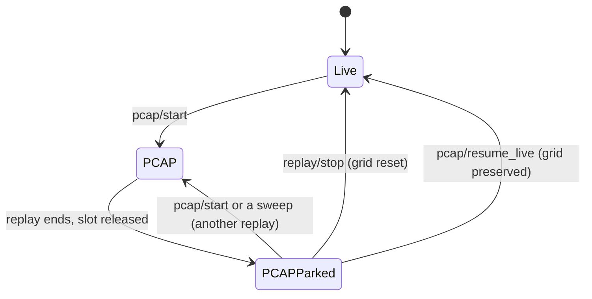
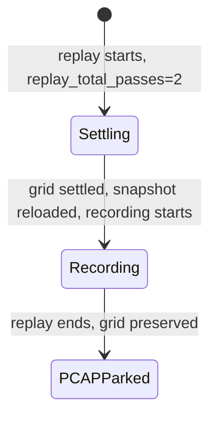

# PCAP analysis mode

PCAP analysis mode replays captured packet data through the LiDAR pipeline while preserving the background grid state for offline inspection and tuning.

## Overview

For isolated headless evaluation, `velocity lidar pcap-replay` does not start the server or
use its saved grid. `--start-seconds` alone skips packets and does not warm anything.
Use `--warmup-seconds` to process a same-capture prefix before the scoring start, with
background and tracker state retained continuously. For example, start 35, warm-up 35,
duration 20 processes capture seconds 0–55 and records frames starting in seconds 35–55.
`--require-settled` rejects a run whose grid is not settled before the first scored frame.
This certifies grid convergence, not a static sensor pose or an empty street.

An offline replay reads packets on its own goroutine rather than through gopacket's packet
channel, which woke a reader goroutine for every packet; the
[measurement](pcap-read-in-place-2026-10.md) found 10 % less CPU and, from local disk, about 3 %
less wall time. Where the captures live matters more: read from the NAS, the same replay took
twice as long as from the internal SSD, so copy a case's captures to local disk before a long run.

Each successful headless run writes `replay_manifest.json` with source/calibration/tuning
hashes, build identity, processing/scoring boundaries, retained-state policy, settling status,
and frame counts. Output directories must be empty. Use identical windows and explicit tuning
files in both arms. Point clouds are omitted unless `--include-points` is set. See the
[heading experiment](../../plans/lidar-heading-d2-implementation-report.md) for evidence limits.

`--observations DIR --clip-id ID` also writes every processed frame's L4 evidence,
warm-up included, to a VRLOG 1.x observation container: the complete L3 foreground in float64,
cluster membership and explicit empty, unsettled and failed frames
([format](../../../data/structures/VRLOG_FORMAT.md#vrlog-1x-observation-container)). The case
identity is required. Coordinates are sensor-frame, because replay applies no site pose, and
the manifest says so. Frames are committed durably as the replay runs, in generations, under
the provisional group-commit policy the manifest declares. A replay that fails keeps what it
committed and ends the container with a failure record saying why.
`velocity lidar observations verify --require foreground-complete DIR` checks a container end to
end and says how its capture ended. `compare A B` confirms two extractions of one source hold the
same evidence. `recover DIR` makes an interrupted container consistent without rewriting what was
committed.

`--experiment NAME[,NAME...]` replays under the offline harness's default-off experiments, with
the same names, validation and combination rules as `lidar-state-estimation-baseline -experiment`
([names](../../../config/CONFIG.md#replay-experiment-names)). It is how a return-fate arm, such as
`region_overrides_cell_tercile` or `dwell_policy`, gets its observation container. An unknown name,
two settings of one option, or a qualifier without what it qualifies is refused before the capture
is read. So are the experiments that need an input `pcap-replay` does not take: `coast_support`,
`class_coast_bounds` and `occlusion_continuity` need a sensor coverage declaration, and `solid_body`
without `near_edge_track` writes only to an evidence database and would otherwise record the
default replay. The names are folded into the parameter hash in `header.json` and listed under
`experiments` in `replay_manifest.json`, in the observation container's provenance (shown by
`velocity lidar observations inspect`) and in the printed summary. The VRLOG `header.json` has no
field for them: adding one would change its schema and every recording's header, so the hash
there identifies the arm and the manifest beside it names it. Without `--experiment` the replay
is configured exactly as before the flag existed.

The server supports two modes for PCAP replay. Both park on their final
frame when the selected window ends. While parked, the server listens for live
packets; a new packet returns the pipeline to live, while a quiet sensor leaves
the replay available for inspection.

1. **Normal PCAP Replay** - Replays the PCAP file and holds its final scene while parked; automatic live handover resets the grid
2. **PCAP Analysis Mode** - Replays the PCAP file and **preserves the background grid** while parked, including across an explicit `resume_live`, for inspection and analysis

## Use cases

### Normal replay mode

- Testing sensor configurations
- Debugging packet parsing issues
- Verifying frame assembly
- Quick validation before returning to live monitoring

### Analysis mode

- **Track Analysis** - Identify and study vehicle trajectories from historical data
- **Background Characterization** - Build accurate background models from known-quiet periods
- **Object Detection Tuning** - Analyse detection thresholds with real-world data
- **Scene Comparison** - Compare PCAP-analysed background with live data overlay
- **Historical Investigation** - Study specific incidents or traffic patterns

## API endpoints

### Start PCAP replay (analysis mode)

```bash
POST /api/lidar/pcap/start?sensor_id=hesai-pandar40p
Content-Type: application/json

{
  "pcap_file": "break-80k.pcapng",
  "analysis_mode": true,
  "settle_before_recording": true
}
```

`settle_before_recording` is optional and requires `analysis_mode`. When enabled,
the server runs the selected PCAP window once without recording so the background
grid can settle, drains the completed frames, reloads that settled grid from the
database, resets transient tracking state, then replays the same window from its
start while recording the VRLOG. This keeps the settling interval in the recorded
run instead of trimming it from the beginning. The request fails without starting
the recorded pass if the selected window is too short to settle or its settled
snapshot cannot be restored.

`tuning_config` is optional: a tuning config file, as a path relative to the
server's config directory (`--lidar-config-dir`, by default the directory of
`--config`), for example `experiments/geometry-convergence-candidate.json`.
The server applies the whole file before it stops the current source, so
the replay runs on exactly those parameters. A file that fails to load or
changes a startup-only key refuses the start before any parameter changes.
The startup-only keys are the engine selectors, the `pipeline` block and L4
keys other than DBSCAN's three. Without the field, the replay runs on the
server's current parameters. See
[Experiment parameter sets](../../../config/CONFIG.md#experiment-parameter-sets).

`full_frames` is optional and defaults to `false` (a JSON boolean, or the form
field `full_frames=true` or `1`). When set, the visualiser stream carries every
frame's whole classified cloud for this replay (class 0 background, class 1
foreground, `frame_type` full, no decimation) instead of split streaming's
foreground points, and the replay's VRLOG records those full frames: its run
has `frame_mode: "full"` (otherwise `"foreground"`) in `GET /api/lidar/runs`
and `GET /api/lidar/runs/{id}`. A full-frames VRLOG is much larger. It needs
the visualiser gRPC stream: a server started without it refuses the start with 400. Full frames can also be switched on while a replay runs (see below), and
always end with the replay.

Every speed mode runs the tuning file's L3 as written. **Until October 2026
(#782) a `scaled` or `realtime` replay substituted five L3 values for the file's
while it ran** (closeness 2.0, safety margin 0.30 m, neighbour confirmation 5,
seed from first observation, noise relative 0.02), so a paced replay ran an L3
its `tuning_hash` did not name, while analysis mode, live input and the offline
tools ran the file. That is a breaking change for reproducing a paced replay
made before it: the scenes published before then ran the substituted L3. That
L3 has since become the defaults' (l3bg0023), and the defaults' previous L3 is
the parameter set `config/experiments/l3-pre-consolidation.json`. See [replay speed and analysis mode](replay-speed-and-analysis-mode-2026-10.md).

A replay starts from nothing, whatever the server replayed before it. Every
replay resets the background grid, including the state its settling check
keeps between checks, so a reused server settles as a new one does. And a PCAP
replay neither restores a region map and grid that an earlier run persisted to
the database (by source path, or by the scene signature when no path matches)
nor persists its own, so the same capture replayed twice against one database
records the same thing both times; a replay with `settle_before_recording`
persists its own settle, which its recorded pass reloads. And a replay's frames
end only on their azimuth wrap: the idle timer that finalises a live frame when
the sensor stops sending no longer cuts a rotation whose reader stalled. Live input keeps
both uses of the store: a sensor restarted on a scene it knows skips settling.
Until October 2026 neither held, and a replay's result depended on the
server's history ([l3bg0021](../../../data/experiments/l3bg/l3bg0021.md)).

**Response:** returns `status: "started"`, `sensor_id`, `current_source: "pcap"`,
`pcap_file` (resolved path), `analysis_mode: true`, the requested
`settle_before_recording` value, and `full_frames`. With `tuning_config`, it also returns
`tuning_config` and `tuning_fingerprint`, the applied file's fingerprint.

### Switch full frames during a replay

```bash
POST /api/lidar/replay/full_frames
Content-Type: application/json

{ "enabled": true }
```

Turns full frames on or off for the PCAP replay that is running now: the
visualiser stream then carries background (class 0) and foreground (class 1)
points in every frame, as FrameTypeFull, instead of split streaming's
foreground only. The macOS visualiser's _Accumulate frames_ uses it to collect
background points from a replay.

- It answers **409** unless a PCAP replay is running: live input never gets
  full frames, a VRLOG replay holds foreground points only, and a finished
  replay has no frames left to send. A server without the visualiser stream
  answers **501**.
- It always ends with the replay. Stopping it, reaching the end of the file,
  resuming live and parking a finished replay all restore split streaming.
- It does not change the recording, whose kind was fixed at the start. In a
  replay started without `full_frames`, the VRLOG is written with the
  foreground-only frames split streaming would have sent (and the empty
  frames, where nothing was in the foreground). A replay started with
  `full_frames` records full frames, so switching them off is refused with
  **409** until it ends. Background snapshots go out as before.
- A clip scene exported from a full-frames VRLOG leaves its background points
  out, as one from a foreground-only VRLOG has none.
- Frames with nothing in the foreground, which split streaming sends as empty
  frames, carry their whole cloud too while it is on.

`sensor_id` is optional, as for `replay/stop`.

**Response:** returns `success: true`, `full_frames` (the state now), and
`current_source`. `GET /api/lidar/playback/status` reports the same state as
`full_frames`.

### List tuning configs

```bash
GET /api/lidar/configs
```

**Response:** returns `config_dir`, `count`, `active` (the `path` and
`fingerprint` of the last applied file; the path is empty before any), and
`configs`, one entry for each `.json` file under the config directory. Each
entry has `path`, `kind` (`tuning`, or `other` for JSON the strict loader
refuses, with `error`), and for a tuning config its `fingerprint`, `profile`,
`engines` and a `solid_body` summary. `applicable` says whether the file can
be applied to the running server, with `reason` when it cannot. `active`
marks the file the last replay start applied. Returns 503 when the server
has no config directory.

### Check data source status

```bash
GET /api/lidar/data_source?sensor_id=hesai-pandar40p
```

**Response:** returns `status: "ok"`, `data_source` (one of the values below), `pcap_file` (path), `pcap_in_progress` (boolean), and `analysis_mode` (boolean).

Data source values:

- `live` - Normal live UDP data collection
- `pcap` - PCAP replay, running or finished without grid retention
- `pcap_analysis` - PCAP replay completed in analysis mode (grid preserved)
- `vrlog` - Replay of a recorded frame log

`pcap_analysis` is derived rather than stored: it means a PCAP source, a
finished replay, and a retained grid. See
[data-source-switching.md](data-source-switching.md) for the state model.

The response also carries `source_path`, `replay_active`, `replay_pass`,
`replay_total_passes`, `grid_preserved`, `live_listener_running`, `recording`,
`recording_path`, and `tuning_config` and `tuning_fingerprint` (the last
applied config file, if any, and the running parameters' fingerprint).

### Resume live data (preserve grid)

```bash
POST /api/lidar/pcap/resume_live?sensor_id=hesai-pandar40p
```

Switches from PCAP analysis mode back to live UDP data **without resetting the grid**. This allows you to overlay live traffic on top of the PCAP-analysed background.

**Response:** returns `status: "resumed_live"`, `sensor_id`, `current_source: "live"`, and `grid_preserved: true`.

### Stop PCAP replay (reset grid)

```bash
POST /api/lidar/replay/stop?sensor_id=hesai-pandar40p
```

Stops PCAP replay and **resets the grid** before returning to live data.

## Workflow examples

### Basic analysis workflow

1. **Start analysis mode replay:**

   ```bash
   curl -X POST "http://localhost:8080/api/lidar/pcap/start?sensor_id=hesai-pandar40p" \
     -H "Content-Type: application/json" \
     -d '{"pcap_file":"break-80k.pcapng","analysis_mode":true,"settle_before_recording":true}'
   ```

2. **Wait for completion and inspect results:**
   - Check grid status: `/api/lidar/grid_status?sensor_id=hesai-pandar40p`
   - View heatmap: `/api/lidar/grid_heatmap?sensor_id=hesai-pandar40p`
   - Export snapshot: `/api/lidar/export_snapshot?sensor_id=hesai-pandar40p`

3. **Resume live data (preserving PCAP background):**

   ```bash
   curl -X POST "http://localhost:8080/api/lidar/pcap/resume_live?sensor_id=hesai-pandar40p"
   ```

4. **When done, reset grid:**
   ```bash
   curl "http://localhost:8080/api/lidar/grid_reset?sensor_id=hesai-pandar40p"
   ```

### Comparative analysis

1. Load PCAP in analysis mode to build background model
2. Resume live data (grid preserved)
3. Live objects will be detected against PCAP-built background
4. Useful for comparing "then vs now" traffic patterns

### Scene reconstruction

1. Process PCAP with empty parking lot → builds clean background
2. Resume live data with grid preserved
3. All detected objects are vehicles/people (not infrastructure)
4. Export snapshot for offline analysis

## Web UI

The LiDAR Status page in the web app (`http://localhost:8080/app/lidar/status`)
replaced the old `:8081` status page in v0.5.2. It includes:

- **Replay a capture** form: a clip or a capture file, with "Analyse and record a
  VRLOG" and optional "Settle the grid, reload, and record from the start"
  checkboxes, plus speed mode and ratio, start and duration, and debug options.
  Selecting settling also selects analysis mode because the warm first pass is
  specifically a VRLOG capture workflow. "Full frames (background and ground in
  every frame; larger VRLOG)" sends `full_frames`, so the replay streams and
  records full frames.
- **Tuning Config dropdown** on the start form, filled on page load from
  `GET /api/lidar/configs`. Each option shows the file, its solid-body summary
  and fingerprint. A file that cannot be applied is disabled, with the reason.
  The default keeps the server's current parameters.
- **Resume live, keep grid** button
- **Stop replay** button (resets grid)
- **Pipeline, Packets, and Replay and recording** panels show the source, the
  packet rates, the replay pass, whether a VRLOG is being recorded, whether full
  frames are on, and the tuning config and fingerprint in use
- The **Runs** page's Frames column says what each run's VRLOG holds: `FG`
  (foreground points only) or `Full`, from the run's `frame_mode`
- **Tuning parameters** editor for the running parameters, and **Maintenance**
  actions (reset grid, reset acceptance, save snapshot, clean up snapshots,
  clear tracks)

## Logging

Analysis mode produces distinct log messages:

```
# Starting in analysis mode
[DataSource] switched to PCAP analysis mode for sensor=hesai-pandar40p file=break-80k.pcapng

# PCAP completion (grid preserved)
[DataSource] PCAP analysis complete for sensor=hesai-pandar40p, grid preserved for inspection

# Resuming live with preserved grid
[DataSource] resumed Live from PCAP analysis for sensor=hesai-pandar40p (grid preserved)
```

Normal mode logs:

```
# Starting normal replay
[DataSource] switched to PCAP replay mode for sensor=hesai-pandar40p file=break-80k.pcapng

# Completion — the replay stays the data source
[DataSource] PCAP replay finished for sensor=hesai-pandar40p; holding this source until live input resumes or an operator switches source
```

## Technical details

### Grid preservation

In analysis mode:

- Background grid statistics remain intact after PCAP completion
- Data source switches to `pcap_analysis` state
- Grid persists through manual live data resume
- Grid survives background flush cycles (persisted to database)

### State transitions

Nothing changes the source on its own. A replay that reaches its end releases
the replay slot and stops there, holding its final frame and the grid it built;
only an operator takes the pipeline back to live.



`PCAPParked` reports `pcap_in_progress: false` with `data_source` still naming
the replay — `pcap_analysis` when the run preserved its grid, `pcap` otherwise.
The visualiser's Live toggle shows this as **Replay** and stays there until
switched back. A parked replay does not hold the replay slot: starting another
replay, or a sweep, auto-tune or HINT run that replays captures, resets the grid
and takes the pipeline over. Only a replay that is still running makes them
wait.

Two earlier designs decided this automatically and both surprised operators.
Choosing from the analysis flag stranded `settle_before_recording` runs, which
carry that flag only because recording a VRLOG requires `analysis_mode=true`.
Choosing from whether the sensor was streaming reset the grid and switched the
source while someone was still reading the replay.

With `settle_before_recording`, the replay runs the selected window twice. Both
passes report `data_source: "pcap"` with `pcap_in_progress: true`, and packet
progress restarts between them, so `replay_pass` names which one is running:



`recording` stays false throughout the settling pass — no VRLOG is opened until
the settled snapshot has been restored.

### Performance notes

- PCAP replay runs as fast as CPU allows (not real-time throttled)
- The optional settling pass is always unpaced; the recorded second pass uses the
  requested replay speed
- Example: 80K packets (28.7M points) processes in ~13 seconds
- Grid preservation has no performance impact
- Resuming live from analysis mode is instantaneous

## Limitations

- Only one PCAP can be in progress at a time
- Analysis mode requires manual resume or stop
- Settle-before-recording needs enough capture time for the configured background
  settling interval and a writable background snapshot database
- Grid reset is irreversible (must replay PCAP to rebuild)
- PCAP files must be in configured safe directory

## See also

- [LiDAR Architecture](../architecture/LIDAR_ARCHITECTURE.md) - Background subtraction (L3) and grid management
- [Data Source Switching](data-source-switching.md) - PCAP replay implementation
- [Foreground Tracking Status](../architecture/foreground-tracking.md#current-operational-status): Current issues and debugging
- [Settling time optimisation](settling-time-optimisation.md) - Settling convergence tuning
- [Adaptive region parameters](adaptive-region-parameters.md) - Region classification after settling
- [Motion capture](motion-capture.md) - Sensor movement detection in L3

---

## PCAP split tool

Automatically segments LiDAR PCAP files into non-overlapping motion and static periods. Enables separate analysis pipelines for mobile observation (driving) and parked data collection.

**Status:** Implemented. Run it as `velocity lidar pcap-split --pcap capture.pcapng --output ./segments` (or the standalone `cmd/tools/pcap-split` wrapper, which is a thin shim over the same engine). `pcap-split` is the single offline tool for **scan, motion stats, and splits**: its summary reports capture health (duration, frame rate from motor RPM, RPM range, points/frame, foreground %) alongside the motion/static segments. To preview the stats and timeline without writing any PCAP files, add `--dry-run`; `--stats-10s` appends per-10-second frame-rate buckets and `--motion-json timeline.json` writes the motion/static timeline to a file. Both offline tools (`pcap-split`, `settling-eval`) take `--config <tuning.json>` and load it via the same disk-or-embedded fallback as the live server, so offline analysis runs the **same algorithms and tuning as live observation** (the background model, motion thresholds, and sensor id all come from the tuning config; `settling-eval`'s old `--tuning` refuses work and prints `--config`). Use `--start-seconds N` and `--duration-seconds N` to limit an offline replay; `0` and `-1` mean the remainder of the capture. When `--port` is omitted the sensor's UDP port is auto-detected from the capture. The detailed breakdown lists each segment by offset seconds by default; pass `--timeline-units frames` or `--timeline-units timestamp` for frame indices or absolute capture time (these diverge when a capture has recording gaps). Long reads print progress lines to stderr every 20 s by default; the scan pass reports percentage, packets, points, RPM, points-per-frame, elapsed time, and rate, while the write pass reports only percentage, packets, elapsed time, and rate. Tune or silence both with `--progress N` (0 disables). Pipeline performance regression testing lives in a separate dev/CI tool, `lidar-bench` (see [performance-regression-testing.md](performance-regression-testing.md)).

### Problem

Long PCAP captures from mobile observation sessions contain mixed driving and parked data. The background model only functions during static periods: motion segments are unusable for perception. Today an operator must manually identify transition points and split files with external tools. This is slow, error-prone, and blocks the mobile-observation workflow.

### Split tool architecture

```
┌──────────────────────────────────────────────────┐
│              pcap-split CLI                      │
│           (cmd/tools/pcap-split)                 │
└──────────────────────────────────────────────────┘
         │                │                │
         ▼                ▼                ▼
  ┌────────────┐  ┌──────────────┐  ┌────────────┐
  │ PCAP Reader│  │  Settling    │  │ PCAP Writer│
  │ (l1packets)│  │  Analyser    │  │ (pcapsplit)│
  │            │  │ BackgroundMgr│  │            │
  │ Parse UDP  │  │ Track metrics│  │ Buffer pkts│
  │ Extract pts│  │ Detect state │  │ Write segs │
  └────────────┘  └──────────────┘  └────────────┘
```

**Key packages:**

| Package           | Location                                   | Role                                                            |
| ----------------- | ------------------------------------------ | --------------------------------------------------------------- |
| PCAP reader       | `internal/lidar/l1packets/network/pcap.go` | Reads PCAP, filters UDP, parses packets                         |
| Settling analyser | `internal/lidar/pcapsplit/analyse.go`      | Pass 1: classifies each frame motion/static via BackgroundMgr   |
| Segment writer    | `internal/lidar/pcapsplit/writer.go`       | Pass 2: copies packets into per-segment PCAPs by timestamp      |
| Orchestration     | `internal/lidar/pcapsplit/run.go`          | Two-pass `Run`; shared by the applet and the standalone wrapper |
| CLI               | `internal/cmd/lidar/split.go`              | Flag parsing → `pcapsplit.Run`; `cmd/tools/pcap-split` wraps it |

### Progress reporting

`pcap-split` runs two passes, and each reports progress to stderr paced by
`--progress` (default 20 s; 0 disables): a `[scan]` line during pass-1
classification (with RPM and points-per-frame, since it decodes every frame) and
a `[write]` line during pass-2 segment writing that shows only percentage,
packet count, elapsed time, and packet rate — the writer copies packets without
decoding per-frame points or motor speed. A `--dry-run` performs
only the scan pass.

### Stability detection

Motion is classified per frame by **sensor ego-motion**, from either of two
signals:

- **Foreground fraction ≥ 0.20** (`SensorMovementForegroundThreshold`) catches
  the _onset_ of motion: when the platform first moves, the scene shifts and
  foreground spikes.

- **Background-drift ratio ≥ 0.50** (`SensorMovementDriftRatioThreshold`) catches
  _sustained_ motion. The drift ratio is the fraction of settled cells whose
  range has shifted past `background_drift_threshold_metres` (0.5 m) from its
  locked baseline. Driving shifts most of the grid at once, while a parked
  sensor changes a smaller share. In the Franklin–McAllister capture, the four
  parked files reached roughly 0.25–0.43 and the neighbouring drives reached
  roughly 0.75–0.95. Foreground alone goes blind to
  long drives once the per-cell spread saturates and the gate widens; the drift
  ratio does not.

Drift ratio is the discriminator because it keys on **ego-motion** (most of the
grid moving at once), not **scene activity**. The earlier sustained-motion
signal — mean per-cell range spread over the noise floor — conflated the two: a
busy parked scene inflates per-cell spread exactly as driving does, so a sensor
parked in heavy traffic was mislabelled as moving for its entire stay. Drift
ratio separated them in the original busy-street calibration. The later
Franklin–McAllister recording showed that 0.35 was too sensitive for another
parked scene; the default is now 0.50. A custom tuning file can set a different
threshold for a particular sensor or capture population.

A parked sensor stays below both thresholds — even while its background model is
still settling at the start of a capture, and even when heavy traffic crosses an
otherwise static scene. Settled-cell % is exported as diagnostic evidence but
does not gate the decision. It uses the shared `locked_baseline_threshold`.

The classifier advances warmup and frozen-cell state from PCAP timestamps, not
wall-clock replay time. Replay mode exposes foreground during warmup without
changing L3 tuning values. On a continuous recording, the offline classifier
refreshes its background every 60 capture seconds: a locked baseline from the
previous junction otherwise keeps reporting motion for minutes after a stop.
The 60-second settling hysteresis absorbs short refresh dips during driving;
the 7-second motion trigger absorbs startup foreground spikes while parked.
This refresh policy is specific to
offline motion classification; the per-frame L3 model parameters remain those
of the selected tuning profile.

**State machine:**

- **Motion → Static:** 60 s sustained stability (configurable via `--settling-sec`)
- **Static → Motion:** 7 s sustained motion
- **Intersection bridging:** pauses < 30 s stay classified as motion (`--max-motion-gap-sec`)

### Split tool CLI

```
pcap-split [options]

Options:
  --pcap FILE             Input PCAP file (required)
  --output DIR            Output directory (default: current dir)
  --prefix NAME           Output filename prefix (default: input file stem)
  --settling-sec N        Settling duration threshold (default: 60)
  --min-segment-sec N     Minimum segment duration (default: 5)
  --max-motion-gap-sec N  Maximum motion gap to bridge (default: 30)
  --export-metrics        Export per-frame metrics CSV
  --export-json           Export segment metadata JSON
  --progress N            Seconds between progress updates on stderr (default: 20; 0 = off)
```

Example:

```bash
pcap-split --pcap capture.pcap --output ./segments --export-json
```

Output:

```
segments/
├── capture-motion-0.pcap
├── capture-static-0.pcap
├── capture-motion-1.pcap
├── capture-static-1.pcap
├── capture-motion-2.pcap
├── segments.json
└── capture-summary.txt
```

### Upcoming S2 tagging for static artefacts

The S2 phase will preserve the shipped two-pass split and add geographic
provenance only when a surveyed or quality-filtered WGS84 position is
available. Each eligible static segment derives canonical L13 and then L10 via
`Parent(10)`. Its machine filename becomes, for example,
`capture-static-0-s2-l10-808581.pcap`; motion segments keep their existing
untagged names because they may cross cells.

The same static-segment record in `segments.json` will carry
`geographic_status: "located"`, `s2_l13_token`, `s2_l10_token`, and
`geographic_source`. The corresponding entry in `capture-summary.txt` will
print both canonical tokens and may show the plain L10 family display, but
never the UI-only scan cue. `segments.json`, rather than either display or
filename parsing, is the import authority. When the segment is registered as a
replay case or recorded as VRLOG, the exact tokens propagate to database
metadata and `header.json`.

Missing GPS leaves all S2 tags absent, records
`geographic_status: "unavailable"`, and preserves sensor-local output. Motion
records use `"not_applicable"`. If accepted position evidence spans L10 cells,
requested tagging fails instead of silently choosing one. The complete
filename, summary, VRLOG, and database conformance contract is defined by the
[S2 geographic-indexing plan](../../plans/s2-geographic-indexing-plan.md#static-pcap-and-vrlog-artefact-conformance).

### Motion classifier API

The shared L3 background manager provides these read-only motion inputs:

| Method                                      | Purpose                                              |
| ------------------------------------------- | ---------------------------------------------------- |
| `GetFrameSettlingMetrics(settledThreshold)` | Per-frame settled/nonzero/frozen cell counts         |
| `CheckBackgroundDrift()`                    | Drift metrics; the ratio is the sustained-motion cue |
| `EvaluateSensorMotion(mask)`                | Shared foreground/drift-ratio motion decision        |
