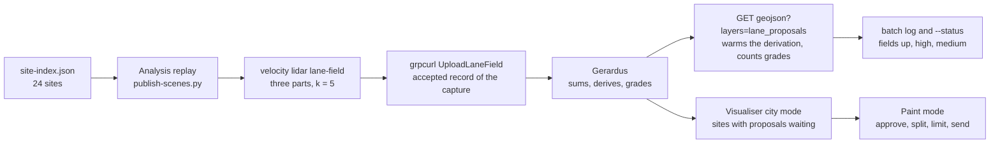

# Lane fields across the corpus: the overnight batch and the sites to review plan

Build every published site's lane field in one unattended run, upload each to the Gerardus the
visualiser reads, have Gerardus derive its lane proposals once per site so the first look is
instant, and give the visualiser a list of the sites with proposals waiting, so an operator walks
the corpus the next morning approving, editing or rejecting lanes rather than replaying anything.

- **Status:** Proposed (D-32: the owner places it in a slot; proposed as the v0.7.20 continuation
  of the lane work delivered in v0.7.19, whose slot is full)
- **Decisions:** relies on D-32, D-33 (hub docs state what ships), D-34 (scene assets leave the
  repository), D-36 (Gerardus owns static street geometry and accepted registration; L8 alone owns
  aggregation), D-38 (geometry is measured spatial data), D-39 (proposals in Gerardus, a snapshot
  here, street data outside git); Gerardus
  [ADR-0006](https://github.com/banshee-data/gerardus/blob/main/docs/adr/0006-boundary-with-velocity-report.md)
  (velocity.report never reports through Gerardus),
  [ADR-0011](https://github.com/banshee-data/gerardus/blob/main/docs/adr/0011-publish-snapshots-and-aggregates-not-trails.md)
  (aggregates only, no cell under five tracks),
  [ADR-0013](https://github.com/banshee-data/gerardus/blob/main/docs/adr/0013-shared-server-on-arrow-with-data-on-the-nas.md)
  (one shared server, data on the NAS) and
  [ADR-0016](https://github.com/banshee-data/gerardus/blob/main/docs/adr/0016-lane-fields-proposals-and-limits.md)
  (lane fields as an input, travel lanes as a derived kind). Proposes no new decision: it keeps
  D-39's locus and adds orchestration only
- **Layers:** L9 endpoints (`velocity lidar lane-field`), the scene publisher
  (`tools/s2-archive`), L10 macOS visualiser (city mode), the vendored Gerardus proto
- **Target:** unscheduled; proposed as the v0.7.20 slot in
  [BACKLOG.md](../BACKLOG.md#v0720---lanes-from-tracks-and-directional-speeds-continued-0720),
  since every piece it runs was delivered in v0.7.19 and that slot holds its twelve items (D-32)
- **Companion plans:** [lanes from tracks](lidar-lane-proposals-from-tracks-plan.md) (the lane
  field, its route and CLI; Phase E is this plan's Item 5), [lane painter](lidar-visualiser-lane-painter-plan.md)
  (the traffic layer and the review the batch feeds), [lane snapshot and attribution](lidar-lane-snapshot-and-attribution-plan.md)
  (what approved lanes become), [city view](lidar-city-view-plan.md) (the site list Item 4 extends);
  Gerardus [LANE-PROPOSALS](https://github.com/banshee-data/gerardus/blob/main/docs/plans/LANE-PROPOSALS.md)
  (W10, whose W10e real check this batch supplies the fields for)
- **Canonical:** [Gerardus alignment pane, paint mode](../ui/visualiser/gerardus-alignment.md#paint-mode-the-street-painter)
  for the operator's steps once a field is up; [publishing runs](../../AGENTS.md#publishing-runs-make-scene-assets)
  for the batch's preflight

The lane field and the proposals are measured spatial data: where tracked objects were observed
over a stated interval, and lines fitted to that by Gerardus at a stated time. A lane that is not
proposed was not seen, which is not the same as absent. See
[Geometry priors: data purpose](../geometry-priors-data-purpose.md).

## Motivation

Both halves of lanes from tracks are built and have met in the middle once. velocity.report sums a
run's tracks into the k = 5 lane field and the painter uploads it; Gerardus (W10a–d, merged at
`e9dc3e0`) sums the fields of a site by their accepted poses, derives `travel_lane` proposals,
grades them and keeps them with stable ids and append-only reviews; the painter draws them and the
operator approves, splits, limits and sends the result back as the snapshot. The one real field, on
columbus-broadway's first 600 s, put its ridges on the right of travel in all four directions
([report](../lidar/operations/lane-field-columbus-broadway-2026-11.md)).

What does not exist is the step between one site and the corpus. Twenty-four sites have accepted
poses in Gerardus (gerardus #70) and the painter's **Send lane field** is the only uploader, one run
at a time, with the app open. The scene publisher already replays every site in analysis mode and
holds each run's id, but builds no field from it. So at 23 of the 24 sites Gerardus has nothing to
propose from, the painter's step 5 reads "no proposals", lane0002 cannot run at columbus-broadway
without a hand-driven upload, and the speed-by-direction reports have no lanes to attribute to.

The question raised on November 6, 2026, whether proposing should move into velocity.report to keep
Gerardus a pure map service, was answered on November 3 by ADR-0016 and D-39, which weighed that
alternative and rejected it: the kerbs, centrelines, intersection nodes and traced paint a proposal
is cut and snapped against are Gerardus's, as is the site frame that sums captures and sensors, and
proposals need identity and reviews across re-derivation. Gerardus sees no track (the field has no
cell under five) and computes no speed (ADR-0016 decision 6). This plan honours the decoupling
where it matters: the corpus, the replays and the orchestration stay here, and Gerardus only
receives fields. Nothing in it changes Gerardus.

## Current state

| Piece               | What exists                                                                                                                                                                                                                                                                                                                                                                                                            |
| ------------------- | ---------------------------------------------------------------------------------------------------------------------------------------------------------------------------------------------------------------------------------------------------------------------------------------------------------------------------------------------------------------------------------------------------------------------- |
| The lane field      | `BuildLaneField` in [lanefield.go](../../internal/lidar/l8analytics/lanefield.go): three parts per run, k = 5, Gerardus's JSON. Analysis replays store no observations, so [lanefieldrun](../../internal/lidar/lanefieldrun/lanefieldrun.go) reads the run's recording instead: 3.2 s over HTTP and 8 s by the CLI for a ten-minute run                                                                                |
| The CLI             | `velocity lidar lane-field --db FILE --run RUN_ID --out DIR [--part] [--vrlog-dir]` ([lanefield.go](../../internal/cmd/lidar/lanefield.go)) writes `<run>.lane-field.<part>.json` with the site token and record id left empty, for `gerardus upload-lane-field --l16 --record-id` to fill. That Gerardus command writes the data directory directly, which under ADR-0013 is on the NAS and not on a Mac              |
| Upload on the wire  | `UploadLaneField` is a client-streaming gRPC call (header, then cells per class group, chunked); there is no HTTP upload. No Go code speaks Gerardus's gRPC: `lanes pull` and `lanes score` use the HTTP GeoJSON routes. The Swift client ([GerardusClient.swift](../../tools/visualiser-macos/VelocityVisualiser/gRPC/GerardusClient.swift)) wraps it for the painter                                                 |
| The accepted record | `ListRegistrationRecords` exists on gRPC and is in the vendored proto. [scene-vectors.py](../../tools/s2-archive/scene-vectors.py) already calls it, and `GetSiteModel`, through `grpcurl` in `accepted_scan()` to place each scene, and refuses a site with more than one accepted scan unless one is named                                                                                                           |
| The batch           | [publish-scenes.py](../../tools/s2-archive/publish-scenes.py) under `make scene-assets`: resolves the 24 entries of `site-index.json` to captures, replays each in analysis mode under the named tuning file, finds the run (`replay()` returns `run_id` and the VRLOG), exports the scene, the background, the vectors and the placement sidecar, swaps the assets and writes a `.rebuilt` marker. Resumable per site |
| Derivation          | Gerardus derives proposals when asked: `ListLaneProposals`, and the HTTP `lane_proposals` GeoJSON layer, call `lane_proposals::current()`, which re-derives under a per-site lock when the fields, the bundle, the observed model or the carriageways changed, and otherwise answers from the stored rows                                                                                                              |
| The visualiser      | Paint mode: the traffic layer, Send lane field, proposals with Approve, Approve all high, Reject, Reopen, Split at sign, limits, Send lanes (painter Items 1–4). City mode: a marker per site from `city/sites.json`, nearby sites played from their scenes. Nothing lists which sites have proposals waiting                                                                                                          |
| Validation          | [lane0002](../../data/experiments/lane/lane0002.md): rule written November 4, 2026, `velocity lidar lanes score` built, report skeleton in place, status `proposed`; its `fields` step is by hand and its `draw` step is the owner's                                                                                                                                                                                   |

## Findings

| Area                              | Current state                                                                                             | Severity | Release view                 |
| --------------------------------- | --------------------------------------------------------------------------------------------------------- | -------- | ---------------------------- |
| Field per site                    | Built on demand for one run; never for the corpus                                                         | High     | Item 1                       |
| Upload from a Mac                 | Only the painter; the Gerardus CLI needs the NAS data directory                                           | High     | Item 1 (grpcurl, as vectors) |
| First look at a site              | Derivation runs on the first request and its cost per site is unmeasured                                  | Medium   | Item 2                       |
| A lanes-only pass                 | The scene batch exports and swaps assets a lane field does not need                                       | Medium   | Item 3                       |
| Finding the sites to review       | No list of sites by proposals outstanding; the operator opens each site to find out                       | Medium   | Item 4                       |
| Grades unmeasured                 | Gerardus's thresholds are declared starting points (LANE-PROPOSALS §4); lane0002 has not run              | High     | Item 5, before the corpus    |
| Sites with several accepted scans | `accepted_scan()` refuses them unless a record is named; a field placed by the wrong record poisons a sum | Medium   | Item 1                       |

## Design / approach

**Boundaries that hold.** The field is the only track-derived thing that leaves a site (ADR-0011);
the batch writes it to a local output directory, never under `public_html/src/scenes` and never into
git (D-39), and records only field ids and counts. Gerardus derives and grades; nothing here fits a
lane (D-39). The batch uploads to the Gerardus server the visualiser reads (`GERARDUS_URL`, the
same base `scene-vectors.py` places by): a field sent to a scratch server on a Mac is invisible to a
visualiser pointed at arrow's, and a field placed by any record but the capture's own accepted one
corrupts that site's sum for every later proposal.

**Why the publisher and not the job queue.** The job queue's kinds (benchmark, state-estimation
baseline, track scorecard, VRLOG record) run inside the `velocity` binary on a worker, and a lane
field there would need a Go gRPC client to Gerardus. The publisher already has the corpus, the
replay, the run lookup, the site token, the accepted record and `grpcurl`; adding the field is one
function after `replay()`. The Go client is the right shape once lane fields run on arrow-worker as
jobs, and is deferred to that trigger below.

**Why warm the derivation in the batch.** `current()` derives on first request under a per-site
lock and includes the observed model in its key, so the first `ListLaneProposals` after an upload
may take seconds to a minute at a site with a large model, and the painter would show that wait.
One HTTP GET of the `lane_proposals` layer per site at the end of the batch pays it overnight,
gives the log the count per grade, and is the same request `lanes score` already makes.

**Placement.** For each site the batch resolves the accepted scan and record exactly as the vectors
do (`accepted_scan()`), passing the scene's own record where the site has more than one accepted
scan; a site with none is logged as `not_placed` and skipped, never uploaded against a hint pose.
The field's header gets the site token, that record id, `capture_ref` as the scene id with the
capture basenames, and the window the run reports.

**Review from the city.** The visualiser's city mode draws a marker per site. Item 4 gives it a
**Lanes to review** list: for each placed site, `ListLaneProposals` (the Swift client has it)
counted into high, medium, adopted and rejected, fetched lazily and cached for the session, sorted
by proposals not yet adopted or rejected; choosing a row switches to the site and opens paint mode
with Proposals on. The counts live nowhere static: `city/sites.json` stays as it is, since a
proposal is a Gerardus row that changes under review.

## Scope

### Item 1: the lane-field step in the scene publisher

**Summary:** After each site's replay, build the run's three fields and upload them to Gerardus
against the capture's accepted record, recording the field ids.

**Steps:**

1. `lane_field(scene, run)` in `publish-scenes.py`: run `velocity lidar lane-field --db $DB --run
<run_id> --out $SCENE_WORK/lane-fields/<site>/` (a local, ignored directory named by a new
   `SCENE_WORK` variable in `local.mk`; refuse a path inside the checkout as the render tool does).
2. Resolve the site token and accepted record with `scene_vectors.accepted_scan()`; fill the three
   headers' `l16_token`, `record_id` and `capture_ref`; `NoPose` logs `not_placed` and skips.
3. Upload each part with `grpcurl` as a client stream to `RegistrationService/UploadLaneField`:
   the header message, then one `LaneFieldCells` message per class group, chunked at a few
   thousand cells. `already_stored` with the same field id is success (content addressing).
4. Write `lane-fields.json` beside the files with the field ids, parts, record id and track counts;
   append the ids to the `.rebuilt` line so `--status` can say a site's fields are up.
5. `SCENE_LANE_FIELDS=off` leaves the step out; the default is on when `GERARDUS_URL` answers and
   `GetServerInfo` reports `supports_lane_fields`, else the step logs why and the scene publishes
   as today.

**Tests:** a fixture test for the header fill and the chunking (pure functions, no server); the
`.rebuilt` and `--status` parsing; the privacy check that nothing under `public_html` or in git
changes when the step runs (the export privacy test's lane-field case, planned by D-39, covers the
scene side).

**Milestone:** v0.7.20 (`M`)

### Item 2: warm the derivation and count the grades

**Summary:** After the uploads, ask Gerardus for each site's proposals once, so the derivation runs
overnight and the log says what each site has.

**Steps:**

1. `GET /api/v1/sites/{l16}/geojson?layers=lane_proposals` per uploaded site, timed; count
   `confidence` high and medium, `review=rejected` and `adopted_by` from the properties.
2. Log one line per site: fields up, seconds to derive, high, medium, adopted, rejected; `--status`
   repeats it from `lane-fields.json` and a fresh GET when the server answers.
3. A corpus summary at the end: sites with fields, sites proposing nothing (and the busiest vehicle
   cell against the medium threshold, as the painter's step 5 words it), total high and medium.

**Milestone:** v0.7.20 (`S`)

### Item 3: a lanes-only pass

**Summary:** Replay, build and upload without exporting or swapping a scene, for a shorter
overnight run and for re-running fields after a pipeline change.

**Steps:**

1. `--lanes-only` in `publish-scenes.py`: `replay()`, `lane_field()`, the Item 2 GET; no export, no
   carry-over, no asset swap, no scene map refresh; its own marker `.lane-fields` keyed by the
   build sha and tuning fingerprint, so a stale field is rebuilt and a current one skipped.
2. `make lane-fields` with the same preflight as `scene-assets` (binary stamped, server up, every
   site resolved) and `SITES=` to pick sites.
3. Replay speed stays the publisher's setting: the result is the same at any speed on a fresh
   process ([perf0002](../../data/experiments/perf/perf0002.md)), so the pass runs as fast as the
   host allows.

**Milestone:** v0.7.20 (`S`)

### Item 4: the sites with proposals waiting, in the visualiser

**Summary:** A **Lanes to review** list in city mode that counts each placed site's proposals and
takes the operator to its painter.

**Steps:**

1. A `LaneReviewIndex` beside `CitySiteIndex`: per placed site, `ListLaneProposals` counted into
   high, medium, adopted and rejected, fetched when city mode opens and after a save or review,
   one call on the wire at a time as the alignment pane does, cached for the session.
2. The list in the city pane: site, high, medium, outstanding; sorted by outstanding; a row switches
   site (city view Item 5) and opens paint mode with Proposals on.
3. The marker in city mode carries the outstanding count where it is not zero.
4. Tests: the counting from a fixture response; the sort; the switch-and-open path through the
   existing `SiteContext` seam.

**Milestone:** v0.7.20 (`M`, {frontend})

### Item 5: validate before approving at scale

**Summary:** Run lane0002 on the first fields, hand the grade thresholds back to Gerardus, and only
then run the corpus and open the review list.

**Steps:**

1. Item 1 on columbus-broadway (in `site-index.json`) and the painter's Send lane field on kirk0
   (Kirkham at 9th is not an archive scene; its fields go up by hand or by a one-off `velocity
lidar lane-field` and `grpcurl` with the same code path).
2. The owner's `draw` step and `velocity lidar lanes score` per lane0002; the report written.
3. Thresholds that move go to Gerardus (W10e) and the proposals re-derive under the new
   `DERIVATION`; the batch's Item 2 GET then re-counts.
4. The corpus pass (`make lane-fields`), then the review from the city.

**Milestone:** v0.7.20 (the owner's drawing; `S` of tooling)

## Dependencies

- Gerardus main at or after `e9dc3e0` (W10a–d) running as the server the visualiser reads, with
  `supports_lane_fields`; `ListRegistrationRecords` and `GetSiteModel` answering, as the vectors
  already need.
- `grpcurl` on the publishing host, as `scene-vectors.py` already requires.
- A stamped `velocity` build (`make build-radar-local`) and the publishing preflight.
- lane0002's `draw` step is the owner's time: two sites, about two hours.
- Painter Item 2's remainder (Edit, crossing markers, keys) is not a dependency; the review works
  without it.

## Risks

| Risk                                                                                | Likelihood | Impact | Mitigation                                                                                                                                             |
| ----------------------------------------------------------------------------------- | ---------- | ------ | ------------------------------------------------------------------------------------------------------------------------------------------------------ |
| A field placed by the wrong accepted record at a site with several scans            | Medium     | High   | Place by the scene's own record as the vectors do; refuse ambiguity rather than pick; the field id and record id in `lane-fields.json`                 |
| Fields uploaded to a server the visualiser does not read                            | Medium     | Medium | One `GERARDUS_URL` for vectors, fields and the app; the batch log names the server and its version from `GetServerInfo`                                |
| First derivation at a site is slow and holds the lock while the painter waits       | Medium     | Low    | Item 2 pays it overnight; the time is logged, and a site over a minute is reported to Gerardus                                                         |
| Short or quiet captures propose nothing                                             | High       | Low    | By design (k and the grades); the summary names them and more captures at a site add up                                                                |
| Grades approved at scale before lane0002 says they hold                             | Medium     | High   | Item 5 orders the work; **Approve all high** is the operator's act and the report says what `high` meant at two sites                                  |
| `grpcurl` JSON for a dense field is large                                           | Low        | Low    | Cells chunked per message; the server's limit is a few megabytes per message and content addressing makes a retry idempotent                           |
| A pipeline change moves every field, and the summed site field mixes builds         | Medium     | Medium | The header carries build and tuning fingerprint; Gerardus keeps the newest whole-run field per capture ref; `.lane-fields` keys on sha and fingerprint |
| Scope creep into a Go gRPC client or a job-queue kind before the batch has run once | Medium     | Low    | Deferred below with its trigger                                                                                                                        |

## Design decisions

- **Locus unchanged (implemented fact):** proposals are Gerardus's; this plan adds orchestration
  only (ADR-0016, D-39). The alternative of proposing in Go was weighed on November 3, 2026 and is
  not reopened here.
- **The batch is the scene publisher (proposal):** the field step rides the replay the publisher
  already runs, with `grpcurl` as the publisher's existing gRPC tool, rather than a new job kind.
- **Fields are local output (proposal):** written under `SCENE_WORK`, never under the scenes or in
  git; only ids and counts are recorded (D-39, ADR-0011).
- **Warm, do not pre-approve (proposal):** the batch derives and counts; approval stays the
  operator's, one site at a time, in the painter.
- **Counts are live, not static (proposal):** the review list reads Gerardus; `city/sites.json`
  carries no proposal state.

## Open questions

- Should a `MANUALLY_PLACED` record place a field as a `REGISTERED` one does? Both are accepted
  states today and the painter sends against either; the field header records the id, so the
  distinction can be read back later. Proposed: yes, logged as such.
- Should the lanes-only marker also rebuild when Gerardus's `DERIVATION` changes? No: the fields
  are the input and re-derivation is Gerardus's; Item 2's GET re-counts on the next pass.
- Does Gerardus want a bulk count per site in `ListSites` so Item 4 makes one call instead of
  twenty-four? Not needed to start; raise after the first review session says how long the list
  takes to fill.

## Checklist

### Complete

- [x] Plan written from the November 6, 2026 assessment of where the lane work stands in both
      repositories

### Outstanding

- [ ] Item 1: the lane-field step in `publish-scenes.py`, headers filled from the accepted record,
      `grpcurl` upload, `lane-fields.json`, `--status` (`M`)
- [ ] Item 2: warm the derivation and count grades per site; the corpus summary (`S`)
- [ ] Item 3: `--lanes-only` and `make lane-fields` with the shared preflight (`S`)
- [ ] Item 4: **Lanes to review** in the visualiser's city mode (`M`)
- [ ] Item 5: lane0002 run from the first fields; thresholds handed to Gerardus; then the corpus
      pass and the first review session, written up in the lanes-from-tracks plan's Phase E

### Deferred

- [ ] A Go gRPC client to Gerardus (`velocity lidar lane-field --upload`, `ListRegistrationRecords`
      and `UploadLaneField` from generated stubs of the vendored proto) when lane fields run as
      jobs on arrow-worker: [worker pool plan](lidar-worker-pool-and-results-hub-plan.md)
- [ ] Proposals and the summed field in the web site viewer, read-only:
      [lane snapshot plan Item 3](lidar-lane-snapshot-and-attribution-plan.md#item-3-the-field-proposals-and-lanes-in-the-web-site-viewer)
- [ ] Scene lanes drawn in the visualiser's city mode from the vectors file; today lanes appear
      only in paint mode, live from Gerardus

### Accepted residuals (no action planned)

- [ ] The lane field is never published with the scene assets or shown on the public site; the
      publication checklist would apply first (D-39)
- [ ] Turning lanes and lanes inside the intersection box are not proposed (LANE-PROPOSALS §4.2);
      the painter draws them by hand
