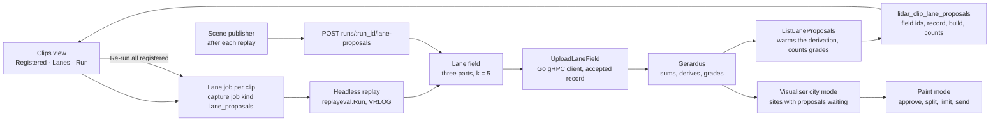

# Lane proposals across the corpus: the lane job, the clips view and the sites to review plan

Run lane proposals as a server job per clip: replay the clip, build its lane field, upload the field
to the Gerardus the visualiser reads against the clip's accepted registration record, and ask
Gerardus for the proposals once so the derivation runs while nobody waits. Show each clip's state in
the web clips view, two columns, **Registered** and **Lanes**, with a progress bar while its job
runs, and one button that re-runs lane proposals across every registered clip. Let the scene
publisher use the same job after each replay, and give the visualiser a list of the sites with
proposals waiting, so an operator walks the corpus the next morning approving, editing or rejecting
lanes rather than replaying anything.

- **Status:** Active: built on the owner's instruction of November 6, 2026 (Items 1–4 and 6); Item
  7 waits on the owner's lane0002 drawing. Placed as the v0.7.20 continuation of the lane work
  delivered in v0.7.19, whose slot is full (D-32)
- **Decisions:** relies on D-31 (the clip cutover), D-32, D-33 (hub docs state what ships), D-34
  (scene assets leave the repository), D-36 (Gerardus owns static street geometry and accepted
  registration; L8 alone owns aggregation), D-38 (geometry is measured spatial data), D-39
  (proposals in Gerardus, a snapshot here, street data outside git); Gerardus
  [ADR-0006](https://github.com/banshee-data/gerardus/blob/main/docs/adr/0006-boundary-with-velocity-report.md)
  (velocity.report never reports through Gerardus),
  [ADR-0011](https://github.com/banshee-data/gerardus/blob/main/docs/adr/0011-publish-snapshots-and-aggregates-not-trails.md)
  (aggregates only, no cell under five tracks),
  [ADR-0013](https://github.com/banshee-data/gerardus/blob/main/docs/adr/0013-shared-server-on-arrow-with-data-on-the-nas.md)
  (one shared server, data on the NAS) and
  [ADR-0016](https://github.com/banshee-data/gerardus/blob/main/docs/adr/0016-lane-fields-proposals-and-limits.md)
  (lane fields as an input, travel lanes as a derived kind). Proposes no new decision: it keeps
  D-39's locus and adds orchestration, a job and two views
- **Layers:** L9 endpoints (a Gerardus gRPC client, the lane job and its routes), SQLite storage
  (one table), the web clips view, the scene publisher (`tools/s2-archive`), L10 macOS visualiser
  (city mode), the vendored Gerardus proto
- **Target:** unscheduled; proposed as the v0.7.20 slot in
  [BACKLOG.md](../BACKLOG.md#v0720---lanes-from-tracks-and-directional-speeds-continued-0720),
  since every piece it runs was delivered in v0.7.19 and that slot holds its twelve items (D-32)
- **Companion plans:** [lanes from tracks](lidar-lane-proposals-from-tracks-plan.md) (the lane
  field, its route and CLI; Phase E is this plan's Item 7), [lane painter](lidar-visualiser-lane-painter-plan.md)
  (the traffic layer and the review the job feeds), [lane snapshot and attribution](lidar-lane-snapshot-and-attribution-plan.md)
  (what approved lanes become), [city view](lidar-city-view-plan.md) (the site list Item 6 extends),
  [unsited captures publishing](lidar-unsited-captures-publishing-plan.md) (the clips view's
  publishing panel this plan sits beside); Gerardus
  [LANE-PROPOSALS](https://github.com/banshee-data/gerardus/blob/main/docs/plans/LANE-PROPOSALS.md)
  (W10, whose W10e real check this job supplies the fields for)
- **Canonical:** [LiDAR clip management](../lidar/operations/clip-management-implementation.md)
  for the clips view once the columns ship; [Gerardus alignment pane, paint mode](../ui/visualiser/gerardus-alignment.md#paint-mode-the-street-painter)
  for the operator's steps once a field is up; [publishing runs](../../AGENTS.md#publishing-runs-make-scene-assets)
  for the scene batch's preflight

The lane field and the proposals are measured spatial data: where tracked objects were observed
over a stated interval, and lines fitted to that by Gerardus at a stated time. A lane that is not
proposed was not seen, which is not the same as absent. See
[Geometry priors: data purpose](../geometry-priors-data-purpose.md).

## Motivation

Both halves of lanes from tracks are built and have met in the middle once. velocity.report sums a
run's tracks into the k = 5 lane field and the painter uploads it; Gerardus (W10a–d, merged at
`e9dc3e0`) sums the fields of a site by their accepted poses, derives `travel_lane` proposals,
grades them and keeps them with stable ids and append-only reviews; the painter draws them and the
operator approves, splits, limits and sends the result back as the snapshot. The one real field, on
columbus-broadway's first 600 s, put its ridges on the right of travel in all four directions
([report](../lidar/operations/lane-field-columbus-broadway-2026-11.md)).

What does not exist is the step between one run and the corpus. Twenty-four sites have accepted
poses in Gerardus (gerardus #70) and the painter's **Send lane field** is the only uploader, one run
at a time, with the app open. The clips view lists every clip and knows which are located, but
nothing on it says whether a clip's site is registered in Gerardus or whether its lanes have been
proposed, and nothing re-runs the proposals when the pipeline moves every field. The scene
publisher already replays every site in analysis mode and holds each run's id, but builds no field.
So at 23 of the 24 sites Gerardus has nothing to propose from, the painter's step 5 reads "no
proposals", lane0002 cannot run at columbus-broadway without a hand-driven upload, and the
speed-by-direction reports have no lanes to attribute to.

The question raised on November 6, 2026, whether proposing should move into velocity.report to keep
Gerardus a pure map service, was answered on November 3 by ADR-0016 and D-39, which weighed that
alternative and rejected it: the kerbs, centrelines, intersection nodes and traced paint a proposal
is cut and snapped against are Gerardus's, as is the site frame that sums captures and sensors, and
proposals need identity and reviews across re-derivation. Gerardus sees no track (the field has no
cell under five) and computes no speed (ADR-0016 decision 6). This plan honours the decoupling
where it matters: the corpus, the replays, the job and its views stay here, and Gerardus only
receives fields and answers for proposals. Nothing in it changes Gerardus.

## Current state

| Piece               | What exists                                                                                                                                                                                                                                                                                                                                                                                                                                                                                                             |
| ------------------- | ----------------------------------------------------------------------------------------------------------------------------------------------------------------------------------------------------------------------------------------------------------------------------------------------------------------------------------------------------------------------------------------------------------------------------------------------------------------------------------------------------------------------- |
| The lane field      | `BuildLaneField` in [lanefield.go](../../internal/lidar/l8analytics/lanefield.go): three parts per run, k = 5, Gerardus's JSON. Analysis replays store no observations, so [lanefieldrun](../../internal/lidar/lanefieldrun/lanefieldrun.go) reads the run's recording instead (`FromVRLOG`): 3.2 s over HTTP and 8 s by the CLI for a ten-minute run                                                                                                                                                                   |
| The CLI             | `velocity lidar lane-field --db FILE --run RUN_ID --out DIR [--part] [--vrlog-dir]` ([lanefield.go](../../internal/cmd/lidar/lanefield.go)) writes `<run>.lane-field.<part>.json` with the site token and record id left empty, for `gerardus upload-lane-field --l16 --record-id` to fill. That Gerardus command writes the data directory directly, which under ADR-0013 is on the NAS and not on a Mac                                                                                                               |
| Upload on the wire  | `UploadLaneField` is a client-streaming gRPC call (header, then cells per class group, chunked); there is no HTTP upload. No Go code speaks Gerardus's gRPC: `lanes pull` and `lanes score` use the HTTP GeoJSON routes. The Swift client ([GerardusClient.swift](../../tools/visualiser-macos/VelocityVisualiser/gRPC/GerardusClient.swift)) wraps it for the painter. `proto-gen-go` generates stubs for `visualiser.proto` and the recording protos only; the vendored `align.proto` has Swift stubs alone           |
| The accepted record | `ListRegistrationRecords(l16)` exists on gRPC and is in the vendored proto: each record carries `state` (`REGISTERED`, `MANUALLY_PLACED`, `REJECTED`), `sensor_id`, `capture_ref` and the pose. [scene-vectors.py](../../tools/s2-archive/scene-vectors.py) calls it, and `GetSiteModel`, through `grpcurl` in `accepted_scan()` to place each scene. Gerardus's HTTP API has no records route; it has `GET /api/v1/sites` (bundles, no registration state) and `GET /api/v1/sites/{l16}/lane-field` (the summed field) |
| Clips               | A clip names a sensor and ordered captures ([clip management](../lidar/operations/clip-management-implementation.md)). `GET /api/lidar/clips?located=1` returns located clips with `location.s2_l16_token`; a clip carries `dataset_id` when it is the published scene's capture. The web clips view ([clips/+page.svelte](../../web/src/routes/lidar/clips/+page.svelte)) lists Description, PCAP File, Files, Created and Actions, with a publishing panel and a delete action; no column says registered or lanes    |
| Capture jobs        | `lidar_capture_jobs` (migration 043) with `capjobs.Runner` ([runner.go](../../internal/lidar/capjobs/runner.go)): queued, running, completed, failed, cancelled; `progress_current`, `progress_total` and `detail`; `GET /api/lidar/capture/jobs` and `POST …/cancel`. Kinds: `motion_pass`, `vrlog_record` (a headless `replayeval.Run` with a cancellable context, reporting three steps) and `capture_export`. The captures page polls the jobs route and draws progress in place                                    |
| Derivation          | Gerardus derives proposals when asked: `ListLaneProposals`, and `GET /api/v1/sites/{l16}/geojson?layers=lane_proposals`, call `lane_proposals::current()`, which re-derives under a per-site lock when the fields, the bundle, the observed model or the carriageways changed, and otherwise answers from the stored rows                                                                                                                                                                                               |
| The batch           | [publish-scenes.py](../../tools/s2-archive/publish-scenes.py) under `make scene-assets`: resolves the 24 entries of `site-index.json` to captures, replays each in analysis mode under the named tuning file, finds the run (`replay()` returns `run_id` and the VRLOG), exports the scene, the vectors and the placement sidecar, swaps the assets and writes a `.rebuilt` marker. Resumable per site. Builds no field                                                                                                 |
| The visualiser      | Paint mode: the traffic layer, Send lane field, proposals with Approve, Approve all high, Reject, Reopen, Split at sign, limits, Send lanes (painter Items 1–4). City mode: a marker per site from `city/sites.json`, nearby sites played from their scenes. Nothing lists which sites have proposals waiting                                                                                                                                                                                                           |
| Validation          | [lane0002](../../data/experiments/lane/lane0002.md): rule written November 4, 2026, `velocity lidar lanes score` built, report skeleton in place, status `proposed`; its `fields` step is by hand and its `draw` step is the owner's                                                                                                                                                                                                                                                                                    |

## Findings

| Area                              | Current state                                                                                                | Severity | Release view  |
| --------------------------------- | ------------------------------------------------------------------------------------------------------------ | -------- | ------------- |
| Field per clip                    | Built on demand for one run from the painter; never as a job, never for the corpus                           | High     | Items 1–2     |
| Upload from the server            | No Go client to Gerardus's gRPC; the Gerardus CLI needs the NAS data directory                               | High     | Item 1        |
| Is this clip registered?          | Known only to Gerardus, over gRPC; the clips view cannot say                                                 | High     | Items 1, 3    |
| Are its lanes proposed, and when? | Nothing records which build and tuning a clip's fields came from; a pipeline change leaves every field stale | High     | Items 2–3     |
| Progress while it runs            | The painter shows a spinner for one upload; a corpus run has no view                                         | Medium   | Item 3        |
| First look at a site              | Derivation runs on the first request and its cost per site is unmeasured                                     | Medium   | Item 2        |
| The scene batch                   | Replays every site and discards the chance to build the field                                                | Medium   | Item 4        |
| Finding the sites to review       | No list of sites by proposals outstanding; the operator opens each site to find out                          | Medium   | Item 6        |
| Grades unmeasured                 | Gerardus's thresholds are declared starting points (LANE-PROPOSALS §4); lane0002 has not run                 | High     | Item 7, first |
| Sites with several accepted scans | `accepted_scan()` refuses them unless a record is named; a field placed by the wrong record poisons the sum  | Medium   | Item 1        |

## Design / approach

**Boundaries that hold.** The field is the only track-derived thing that leaves a site (ADR-0011);
the job keeps it in memory or in a local, ignored directory, never under `public_html/src/scenes`
and never in git (D-39), and stores only field ids and counts. Gerardus derives and grades; nothing
here fits a lane (D-39). The job uploads to the Gerardus server the visualiser reads: one address
for the server (`--gerardus`, `GERARDUS_URL`), the vectors and the app, since a field sent to a
scratch server on a Mac is invisible to a visualiser pointed at arrow's, and a field placed by any
record but the capture's own accepted one corrupts that site's sum for every later proposal.

**The Go client to Gerardus (Item 1).** `proto-gen-go` gains the vendored `align.proto` and a
small package wraps the three calls the server needs: `GetServerInfo` (for `supports_lane_fields`
and the version), `ListRegistrationRecords` and `UploadLaneField`. The CLI's and the painter's
paths stand; this is the server's. Registration state per site is read from Gerardus and cached in
memory for a few minutes: Gerardus unreachable makes the column read **unknown**, never **no**.

**Registered means an accepted record for the clip's sensor at its site.** A clip is registered
when `ListRegistrationRecords(location.s2_l16_token)` holds a record in state `REGISTERED` or
`MANUALLY_PLACED` for the clip's `sensor_id`; where several do, the one whose `capture_ref` names
the clip's capture or dataset id wins, else the newest. A clip with no location is not registered,
and the column says why (**not located**). The record's id is what places the field.

**The lane job (Item 2)** is a capture job of kind `lane_proposals`, one per clip, with the runner's
cancellation and progress. Its steps, each reported: replay the clip headlessly through
`replayeval.Run` to a VRLOG, as `vrlog_record` does (no server replay slot, so two jobs can run
where the host allows); build the three parts with `lanefieldrun.FromVRLOG`; upload each against
the accepted record; ask Gerardus for the proposals once and count the grades; write one row to
`lidar_clip_lane_proposals`. The run form, `POST /api/lidar/runs/{run_id}/lane-proposals`, does
the same from a finished run's recording without replaying, for the scene publisher and for a run
the painter has open. A job's detail reads as the painter's steps do: "replaying 2:40 of 10:00",
"field 2 of 3", "uploading second_half", "deriving at Gerardus", "12 high, 3 medium".

**Stale is a fact about the field, not an opinion.** The row stores `pipeline_build`, `tuning_fingerprint`
and the field ids; the **Lanes** column is a tick when the newest completed row was built by the
running binary's build and the server's current tuning fingerprint, and **stale** with the build it
came from when either moved. **Re-run lane proposals** across all registered clips enqueues one job
per registered located clip, newest row stale or absent first, skipping a clip whose row is current
unless `force` is set; unregistered clips are listed with their reason and not queued.

**Why warm the derivation in the job.** `current()` derives on first request under a per-site lock
and includes the observed model in its key, so the first `ListLaneProposals` after an upload may
take seconds to a minute at a site with a large model, and the painter would show that wait. One
HTTP GET of the `lane_proposals` layer per job pays it while the job is already running, gives the
row its counts, and is the same request `lanes score` already makes.

**The clips view (Item 3).** Two columns after Files: **Registered** (a tick with the record state in
its title; **not located**; **unknown** while Gerardus does not answer) and **Lanes** (a tick with
"12 high · 3 medium" and the date; **stale** with the old build; a progress bar with the job's
detail while a job runs; **failed** with the error's first line). The toolbar gains **Re-run lane
proposals**, which asks before queueing, says how many clips it will run and how many it skips and
why, and shows the batch's progress as the captures page shows motion passes. Each row's Actions
gain **Run lanes** (one job, `force`). Progress comes from polling `GET /api/lidar/capture/jobs?kind=lane_proposals`
on the captures page's cadence; the page refreshes in place. The web otherwise stays as it is: no
approval, no drawing, no editing of lanes here; those are the painter's (D-39, the September 2026
direction that the macOS app is the review instrument).

**The scene publisher (Item 4)** calls the run form after each site's replay, with the clip found
by `dataset_id`, so a scene run also lands its fields, and `make lane-fields` becomes one call to
the re-run route rather than a second replay loop in Python.

**Review from the city (Item 6).** The visualiser's city mode draws a marker per site. A **Lanes to
review** list counts each placed site's proposals through `ListLaneProposals` (the Swift client has
it) into high, medium, adopted and rejected, fetched lazily and cached for the session, sorted by
proposals not yet adopted or rejected; choosing a row switches to the site and opens paint mode with
Proposals on. The counts live nowhere static: `city/sites.json` stays as it is, since a proposal is
a Gerardus row that changes under review.

## Scope

### Item 1: a Go client to Gerardus and the clip's registration

**Summary:** Generate Go stubs for the vendored proto, wrap the three calls the server needs, and
answer "is this clip registered" from Gerardus with a short cache.

**Steps:**

1. `proto-gen-go` compiles `proto/gerardus/align/v1alpha1/align.proto` into
   `internal/lidar/gerarduspb`; a fixture test pins the four lane RPCs and `ListRegistrationRecords`
   in the vendored file, as the Swift side does.
2. `internal/lidar/gerardus`: `Client` with `ServerInfo`, `AcceptedRecord(l16, sensorID, captureRefs)`
   and `UploadLaneField(header, cells)` (client stream, cells chunked at a few thousand per message;
   `already_stored` with the same field id is success). The address is the server's `--gerardus`
   flag or `GERARDUS_URL`, the same default as the CLI's.
3. `AcceptedRecord` picks `REGISTERED` or `MANUALLY_PLACED` for the sensor, preferring a
   `capture_ref` naming the clip's capture basename or `dataset_id`, else the newest; refuses when
   two remain equally good and says so.
4. A registration cache keyed by site token, a few minutes long, invalidated by a job's completion;
   `GET /api/lidar/clips?located=1` gains `registration: {state, record_id, checked_at}` or
   `{state: "unknown", reason}`.

**Tests:** the record choice over fixtures (one record; two sensors; two captures; a rejected one;
none); the chunking and header fill; the cache's expiry and the unknown state when the dial fails.

**Milestone:** v0.7.20 (`M`)

### Item 2: the lane job, the run form and the re-run across registered clips

**Summary:** One capture job kind that replays a clip, builds and uploads its fields, warms the
derivation and records the result; the same from a finished run; one route that queues it for every
registered clip.

**Steps:**

1. Migration: `lidar_clip_lane_proposals` (clip_id, job_id, l16_token, sensor_id, record_id,
   field_ids_json, window_start_ns, window_end_ns, track_count, pipeline_build,
   tuning_fingerprint, high, medium, adopted, rejected, derive_secs, created_at_ns), append-only,
   newest row per clip read by the view. The next free number is checked at the time; 070 is taken.
2. `runLaneProposals(ctx, job, report)`: `replayeval.Run` on the clip's captures with the clip's
   offsets and the server's tuning, VRLOG only; `lanefieldrun.FromVRLOG` for the three parts;
   header filled with the site token, the record and `capture_ref` (clip id and basenames);
   three uploads; `ListLaneProposals` timed and counted; the row written. Each
   step reports progress; cancellation stops the replay as `vrlog_record`'s does.
3. `POST /api/lidar/clips/{clip_id}/lane-proposals` (`force` optional) enqueues one job, 409 when
   one is queued or running for the clip; `POST /api/lidar/runs/{run_id}/lane-proposals` does the
   upload and derivation from a finished run's recording and writes the row against the run's
   clip when it has one.
4. `POST /api/lidar/clips/lane-proposals/rerun` (`force`, `dry_run`): every located clip with an
   accepted record, stale or absent rows first, skipping current ones unless forced; the response
   lists queued job ids and skipped clips with reasons. `GET /api/lidar/capture/jobs` gains `kind=`.
5. `velocity lidar lane-field` gains `--upload` through the same client, so the CLI path no longer
   needs the Gerardus CLI's data directory.

**Tests:** the job over a fixture clip with a stubbed client (fields built from the recording,
three uploads in order, the row written, the counts parsed); 409 on a running job; the rerun's
selection (stale, current, forced, unregistered, not located); the run form on a run without a
clip.

**Milestone:** v0.7.20 (`M`)

### Item 3: Registered and Lanes in the clips view, with progress and re-run

**Summary:** Two columns, a progress bar while a job runs, a per-row Run lanes action and a
toolbar Re-run lane proposals across all registered clips.

**Steps:**

1. `lidarRecords.ts` types for `registration` and `lanes` on a clip and for the lane job; a pure
   `laneStatus(clip, jobs, build, fingerprint)` that yields tick, stale, running (with the job's
   detail and fraction), failed, unknown or not located.
2. The two columns after Files, read from `GET /api/lidar/clips?located=1` and the jobs poll; the
   title on each state says why.
3. **Run lanes** in a row's Actions; **Re-run lane proposals** in the toolbar, which calls the rerun
   route with `dry_run` first, shows "12 clips to run, 3 current, 9 not registered", then queues
   on confirmation and shows the batch's progress and the newly completed clips as the captures
   page shows motion passes.
4. The jobs poll runs only while a lane job is queued or running, as the captures page's does.

**Tests:** `laneStatus` over the states; the rerun confirmation's wording from a dry-run response;
the columns' rendering from a fixture list; no poll when idle.

**Milestone:** v0.7.20 (`M`, {frontend})

### Item 4: the scene publisher lands fields and `make lane-fields`

**Summary:** The scene batch calls the run form after each replay; a lanes-only pass is one call to
the rerun route.

**Steps:**

1. `publish-scenes.py`: after `replay()`, `POST /api/lidar/runs/{run_id}/lane-proposals` with the
   clip found by `dataset_id`; the response's counts go in the log and the `.rebuilt` line;
   `SCENE_LANE_FIELDS=off` leaves it out; a server without Gerardus logs why and the scene
   publishes as today.
2. `make lane-fields`: the shared preflight, then `POST …/clips/lane-proposals/rerun` and a wait on
   the jobs route with one line per completion; `FORCE=1` passes `force`.
3. `--status` reports each site's newest row (build, counts, date) from the clips route.

**Milestone:** v0.7.20 (`S`)

### Item 5: `grpcurl` upload in the publisher is not built

**Summary:** With the server owning the upload, the publisher never speaks gRPC for lane fields; the
earlier idea of a `grpcurl` client stream in Python is dropped before it is written.

**Milestone:** none (recorded so it is not rebuilt)

### Item 6: the sites with proposals waiting, in the visualiser

**Summary:** A **Lanes to review** list in city mode that counts each placed site's proposals and
takes the operator to its painter.

**Steps:**

1. A `LaneReviewIndex` beside `CitySiteIndex`: per placed site, `ListLaneProposals` counted into
   high, medium, adopted and rejected, fetched when city mode opens and after a save or review,
   one call on the wire at a time as the alignment pane does, cached for the session.
2. The list in the city pane: site, high, medium, outstanding; sorted by outstanding; a row switches
   site (city view Item 5) and opens paint mode with Proposals on.
3. The marker in city mode carries the outstanding count where it is not zero.
4. Tests: the counting from a fixture response; the sort; the switch-and-open path through the
   existing `SiteContext` seam.

**Milestone:** v0.7.20 (`M`, {frontend})

### Item 7: validate before approving at scale

**Summary:** Run lane0002 on the first fields, hand the grade thresholds back to Gerardus, and only
then run the corpus and open the review list.

**Steps:**

1. **Run lanes** on the columbus-broadway clip and on kirk0 (Kirkham at 9th is a clip, not an
   archive scene; the same job serves it).
2. The owner's `draw` step and `velocity lidar lanes score` per lane0002; the report written.
3. Thresholds that move go to Gerardus (W10e) and the proposals re-derive under the new
   `DERIVATION`; the next job at each site re-counts.
4. **Re-run lane proposals** across the corpus, then the review from the city.

**Milestone:** v0.7.20 (the owner's drawing; `S` of tooling)

## Dependencies

- Gerardus main at or after `e9dc3e0` (W10a–d) running as the server the visualiser reads, with
  `supports_lane_fields`; `ListRegistrationRecords` answering.
- `protoc`, `protoc-gen-go` and `protoc-gen-go-grpc` on the developer's host for the stubs, as
  `proto-gen-go` already needs.
- `replayeval.Run`'s VRLOG carries the frames' tracks `lanefieldrun.FromVRLOG` reads (it is the
  recording `vrlog_record` exports annotation packs from; checked in Item 2's first test).
- A stamped `velocity` build (`make build-radar-local`), so `pipeline_build` is a sha and not `dev`.
- lane0002's `draw` step is the owner's time: two sites, about two hours.
- Painter Item 2's remainder (Edit, crossing markers, keys) is not a dependency; the review works
  without it.

## Risks

| Risk                                                                          | Likelihood | Impact | Mitigation                                                                                                                                                   |
| ----------------------------------------------------------------------------- | ---------- | ------ | ------------------------------------------------------------------------------------------------------------------------------------------------------------ |
| A field placed by the wrong accepted record at a site with several scans      | Medium     | High   | `AcceptedRecord` prefers the capture's own `capture_ref`, refuses a tie, and the row keeps the record id; the view shows the record state                    |
| Fields uploaded to a server the visualiser does not read                      | Medium     | Medium | One address for the server, the vectors and the app; `ServerInfo`'s version is logged with every job                                                         |
| First derivation at a site is slow and holds the lock while the painter waits | Medium     | Low    | The job pays it and records `derive_secs`; a site over a minute is reported to Gerardus                                                                      |
| Two lane jobs at one site derive at once                                      | Low        | Low    | Gerardus's per-site flight lock serialises them; the second answers from the rows                                                                            |
| A headless replay reads the capture at full speed on a loaded host            | Medium     | Low    | The runner's concurrency is the host's setting; the result is the same at any speed on a fresh process ([perf0002](../../data/experiments/perf/perf0002.md)) |
| Short or quiet clips propose nothing                                          | High       | Low    | By design (k and the grades); the row records zero and the column says "none proposed" with the busiest cell against the medium threshold                    |
| Grades approved at scale before lane0002 says they hold                       | Medium     | High   | Item 7 orders the work; **Approve all high** is the operator's act and the report says what `high` meant at two sites                                        |
| A pipeline change moves every field, and the summed site field mixes builds   | Medium     | Medium | Rows carry build and fingerprint; the column says stale; Gerardus keeps the newest whole-run field per `capture_ref`, so a re-run replaces, not adds         |
| Registration lookups make the clips view slow or chatty                       | Medium     | Low    | One `ListRegistrationRecords` per site token, cached minutes; the column reads **unknown** rather than waiting on Gerardus                                   |
| The web grows a lane editor                                                   | Low        | Medium | Columns, progress and a run button only; approval and drawing stay in the painter (D-39)                                                                     |

## Design decisions

- **Locus unchanged (implemented fact):** proposals are Gerardus's; this plan adds a client, a job
  and views (ADR-0016, D-39). The alternative of proposing in Go was weighed on November 3, 2026
  and is not reopened here.
- **The job runs in the server, not the publisher (proposal, revised November 6, 2026):** the
  owner asked for the clips view to show progress and re-run proposals across registered clips, so
  the server owns replay, field, upload and derivation as a capture job, and the publisher calls
  it. A Go gRPC client to Gerardus follows from that and is no longer deferred.
- **The web shows and triggers; it does not edit lanes (proposal):** Registered and Lanes columns, a
  progress bar and Run buttons are operations, like the Status page's replay form; approval,
  splitting and limits stay in the painter, per the September 2026 direction that the macOS app is
  the review instrument.
- **Fields are never stored or published here (proposal):** in memory or a local ignored directory
  during the job; only ids, counts and provenance in the row (D-39, ADR-0011).
- **Stale is computed from provenance (proposal):** build and tuning fingerprint on the row against
  the running server's; no manual "mark stale".
- **Warm, do not pre-approve (proposal):** the job derives and counts; approval stays the
  operator's, one site at a time, in the painter.
- **Counts in the visualiser are live, not static (proposal):** the review list reads Gerardus;
  `city/sites.json` carries no proposal state.
- **A site with several accepted records is refused, not guessed (implemented, November 6, 2026):**
  read-only against the shared Gerardus on arrow-worker, Kirkham holds seven accepted records
  (three sensor positions and repeat scans) and Embarcadero at Folsom two, none naming the clip's
  capture. Choosing the newest would place fields by the wrong pose and corrupt the site's sum.
  `AcceptedRecord` places a clip only when one live record fits or the clip's capture names exactly
  one; otherwise the clip is `ambiguous`, the clips view shows **choose**, **Run lanes** asks the
  operator which record, and the job places the fields by the record pinned when it was queued. The
  re-run skips ambiguous clips with the reason, as the scene vectors refuse a site with several
  accepted scans.
- **The job warms the derivation with `ListLaneProposals` (implemented):** the same derivation
  the GeoJSON layer runs, over gRPC, typed, on the connection the uploads already hold.

## Open questions

- Should a `MANUALLY_PLACED` record place a field as a `REGISTERED` one does? Both are accepted
  states today and the painter sends against either; the row records the state, so the distinction
  can be read back later. Proposed: yes, shown in the Registered column's title.
- Should the Lanes column also read Gerardus's `lane-field` route to tick a clip whose fields were
  sent by the painter before this plan? Proposed: no; a row exists only for a job or run form, and
  the first re-run fills the corpus. The painter's uploads are content-addressed, so re-running
  stores nothing new.
- Does the stale check compare the tuning fingerprint to the server's current file or to the clip's
  recommended parameter set? Proposed: the server's current file, as the scene publisher names it;
  a clip-specific set is a later option on the run button.
- Does Gerardus want a bulk count per site in `ListSites` so Item 6 makes one call instead of
  twenty-four? Not needed to start; raise after the first review session says how long the list
  takes to fill.

## Checklist

### Complete

- [x] Plan written from the November 6, 2026 assessment of where the lane work stands in both
      repositories; revised the same day for the clips view and the re-run across registered clips
- [x] Item 1: `align.proto` Go stubs (`internal/lidar/gerarduspb`), `internal/lidar/gerardus`
      client, `AcceptedRecord` and `PinnedRecord`, the registration cache, `registration` on
      `GET /api/lidar/clips?lanes=1`, `--gerardus-url`
- [x] Item 2: migration 071, the `lane_proposals` job (`lanefieldrun.FromHeadlessVRLOG` for a
      replay with no run row), the run form, the rerun route, `kind=` on the jobs route,
      `velocity lidar lane-field --upload`, a record pinned per job for an ambiguous site
- [x] Item 3: Registered and Lanes columns, progress, Run lanes (asking for the record on an
      ambiguous clip), Re-run lane proposals with a dry-run confirmation; checked in the browser
      against a clone of the sensor database and the shared Gerardus, read-only
- [x] Item 4: the publisher's run-form call after each replay, `make lane-fields`, the lanes
      column in `--status`
- [x] Item 6: **Lanes to review** in the visualiser's city mode (unit and app-state tests; the panel
      not yet seen in a running app)
- [x] Hub docs (D-33): [clip management](../lidar/operations/clip-management-implementation.md#lane-proposals)
      and [city view](../ui/city-view.md)

### Outstanding

- [ ] Item 7: lane0002 from the first jobs (Run lanes on columbus-broadway, and on kirk with its
      record named); the owner's drawing; thresholds handed to Gerardus; then the corpus re-run
      and the first review session, written up in the lanes-from-tracks plan's Phase E
- [ ] The first real job's wall time per clip and its derive time, recorded here once measured
      (no tuning key moved, so the perf baselines stand)

### Deferred

- [ ] Running the lane job on arrow-worker through the worker pool, when fields are wanted where
      the captures live: [worker pool plan](lidar-worker-pool-and-results-hub-plan.md)
- [ ] Proposals and the summed field in the web site viewer, read-only:
      [lane snapshot plan Item 3](lidar-lane-snapshot-and-attribution-plan.md#item-3-the-field-proposals-and-lanes-in-the-web-site-viewer)
- [ ] Scene lanes drawn in the visualiser's city mode from the vectors file; today lanes appear
      only in paint mode, live from Gerardus
- [ ] A clip-specific tuning set on the Run lanes button (today the server's current file)

### Accepted residuals (no action planned)

- [ ] The lane field is never published with the scene assets or shown on the public site; the
      publication checklist would apply first (D-39)
- [ ] Turning lanes and lanes inside the intersection box are not proposed (LANE-PROPOSALS §4.2);
      the painter draws them by hand
- [ ] The web shows proposal counts but not the proposals; the painter and, later, the site viewer
      draw them
