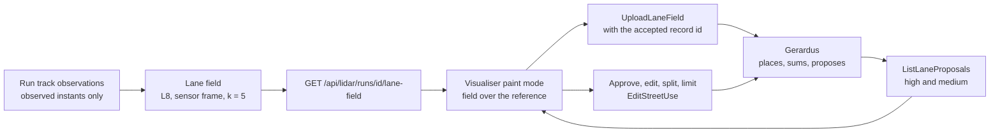

# Lanes from tracks: the lane field, Gerardus's proposals, and their review in the visualiser plan

Where the cars, cyclists and pedestrians were seen says where the lanes are. This plan sums a run's tracks into a lane field, an aggregate of distinct tracks, box extents and headings per cell that is the only track-derived thing to leave a site; sends it to Gerardus, which proposes travel lanes from it; and gives the macOS visualiser a top-down view of the cumulative tracks and box extents with the proposals drawn over them, graded high or medium, so an operator approves, edits or splits each into the travel lanes that velocity.report's speed reporting then uses per lane and per direction.

- **Status:** Proposed (the owner asked for it on November 3, 2026). D-32 holds twelve bodies of work active, so this plan takes a slot only when the owner parks one or names it; no code is written
- **Decisions:** D-32 (planning limits), D-36 (Gerardus owns static street geometry and accepted registration; L8 alone owns aggregation), D-38 (geometry is measured spatial data); Gerardus [ADR-0006](https://github.com/banshee-data/gerardus/blob/main/docs/adr/0006-boundary-with-velocity-report.md) and [ADR-0007](https://github.com/banshee-data/gerardus/blob/main/docs/adr/0007-grpc-interface-to-the-visualiser.md) (the bridge lives here), [ADR-0011](https://github.com/banshee-data/gerardus/blob/main/docs/adr/0011-publish-snapshots-and-aggregates-not-trails.md) (aggregates only, no bin under five tracks), [ADR-0012](https://github.com/banshee-data/gerardus/blob/main/docs/adr/0012-street-level-features-from-registered-scans.md) (proposals)
- **Layers:** L8 analytics (the lane field), L9 endpoints (one HTTP route and one CLI), L10 macOS visualiser (paint mode), the vendored Gerardus proto
- **Target:** unscheduled; proposed as the v0.7.19 slot in [BACKLOG.md](../BACKLOG.md#v0719---lanes-from-tracks-and-directional-speeds-0719)
- **Companion plans:** [Directional speed reporting](platform-directional-speed-reporting-plan.md) (what the approved lanes and their limits are for), [Posted speed limits](posted-speed-limits-plan.md) (the limit model, revised to live on these lanes), [Lane stitching](lidar-lane-stitching-plan.md) (its hand-drawn lane map is these lanes), [Behaviour analytics §10.1](lidar-behaviour-analytics-plan.md#101-roadway-context-does-not-exist-yet-including-the-speed-limit), [Visualiser alignment client](lidar-visualiser-gerardus-alignment-plan.md), [L7 scene §0](lidar-l7-scene-plan.md#0-where-implementation-stands-october-25-2026); Gerardus [LANE-PROPOSALS](https://github.com/banshee-data/gerardus/blob/main/docs/plans/LANE-PROPOSALS.md) (the other half: storage, derivation, review and tags)
- **Canonical:** [Gerardus alignment pane](../ui/visualiser/gerardus-alignment.md) (paint mode is documented there once built)

The lane field and the lanes are measured spatial data: where tracked objects were observed over a stated interval, and lines fitted to that, at a stated time. They are not a plan or a survey of the street, and a lane that is not proposed was not seen, which is not the same as absent. See [Geometry priors: data purpose](../geometry-priors-data-purpose.md).

## Motivation

The street painter in the visualiser marks travel lanes by hand over Gerardus's city centrelines, kerbs and boxes ([paint mode](../ui/visualiser/gerardus-alignment.md#paint-mode-the-street-painter)). It knows nothing of the traffic. Meanwhile every run stores thousands of track observations with a position, a heading and a box, and a replay in the visualiser already accumulates every track it has seen (`AppState.allSeenTracks`). The evidence of where the lanes are is on screen and in the database and nothing reads it.

Three things depend on lanes and are waiting:

- **Speeds per direction and per lane.** An intersection signed 25 mph one way and 30 mph the other cannot be reported against one limit. The [posted speed limits plan](posted-speed-limits-plan.md) attaches a limit to a stretch of road for one direction; that stretch is a travel lane in Gerardus, and until lanes exist there is nothing to attach a limit to. Reports, the API and the survey site then split by direction: the [directional speed reporting plan](platform-directional-speed-reporting-plan.md).
- **Lane-constrained stitching** ([lane stitching plan](lidar-lane-stitching-plan.md)) asks for a hand-drawn lane map per placement and prices one at an hour of drawing per site plus the risk of fitting the map to the tracks it is scored on. Lanes proposed from the field and approved by an operator are that map, drawn from evidence the operator checks rather than draws.
- **Gerardus's W5** tags traced paint against travel lanes at serve time, and INTERSECTION-MODE wants lanes per approach. Both have nothing to read at 22 of the 24 sites.

What this plan does not do: it does not move tracks. Gerardus receives a raster of counts with no cell under five distinct tracks, exactly the `LaneField` that SPEC-V1 §1 and ADR-0011 allow to leave a site, and nothing else.

## Current state

| Piece               | What exists                                                                                                                                                                                                                                                                                                                                                                                                                                                                                                                                                                                                                                                                                                                                | What is missing                                                                                                                                                                     |
| ------------------- | ------------------------------------------------------------------------------------------------------------------------------------------------------------------------------------------------------------------------------------------------------------------------------------------------------------------------------------------------------------------------------------------------------------------------------------------------------------------------------------------------------------------------------------------------------------------------------------------------------------------------------------------------------------------------------------------------------------------------------------------ | ----------------------------------------------------------------------------------------------------------------------------------------------------------------------------------- |
| Stored observations | `track_observations` per run: position, velocity, speed, heading, box length, width and height per accepted cluster ([track_store.go](../../internal/lidar/storage/sqlite/track_store.go)), with the observed-versus-coasted support token of [continuity.go](../../internal/lidar/l5tracks/continuity.go); `GET /api/lidar/observations` serves them raw for a window                                                                                                                                                                                                                                                                                                                                                                     | No aggregate over them; nothing counts distinct tracks per cell                                                                                                                     |
| L8 geometry         | [lateral_fit.go](../../internal/lidar/l8analytics/lateral_fit.go) scores lateral residuals on moving tracks (speed floors 6 and 2 m/s); [localpath.go](../../internal/lidar/l8behaviour/localpath.go) fits a directed local path from trajectories; [pathframe.go](../../internal/lidar/l8behaviour/pathframe.go) gives arc length, lateral offset and tangent along a directed path                                                                                                                                                                                                                                                                                                                                                       | No lane, no raster, no package a lane map can live in that imports no layer                                                                                                         |
| Visualiser          | Paint mode draws marks from above over the reference, snaps, saves one `EditStreetUse` ([StreetPainterSession.swift](../../tools/visualiser-macos/VelocityVisualiser/Alignment/StreetPainterSession.swift), [StreetUseEditor.swift](../../tools/visualiser-macos/VelocityVisualiser/Alignment/StreetUseEditor.swift), [StreetPainterPane.swift](../../tools/visualiser-macos/VelocityVisualiser/UI/StreetPainterPane.swift)); `allSeenTracks` and `trackHistory` accumulate a replay's tracks; [FrameAccumulation.swift](../../tools/visualiser-macos/VelocityVisualiser/Alignment/FrameAccumulation.swift) already sends moving tracks' boxes up as a scan's transient boxes; the alignment session holds the accepted pose and record id | No field overlay, no proposals, no approve, no split, no limit field                                                                                                                |
| Gerardus            | `TRAVEL_LANE` marks with `lane_type` and `width_m`, direction as the vertex order; W5 markings tagged against lanes; the accepted pose per scan                                                                                                                                                                                                                                                                                                                                                                                                                                                                                                                                                                                            | The lane field, the proposals, the review RPC and the `maxspeed` tags: Gerardus's [LANE-PROPOSALS](https://github.com/banshee-data/gerardus/blob/main/docs/plans/LANE-PROPOSALS.md) |
| Proto               | `align.proto` vendored, `make proto-gen-swift`                                                                                                                                                                                                                                                                                                                                                                                                                                                                                                                                                                                                                                                                                             | Re-vendoring after Gerardus adds `UploadLaneField`, `GetLaneField`, `ListLaneProposals`, `ReviewLaneProposal`                                                                       |

## Design

### 1. The lane field (L8)

A lane field is a raster over the sensor's horizontal plane, cell 0.25 m, in the sensor frame, that says per class group what distinct tracks did in each cell. The contract is fixed in Gerardus's [LANE-PROPOSALS §3](https://github.com/banshee-data/gerardus/blob/main/docs/plans/LANE-PROPOSALS.md#3-the-lane-field); this section is the velocity.report side.

**Inputs.** One run's track observations from the sqlite track store. A track counts when it is a confirmed track with at least ten observed instants (coasted and predicted instants are dropped first, by the continuity support token) and, for the vehicle group, a lifetime maximum speed of at least 2 m/s, so a car parked through the whole run paints no lane. Class groups follow the L6 label: `vehicle` (car, truck, bus, motorcyclist), `cyclist`, `pedestrian`; an unclassified track is left out.

**Channels per cell and class group**, as Gerardus stores them:

| Channel         | What is counted                                                                                                                                                                                                                   |
| --------------- | --------------------------------------------------------------------------------------------------------------------------------------------------------------------------------------------------------------------------------- |
| `tracks`        | Distinct tracks whose estimate fell in the cell at an observed instant                                                                                                                                                            |
| `box_tracks`    | Distinct tracks whose box footprint (length, width and heading at that instant) covered the cell's centre at an observed instant: the swept extent of the bodies, which is what gives a lane its width                            |
| `heading[8]`    | Distinct tracks by heading, eight 45° bins clockwise from the sensor's +Y, counted only at instants moving at 2 m/s or more (`LateralFitLocalMinSpeedMps`): below that the heading is noise, and a stopped car names no direction |
| `speed_sum_mps` | The sum of each counted track's mean speed in the cell, so a cell has a mean speed                                                                                                                                                |

Each track counts once per cell per channel however many instants it spent there, so a queue does not outweigh free flow. The box footprint is rasterised from the four corners the box's length, width and heading give at that instant; a track whose box has not converged (length or width zero) counts in `tracks` only.

**k.** A cell is emitted only when its `tracks` or `box_tracks` reaches five distinct tracks; other cells are absent. This is [ADR-0011](https://github.com/banshee-data/gerardus/blob/main/docs/adr/0011-publish-snapshots-and-aggregates-not-trails.md)'s rule applied at the source, so the field the operator sees is the field Gerardus sees, and no path exists that shows a thinner one. Track ids never enter the field.

**Three fields per run:** the whole run, and its first and second halves by time, so Gerardus's two-window agreement test (SPEC-V1 §6: two disjoint windows within 0.20 m) has independent evidence without per-track data.

**Where it is computed.** `internal/lidar/l8analytics/lanefield.go`: `BuildLaneField(observations, options) LaneField`, pure, over the observations the store returns, with the class grouping, the speed floors and k as options whose defaults are the ones above. It is an L8 aggregate (D-36). It imports no layer above L8 and no Gerardus code (ADR-0006 decision 4).

**Where it is served.** `GET /api/lidar/runs/{run_id}/lane-field?part=all|first_half|second_half` on the LiDAR HTTP mux, JSON: the header fields Gerardus's `LaneFieldHeader` names (sensor id, capture ref, window, part, cell size, origin, nx, ny, k, build and tuning fingerprint, track count) and the sparse cells per class group as parallel arrays. The visualiser reads it and the same JSON is what `velocity lidar lane-field --run <id> --out <dir>` writes offline, for the archive captures replayed on arrow, so fields can be uploaded with `gerardus upload-lane-field` without a visualiser. `k` is not a parameter: the route always applies five.

### 2. The visualiser: the cumulative view, the proposals, the limit

All of it is in paint mode, over the reference the alignment pane placed, north up, in the plan view the painter already locks the camera to. It needs an accepted pose at the site: without one there is no site frame to upload in, and the field toggle says so, as Accept's blockers do.

**The field overlay.** A new Metal overlay (`setFieldOverlay`), one quad per non-empty cell in the plan view, drawn under the marks and the reference lines:

- vehicle `tracks` as luminance on one hue (the cumulative tracks), `box_tracks` as a lighter halo of the same hue beyond them (the box extents), so a lane reads as a bright core with a soft edge;
- cyclists and pedestrians on two other hues, each switchable, so the operator sees where people are and where lanes therefore are not;
- direction glyphs: a small arrow every 2 m along the dominant heading of the cells under it, two arrows where a cell is two-way;
- a legend in the pane with the counts (tracks, captures) and a slider for opacity.

Two sources, both drawn: the current run's field from velocity.report's route (this recording), and the site's summed field from Gerardus's `GetLaneField` (every capture uploaded so far, the cumulative view). The pane names which is shown and offers both.

**Upload.** "Send lane field" uploads the run's three fields with the accepted record's id (`UploadLaneField`, chunked like a scan). Blocked without an accepted pose, while a save is pending, or when the server lacks `supports_lane_fields`; the same one-call-on-the-wire rule the alignment pane keeps for `EvaluatePose`. After the upload the summed field and the proposals are read again.

**Proposals.** `ListLaneProposals` returns Gerardus's proposed travel lanes with their tags and, per station, the lateral profile they were read from. They are drawn as centrelines with a width band in the lane's colour: `high` solid, `medium` dashed, adopted ones faint, rejected ones struck through, each with its direction arrow and a label (street, tracks, spread). The pane lists them sorted by grade, and selecting one centres the view and draws its lateral profiles as thin cross-lines, so the operator sees the ridge the line was fitted to.

**Approve, edit, split, reject.** All but reject are ordinary edits in the painter's undo stack:

- **Approve** adds a new `travelLane` mark with the proposal's vertices, `lane_type` and `width_m` and the tag `proposal=<id>`; the mark is selected and editable before Save like any mark. **Approve all high** adds every unadopted `high` proposal.
- **Edit** is the painter as it is: move, insert and remove vertices, Reverse, the tags.
- **Split here** turns a selected lane into two lanes end to end at the point under the cursor, snapped to the lane; both keep the tags, and the operator then changes one side's limit. In the save diff a split is a remove and two upserts in one batch.
- **Reject** calls `ReviewLaneProposal(REJECTED)` with the proposal's row id and a stable request id, through the same pending-request discipline the painter's Save uses; **Reopen** reverses it.

Save is the one `EditStreetUse` it is today; Gerardus snaps, drapes and checks, and tags the proposals an approved lane adopted, so the next read draws them faint.

**The limit on a lane.** The selected lane's section gains a limit row: a number field, a unit picker (mph, km/h), a source picker (sign, operator, statutory), a jurisdiction field prefilled from the site (`US-CA` for San Francisco) and a note. They write the tags `maxspeed` (`25 mph`, `40 km/h`: the unit inside the value, never converted, as the posted-limits plan requires), `maxspeed_source`, `jurisdiction` and `maxspeed_note`. A lane with no limit says "limit unknown"; the painter never suggests one. The lane tool's fields gain the same row, so a lane drawn by hand carries its limit from the start. Gerardus refuses a malformed value; the problem shows beside the mark as today's problems do.

**Direction.** "Travels towards N°" exists. The pane adds the `street` Gerardus fills and the direction label velocity.report will group it under (`Columbus Ave northbound`), so the operator sees the name a histogram will carry before anything is reported.

**Files.** `StreetPainterSession` (field and proposal state, the two reads, upload, approve, split, reject), `StreetUseEditor` (the new tags and the split), `StreetPainterPane` (field controls, proposals list, the limit row), `GerardusClient` (four RPCs), `MetalRenderer` (the field overlay), `StreetPaintStyle` (grades, hues), and `align.proto` re-vendored with `make proto-gen-swift`.

### 3. What crosses to Gerardus, and what does not

| Leaves the device                              | Form                                                                                                  | Rule                                                   |
| ---------------------------------------------- | ----------------------------------------------------------------------------------------------------- | ------------------------------------------------------ |
| The lane field                                 | Counts of distinct tracks per 0.25 m cell, eight heading bins, a speed sum; no cell under five tracks | ADR-0011 decision 2, SPEC-V1 §1's `LaneField`          |
| Approved lanes                                 | Authored `TRAVEL_LANE` marks with tags                                                                | As every street-use mark today                         |
| Rejections                                     | A review row naming the proposal                                                                      | Append-only, like registration reviews                 |
| Tracks, observations, trails, per-track speeds | **never**                                                                                             | ADR-0011; SPEC-V1 §1's `TrackSummary` is not an entity |

The field is also what the published survey site could one day show as a heat map; nothing here publishes it, and the publication checklist in [Geometry priors: data purpose](../geometry-priors-data-purpose.md#publication-checklist) would apply first.

### 4. What velocity.report changes

- `internal/lidar/l8analytics/lanefield.go` and its tests.
- `internal/lidar/server`: the lane-field route; `velocity lidar lane-field` in `internal/cmd/server`.
- The vendored `align.proto` and generated Swift.
- The visualiser files named above.
- Hub doc after it ships: [gerardus-alignment.md](../ui/visualiser/gerardus-alignment.md) paint mode section (D-33: it states what ships, so it changes with the code, not with this plan).

Nothing changes in the pipeline's layers, in the proto to the Go server, or in any schema: the field is computed from what is stored.

## Steps and acceptance

| Phase | Work                                                                                                                                                                                                               | Done when                                                                                                                                                                                                                                                                                                                                                                                                                                                                                                            |
| ----- | ------------------------------------------------------------------------------------------------------------------------------------------------------------------------------------------------------------------ | -------------------------------------------------------------------------------------------------------------------------------------------------------------------------------------------------------------------------------------------------------------------------------------------------------------------------------------------------------------------------------------------------------------------------------------------------------------------------------------------------------------------- |
| A     | `BuildLaneField` in L8, over a run's observations, with the class groups, the speed floors, k and the three parts                                                                                                  | Unit fixtures: a track counts once per cell however many instants; a parked car fills `tracks` and `box_tracks` and no heading bin; a cell with four tracks is absent and one with five present; a box's footprint covers the cells its corners say; the halves partition the whole's instants. Run on columbus-broadway's first segment on arrow: the field's vehicle ridges fall on Columbus Ave and Broadway by eye in a plotted PNG, kept as evidence under `docs/lidar/operations/` as a report, not raw output |
| B     | The HTTP route and the CLI                                                                                                                                                                                         | The route answers the JSON for a stored run within a second for a 10-minute run; the CLI writes the same bytes; `gerardus upload-lane-field` accepts the file (Gerardus W10a)                                                                                                                                                                                                                                                                                                                                        |
| C     | The field overlay in paint mode, both sources, the upload                                                                                                                                                          | On columbus-broadway with its accepted pose the field draws under the city streets and lines up with them; Send lane field stores three fields on arrow's Gerardus and the summed field returns; blocked states read right                                                                                                                                                                                                                                                                                           |
| D     | Proposals drawn with profiles; approve, approve all high, split, reject, reopen; the limit row; direction labels                                                                                                   | Against Gerardus W10b–c: an approval becomes a mark naming its proposal, saves, and the proposal returns adopted; a split lane saves as two with different `maxspeed`; a rejection sticks across a reload; a malformed limit shows Gerardus's problem; Undo walks each back                                                                                                                                                                                                                                          |
| E     | The real check with the owner: the sites with accepted poses (columbus-broadway, embarcadero-folsom, then the six that agreed across windows in [pose0003](../../data/experiments/pose/pose0003.md) once accepted) | Every `high` proposal within 0.30 m of the painted lane line or the owner's hand trace, counted per direction; what is learned goes into Gerardus's thresholds and this plan's "where it stands"                                                                                                                                                                                                                                                                                                                     |

Phase A and B need no Gerardus work and no visualiser; C needs Gerardus W10a; D needs W10b and W10c. The order lets A run this week on the archive captures while Gerardus builds its half.

## Tests

- `lanefield_test.go`: the fixtures of phase A; determinism (the same observations in any order give the same field); the JSON round-trips.
- Server: the route's status codes (no such run, a run with no observations gives an empty field with a header), the part parameter, k not overridable.
- Swift: `StreetPainterTests` gain the field overlay's cell quads for a two-cell field; approve produces the expected mark and diff; split produces a remove and two upserts sharing a vertex; the limit row writes and clears the four tags; reject and reopen send the right request with the row id; the blockers.
- A proto fixture test that the vendored `align.proto` carries the four RPCs before the Swift that calls them is merged.

## Risks

| Risk                                                                                                            | Likelihood | Impact | Mitigation                                                                                                                                                                       |
| --------------------------------------------------------------------------------------------------------------- | ---------- | ------ | -------------------------------------------------------------------------------------------------------------------------------------------------------------------------------- |
| The field's ridges sit toward the sensor (the near-side bias of a roadside LiDAR) and proposals come out offset | Medium     | Medium | `box_tracks` carries the body extent; Gerardus's per-class correction starts at 0 and phase E measures the residual against painted lines before anything is approved by default |
| Parked and queued vehicles blur a kerbside lane                                                                 | High       | Medium | Heading counts need 2 m/s; marked parking spaces exclude their cells in Gerardus; phase E says how much blur is left                                                             |
| Short captures fall under k at the lane ends                                                                    | High       | Low    | By design; the field sums over captures and more visits lengthen the lanes                                                                                                       |
| The visualiser's second gRPC channel gets a fourth and fifth long call                                          | Medium     | Low    | The alignment pane's one-call-on-the-wire rule extends to upload and review; cancellation drops the call as `EvaluatePose` does                                                  |
| Scope creep into a lane editor that replaces the painter                                                        | Medium     | Medium | Approve adds a mark; everything after is the painter as it is. Not-in-scope list below                                                                                           |
| Gerardus's half lands later than this one                                                                       | Medium     | Low    | Phases A–B stand alone and produce the fields on disk for the archive; C–D wait                                                                                                  |
| A thirteenth active plan under D-32                                                                             | Certain    | Low    | Proposed, not Active; the owner picks the slot                                                                                                                                   |

## Open questions

- Should the field be computed per run or per capture segment, given long archive captures are replayed in segments? Per run, with the capture ref naming the segment; Gerardus sums.
- Should `medium` proposals be approvable, or only `high`? Both, with the grade copied onto the mark's `confidence` tag for the record; the owner may narrow it.
- Does the web `/app/lidar/sites` page draw the field and proposals read-only? Yes, from Gerardus's GeoJSON and lane-field endpoints, later and not in this plan's steps.
- Where does the near-side correction belong, here (on the field) or in Gerardus (on the fit)? In Gerardus, so one parameter per class group is set against paint; the field stays what was observed.

## Not in scope

- Any per-track data leaving the device, any heat map on the public site.
- Lane fitting in Go: the fit is Gerardus's (ADR-0001, SPEC-V1 §6).
- Turning lanes and lanes inside the intersection box (INTERSECTION-MODE).
- Speed attribution, directions, reports and the survey site: the [directional speed reporting plan](platform-directional-speed-reporting-plan.md).
- Schedules on a limit (D-16): they follow the posted-limit item and attach to a lane by its id.
- The web street editor: retired in favour of the painter; the web page stays read-only.
