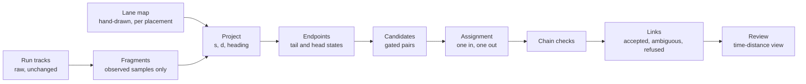

# LiDAR lane-constrained fragment stitching plan

- **Status:** Proposed; five specs written as `proposed` (none approved), no code written
- **Decisions:** relies on D-32 in two ways. The L7 scene plan is parked under it, so nothing here
  may need L7. Twelve plan files already carry Active or In progress, so this plan stays Proposed
  until one of them parks or completes. Proposes no DECISIONS entry until the held-out experiment
  answers, except the neutral geometry boundary (Scope, P1)
- **Layers:** L5 Tracks (offline identity links), a neutral lane-geometry package, L8 consumers,
  macOS review tool
- **Target:** none until [l5id0010](../../data/experiments/l5id/l5id0010.md) passes; offline and
  in shadow until then
- **Companion plans:** [behaviour analytics §9.2](lidar-behaviour-analytics-plan.md#92-coasting-is-not-observation),
  [deterministic track identity](lidar-deterministic-track-identity-plan.md),
  [bodies in motion](lidar-bodies-in-motion-plan.md) (its sparse-cluster linking row, L5 with L7)
- **Canonical:** [Dong2026 review](../lidar/operations/dong2026-lane-stitching-review.md)

## Motivation

A vehicle hidden behind another vehicle stops returning points, its track coasts and expires,
and when it reappears a new track starts. One vehicle becomes two or three tracks. Counts in a
zone go up, per-vehicle speed and following records are cut short, and identity scores
(fragmentations, IDF1) are worse than the detection is. Dong et al. report a 50 m zone count
error falling from 14.5% to 2.6% when such fragments are linked along lanes; the reference is
one Reno intersection, tuned on its own evaluation data.

The workflow asked for here constrains vehicles to directed lane segments, tracks them through
those segments, allows declared merges, and links fragments that one occlusion has split. The
consequence of not doing it is that every per-vehicle product — counts, max speed per vehicle,
following time — keeps an unmeasured bias wherever traffic is dense enough to occlude.

What this plan will not do: invent observations. A link says "A and B are the same vehicle";
it does not say where the vehicle was between them. Interpolated positions are display only and
carry no observation support, as §9.2 of the behaviour plan already requires.

## Current state

- **No lane concept in the Go code.** The word appears only in comments and tuning keys; there
  is no lane map, no segment identifier and no topology.
- **L5 already separates evidence from hypothesis.** [continuity.go](../../internal/lidar/l5tracks/continuity.go)
  records an observation-support token on every instant, an expiry reason on every deleted
  track, and can classify an absence as explained (occluded by a nearer body) or unexplained.
  The occlusion test there, which asks whether a nearer cluster covers the coasting track's
  apparent half-angle, is the physical evidence the paper does not have.
- **L5 already reacquires within its coast window.** Reacquisition guards and
  [overlap_end.go](../../internal/lidar/l5tracks/overlap_end.go) handle a track that is still
  alive. Nothing associates two tracks after the first has been deleted.
- **L8 has a path frame.** [pathframe.go](../../internal/lidar/l8behaviour/pathframe.go) gives
  arc length, signed lateral offset and tangent along a directed path, and
  [localpath.go](../../internal/lidar/l8behaviour/localpath.go) fits one from trajectories. It
  refuses forks and merges, and L5 must not import L8.
- **The evaluator can already see fragments.** `lidar-ground-truth-eval perframe` reports
  fragmentations, switches, HOTA and IDF1; `fate` reports what the gaps between one reviewed
  object's fragments are made of. Neither turns fragments into link truth yet.
- **Truth is thin.** kirk0 (83 s) and kirk1's first 272 s are the labelled captures; label0001's
  held-out window is proposed, not labelled.

## Design

### Pipeline, offline first

Raw tracks are never rewritten. The output is a link table and a derived identity chain that a
consumer may read beside the raw tracks.

### The lane map

A per-placement file, hand-authored and committed (it is configuration, like a tuning set, not
output). Each **segment** has an identifier, a directed centreline polyline in the sensor's world
frame, a corridor half-width, and a list of **successors**. A **transition** names a merge or
diverge: the segments it joins, the arc-length interval on each over which a vehicle may change
segment, and the route-distance offsets that put both segments' arc lengths on one axis. Lane
changes outside a transition are not modelled in the first version.

Geometry lives in a new neutral package that imports no layer: projection of a point to
`(segment, s, d, heading error)`, membership with hysteresis, and route distance through the
graph. L5 code and the L8 path frame can both use it; the L8 `PathFrame` interface can be
satisfied by a segment, so following can read a drawn lane where it now fits one.

### Fragments and endpoints

A fragment is a confirmed vehicle-class track's **observed** samples only; coasted and predicted
instants are dropped before anything is fitted. Its tail state is a robust fit of `s(t)` and
`d(t)` over the last `k` observed samples (Theil–Sen slope, residual spread as uncertainty); its
head state the same over the first `k`. The fit's anchor must be the same body point at both
ends: the published box's centre where the box model has converged, otherwise the cluster
centroid, recorded so a centroid shift is not read as acceleration.

**Disappearance and reappearance tests** replace the paper's boundary tolerance. A tail is
_internal_ when its predicted path stays inside the lane map's covered extent and the sensor
coverage for at least the gating horizon; a head is internal by the same test backwards. The
L5 expiry reason is carried as a feature: `occluded_inferred` (the continuity test found a
nearer body across the bearing) is evidence, `missed_unknown` and `misses` are not, and
`out_of_fov` makes a tail ineligible. The absence classification is default-off in L5; the
`coast_support` replay option switches it on without changing a single track, so every replay
this plan scores uses it, linked arm or not.

### Candidates, with the paper's equations made dimensionally consistent

A tail of fragment _i_ and a head of fragment _j_ are a candidate when all of:

- `0 < t_head(j) − t_tail(i) ≤ T_max`, or a bounded overlap of at most `n_ov` observed samples
  within `D_ov` metres (the paper's 3 samples within 5 m at 10 Hz) where `j` starts before `i`
  ends;
- the route distance satisfies
  `v_min·Δt − δ ≤ s_head(j) − s_tail(i) ≤ v_max·Δt + δ`, with `v_min` allowed to be zero for a
  stop and `δ` covering endpoint uncertainty; this replaces Equation 10's `S_min + Δt`;
- the two endpoints lie on the same segment, or on segments joined through a transition whose
  interval contains both, with `s` in route distance;
- the heads' and tails' lateral offsets, headings, extents and class are compatible within
  their uncertainties;
- no observed sample of _i_ and _j_ claims the same instant beyond the overlap allowance.

### Cost and assignment

Each candidate gets a cost: the squared normalised innovation of the head against the tail's
constant-velocity prediction in `(s, d)`, plus speed change, extent change and a class mismatch
term. `occluded_inferred` absence evidence lowers the threshold at which a link is refused; it never makes
a link on its own.

Tails and heads form a bipartite graph. A minimum-cost assignment with a "no link" dummy on each
side at the refusal cost gives every fragment at most one predecessor and one successor (the
existing `HungarianAssign` is enough at these sizes). A pair whose cost is within a margin of the
second-best competitor for either endpoint is marked **ambiguous** and left unlinked. This is the
part the paper leaves unspecified (ordering, ties, chains), so it is stated here and fixed in unit
fixtures.

### Chain checks

Accepted links compose into chains A→B→C. Time ordering forbids cycles once overlap is bounded.
Each chain is then checked as a whole: total travel feasible, no simultaneous observations, no
class flip without evidence. A failing chain drops its weakest link and is rechecked. Two
vehicles hidden together are the hard case: independent nearest-neighbour joins cross them, the
assignment does not, and the ambiguity margin refuses what it cannot separate.

### Output and consumers

| Record     | Fields                                                                                         |
| ---------- | ---------------------------------------------------------------------------------------------- |
| Link       | tail track, head track, gap seconds and metres, cost, margin, state, rule version, map version |
| Chain      | derived identity, ordered member tracks, observed intervals, unobserved intervals              |
| Provenance | lane map digest, linker parameter set, run id                                                  |

Counting reads chains. Max speed per vehicle reads the maximum over observed samples of all
members. Following reads members' observed samples only; an unobserved interval is ineligible
and a chain may not be paired with itself.

### Review view

The screenshot pattern is the right one: point cloud with the selected segment on one side,
`s(t)` traces per segment on the other, with controls to mark a wrong link and a missed link.
It belongs in the macOS tool, which is the project's one annotate-and-grade instrument. Graded
links are link truth for a second site without full per-frame labels.

## Core algorithm work and estimates

Estimates are a person's focused hours for the code and its tests, from the size of the nearest
existing pieces (the path frame, overlap end, the `fate` subcommand). They exclude review and
experiment runtime.

| #   | Component                                                                                               | Where                                                | Estimate              | Needed by          |
| --- | ------------------------------------------------------------------------------------------------------- | ---------------------------------------------------- | --------------------- | ------------------ |
| C0  | `ground_truth_eval` as a job kind; the `lane_membership` and `identity: chains` measures (Flo estimate) | `internal/lidar/jobs`, `lidar-ground-truth-eval`     | 8h                    | l5id0007, lane0001 |
| C1  | Link truth from per-frame matching: true, wrong and missed links per GT object                          | `perframeeval`, `lidar-ground-truth-eval links`      | 4h                    | l5id0007           |
| C2  | Lane map format, loader, validation; projection, hysteresis, route distance                             | new neutral package; file per placement              | 8h                    | lane0001           |
| C3  | Lane-map authoring: draw on the macOS tool's point cloud, export the file                               | macOS visualiser                                     | 6h                    | lane0001           |
| C4  | Fragment extraction from a run (observed-only) and robust endpoint fits                                 | L5 sub-package, reads run tracks                     | 4h                    | l5id0008           |
| C5  | Candidate gates, cost, bipartite assignment with dummies, ambiguity margin                              | same sub-package; reuses `HungarianAssign`           | 6h                    | l5id0008           |
| C6  | Chain composition and whole-chain checks                                                                | same sub-package                                     | 3h                    | l5id0008           |
| C7  | A Dong-like baseline: the paper's gates on a straight lane, its exclusive match                         | same sub-package, separate option                    | 2h                    | l5id0008           |
| C8  | Offline tool: run → links and chains JSON; scores against C1; zone counts                               | `cmd/tools/lidar-fragment-link`                      | 4h                    | l5id0008           |
| C9  | Linker parameters as default-off tuning keys, with parameter sets per arm                               | `config/tuning.defaults.json`, `config/experiments/` | 1h                    | l5id0008           |
| C10 | Time-distance review view with wrong-link and missed-link grading                                       | macOS visualiser                                     | 12h                   | l5id0009           |
| C11 | Transition handling through merges, with route-distance offsets                                         | C2 and C5                                            | 4h                    | l5id0009           |
| C12 | Link and chain persistence, a migration, an API read                                                    | storage, L9                                          | 6h                    | after l5id0010     |
| C13 | Live fixed-lag linking: revise links within a lag, publish when final                                   | L5 and composition root                              | 12–20h                | not queued         |
| C14 | Chain adapter for counting, max speed and following, with unobserved-interval tests                     | L8 consumers, offline adapter                        | 3h (matches l5id0010) | l5id0010           |
| C15 | `ContinuityCoverage` declaration per new placement, from a survey (Flo estimate)                        | `internal/lidar/replayeval`, site record             | 2h each               | l5id0009, l5id0010 |

Offline shadow (C0–C9) is about 46 hours; review and merges (C10–C11) add 16; the held-out
consumers and coverage (C14–C15) add 7; persistence (C12) and live linking (C13) are not
scheduled. The algorithm itself (C4–C7) is about 15 hours. The truth, map and review work around
it (C0, C1, C2, C3, C10) is about 38.

Counted per spec, the five linker specs and the two label specs put about 86 person-hours on one
operator: 54 of implementation, 13.5 of label work, 15.5 of writes, draws and grading, and 3 of
consumers. The table does not carry the label work or the writes, draws and grading. The queue's
longest-chain figure (67h53m) is a path, not a calendar. Queue actuals are mixed: l5id0001 to
l5id0004 ran at about half their estimates and l8fol0003 at about five times, so no padding
should be assumed.

## Scope and sequence

| Phase | Work                                    | Experiment                                          | Gate to proceed                                                                                               |
| ----- | --------------------------------------- | --------------------------------------------------- | ------------------------------------------------------------------------------------------------------------- |
| P0    | C0, C1; census of fragment gaps on kirk | [l5id0007](../../data/experiments/l5id/l5id0007.md) | at least 40 true vehicle links (spec rule 1), and at least half the gaps occlusion-shaped (rule 2)            |
| P1    | C2, C3; lane maps for kirk              | [lane0001](../../data/experiments/lane/lane0001.md) | membership and drawing time inside the spec's rule; a D-NN for the neutral geometry boundary before C2 merges |
| P2    | C4–C9; offline baseline and lane linker | [l5id0008](../../data/experiments/l5id/l5id0008.md) | link precision and identity scores on kirk's tuning split                                                     |
| P3    | C10, C11; merges, a second placement    | [l5id0009](../../data/experiments/l5id/l5id0009.md) | merge links graded at the same precision                                                                      |
| P4    | frozen held-out score and consumers     | [l5id0010](../../data/experiments/l5id/l5id0010.md) | held-out precision; following and counts unchanged in kind                                                    |
| P5    | C12, a decision on persistence          | none                                                | a `D-NN` entry                                                                                                |
| P6    | C13, live fixed-lag                     | not queued                                          | a Pi timing experiment written then                                                                           |

P0 and P1 do not depend on each other and can run in parallel. P2 needs both.

## Acceptance rules, proposed

These are engineering rules for this project, not values from the paper. Each spec restates
the rule that binds it, written before its runs.

- **Wrong links are worse than missed links.** A wrong link merges two vehicles; a missed link
  leaves today's state. Vehicle link precision must be at least 0.98, with recall reported.
- **Identity scores must not fall.** HOTA and IDF1 on the same split no lower than without
  links less 0.005; identity switches no more.
- **Counts are read, not tuned on.** The 50 m zone count error is reported for every arm and
  decides nothing on the split it was tuned on.
- **Observed time does not grow.** Total observed vehicle seconds is identical with and without
  links; a change means an interval was invented.

Two facts bind these rules. Below 50 accepted links, a precision of 0.98 admits no wrong link.
A zero-error record of 40 links gives a 95% lower bound of about 0.91; about 180 zero-error links
are needed for a lower bound of 0.98. The rules above are the point test only, and any report
states the count and an interval beside each ratio. None of the rules yet requires a linker to
gain anything over `a0`; the Flo review (Findings 2 and 3) asks the owner to set that clause
before l5id0008 runs.

## Dependencies

- label0001 (held-out window) before l5id0010; label0002's following records for the consumer
  check.
- The macOS visualiser for C3 and C10. No active plan owns it:
  [lidar-review-workflow-plan](lidar-review-workflow-plan.md) is Parked, and its revisit trigger,
  a held-out window needing it, is met by label0001. Name the owner at approval.
- `ground_truth_eval` is a planned kind, not a job kind, and the `lane_membership` and
  `identity: chains` measures do not exist (C0). No link or lane spec runs before C0 lands.
- `coast_support` refuses a placement without a `ContinuityCoverage` declaration (C15). kirk0 has
  one (the replay test names it); kirk1's, the l5id0009 site's and the held-out site's are not
  yet confirmed.
- The 50 m count measure is l5id0006's implement step (`lidar-box-eval`). l5id0008 and l5id0010
  report it, so they either depend on l5id0006 or build it here.
- The held-out map is drawn inside label0001's select step, before any labelling.
- No dependency on the L7 scene plan (parked under D-32) or on deterministic track identity,
  though links keyed by `CreationSequence` replay reproducibly where random IDs do not.

## Risks

| Risk                                                                 | Consequence                                                                                        | Mitigation                                                                                     |
| -------------------------------------------------------------------- | -------------------------------------------------------------------------------------------------- | ---------------------------------------------------------------------------------------------- |
| kirk has too few occlusion fragments to score precision at 0.98      | the rule cannot be read                                                                            | l5id0007 counts first; graded links on a second placement (C10)                                |
| Fragments are mostly L3/L4 loss, not occlusion                       | a linker hides an upstream fault                                                                   | l5id0007 reads `fate` for each gap; upstream fixes stay in l3bg/l4clus                         |
| Thresholds tuned on kirk do not transfer                             | precision falls at a busier placement                                                              | held-out window; parameters per placement class, not per site                                  |
| A merged detection (two cars, one cluster) looks like a fragment gap | a link over a gap the linker cannot see into                                                       | overlap check; duplicates stay with l5id0006                                                   |
| Drawing lane maps costs more than it saves                           | the workflow does not scale past a few placements                                                  | lane0001 times it; fitted maps from trajectories are a later option                            |
| Consumers read interpolated positions                                | following time or speed from no observation                                                        | chains expose observed intervals only; a test on each consumer                                 |
| Link pool shrinks as the tracker improves                            | kirk0 has 48 fragmentations at `a0`, 31 to 36 under the duplicate arms; the 40-link floor may fail | the floor is checked on the arm the linker runs on; a shortfall is reported, not worked around |
| Held-out window too short for a link count                           | l5id0010's precision rule is unreadable on 3 minutes, half of kirk's span                          | lengthen the window, or state the floor and an unreadable outcome, before label0001 draws it   |
| The held-out window serves four experiments                          | a pass after an L3 or geometry tune on it is no longer held-out                                    | l5id0010 names its tuning file and physical revision; every look is logged in the spec         |
| One operator runs every human step                                   | about 86 person-hours on one queue; the 67h53m chain understates it                                | schedule label0001 in P0; plan on the calendar, not the chain                                  |
| Unmatched tracks counted as wrong links                              | unlabelled vehicles deflate precision, so the gate measures labelling                              | unmatched tracks are unknown and reported apart from wrong links                               |
| The macOS review tool has no active owner                            | C3 and C10 stall behind a Parked plan                                                              | name an owner at approval; spike C10 for 2h, then build the grading minimum only               |

## Flo review

- **Date:** 2026-10-21
- **Verdict:** approve with changes. The sequence and scope are sound. The pre-registered
  rules need a benefit clause and a link floor, the fallback needs rewriting, and the tooling
  and parameter-set gaps need closing, all before any of the five specs is approved. Nothing has
  run, so the changes cost nothing yet.

Findings (H high, M medium, L low):

1. **H. The held-out window cannot carry l5id0010's rule.** label0001 draws 3 minutes; kirk's
   labelled span is 355 s and the floor is 40 links. Lengthen the window, or state a link floor
   and an unreadable outcome.
2. **H. A 0.98 precision clause admits no wrong link below 50 accepted links.** Keep the point
   rule; print the count and a Clopper–Pearson interval beside each ratio.
3. **H. No pass clause requires benefit.** An arm linking one correct pair passes l5id0008
   rule 1 and l5id0010 rule 1. The owner sets a recall or fragmentation floor against `a0`
   before l5id0008 runs.
4. **H. The fallback drops the comparison, and l5id0009 cannot read it.** Under 40 links,
   `lane-assign` is carried on design alone; rules 2 and 3 are then unreadable, since
   l5id0009 runs no dong-like or occlusion arm. It is not circular (no output feeds back).
   Add the dong-like arm to l5id0009; under 30 graded links, the linker stops unshipped.
5. **H. `ground_truth_eval` is a planned kind, not a job kind.** `jobs.Kinds` has benchmark,
   state_estimation_baseline, track_scorecard and vrlog_record. Four specs need the planned
   kind and two measures that do not exist. C0 (8h, Flo estimate) is added; it must land
   before l5id0007 is approved.
6. **H. The arms break AGENTS.md's parameter-set rule.** They name `config/tuning.defaults.json`
   plus replay flags; `fragment_link_*` does not exist; `coast_support` has no config key.
   C9 builds one set per linker arm, with its row in `config/experiments/README.md`.
7. **M. D-32 is at its cap.** Twelve plan files carry Active or In progress. This plan goes
   Active only when one parks or completes. The owner decides which.
8. **M. The estimates under-count.** The table held 54h for C1 to C11; the specs carry about
   86 person-hours on one operator. C0, C14 and C15 are added, and the gap is stated.
9. **M. Estimate disagreement, fixed.** l5id0008 implement was 19h against C4 to C9 at 20h.
   Set to 20h; the graph is regenerated.
10. **M. A draw estimate contradicts its own rule.** lane0001 `draw` is 1h; clause 4 needs under
    45 minutes. The owner keeps 45 minutes and accepts the expected failure, or moves clause 4
    to 60 minutes before drawing. Not changed.
11. **M. The P0 gate disagreed with its spec.** It said "most gaps"; rule 2 says "fewer than
    half" only triggers a report. The plan now says "at least half". Open: whether a share below
    half halts l5id0008.
12. **M. The link pool is the tracker's own fragmentation count.** kirk0 has 48 at `a0`
    (l5-duplicate-tracks-2026-10.md) and 31 to 36 under the duplicate arms. The floor may fail
    once those ship. Measure the floor on the arm the linker runs on.
13. **M. "Matched to none" counts as wrong.** Unlabelled vehicles would deflate precision.
    Unmatched tracks become unknown, reported apart.
14. **M. `coast_support` needs a coverage declaration per placement** (`replayeval/coverage.go`
    refuses without one). C15 adds it, 2h each, Flo estimate; l5id0009 and l5id0010 get a
    manual step before approval.
15. **M. The macOS tool has no active owner.** lidar-review-workflow-plan is Parked, and its
    revisit trigger is met by label0001. Name the owner at approval.
16. **M. The held-out window serves four experiments** (l3bg0009, label0002 with l8fol0005,
    geometry W7, l5id0010). l5id0010 names its tuning file and physical revision.
17. **M. "Draw without opening labels" cannot be enforced** when one operator labels the window.
    Draw the held-out map in label0001's select step, before labelling; freeze its digest.
18. **M. C10 (12h) is the largest unspiked estimate.** Spike 2h first, then build the grading
    minimum: link list, wrong and missed toggles, two-fragment time-distance strip. The full
    segment panel waits. C13 stays unscheduled; C12 waits for l5id0010.
19. **M. Counts are read but carry no value clause.** Before l5id0010 runs, state the
    held-out direction, for example a count error no higher than `a0`'s.
20. **L. Pre-registration needs a commit.** The "2026-10-21" stamps are dates, not proof. Record
    the approving commit SHA in each spec.
21. **L. Companions and boundary.** Bodies in motion is linked. The behaviour plan (line 621)
    says not to wait for an authored lane map; this plan does not. The neutral geometry boundary
    and "L5 must not import L8" have no DECISIONS entry; P1 now requires one.

Checked against code and held: `continuity.go` carries `occluded_inferred`,
`missed_unknown`, `out_of_fov` and `misses`; the `coast_support` test asserts identical tracks;
`PathFrame` and `localpath.go` refuse forks and merges; `HungarianAssign` exists. D-32 is
otherwise respected: one body, one plan, a BACKLOG queued-slot item.

Resulting sequence:

1. Now, in parallel: C0 with l5id0007's implement; C2 and C3 with lane0001's implement; label0001
   select and propose, moved into P0 (the longest human lead time, and no linker waits on it).
2. Gate A: l5id0007 links and fate, under rules 1 and 2 as corrected (Finding 11).
3. Gate B: lane0001 membership, with clause 4 decided (Finding 10).
4. C9 parameter sets and the geometry-boundary D-NN, then the floor from Finding 3 is set.
5. l5id0008 (C4 to C8, 20h): replay, links, score.
6. Gate C: pass, or the l5id0009 fallback with the dong-like arm added (Finding 4).
7. C10 spike, then the grading minimum; l5id0009 replays, grades and decides transitions.
8. label0002 fit and following, after label0001 freezes.
9. l5id0010: held-out, consumers (C14), counts reported; then the D-NN on persistence (P5).
