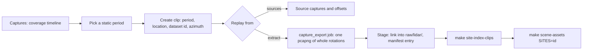

# Unsited captures: locate, clip, extract and publish from the web UI

- **Status:** Active (October 22, 2026). The owner unparked survey publishing for these captures
  on October 22, 2026; this plan is the one active plan for it, and the scene catalogue plan
  records the unpark. The tooling is delivered; the positions wait on coordinates. The parted
  capture export (300 s grid) stays parked
- **Layers:** L1 captures and the capture index, clips, LiDAR sites; publishing (Hugging Face
  dataset, scene assets); web (`/lidar/captures`, `/lidar/clips`)
- **Companion plans:** [platform-survey-capture-export-plan](platform-survey-capture-export-plan.md)
  (parts rubric), [lidar-scene-catalogue-publishing-plan](lidar-scene-catalogue-publishing-plan.md),
  [lidar-captures-multi-file-cases-plan](lidar-captures-multi-file-cases-plan.md),
  [s2-geographic-indexing-plan](s2-geographic-indexing-plan.md)
- **Canonical:** [clip-management-implementation](../lidar/operations/clip-management-implementation.md)

Sixteen captures from September 2025 to January 2026 have no site, no location and no published
scene. This plan inventories them, lists the static stretches worth publishing, and records the
web-UI workflow built for them. The operator locates a static period on the coverage timeline,
keeps the clip as a reference to its source captures or cuts it to a standalone extract, stages
the extract into the dataset clone, and runs the scene publisher.

## Inventory

Facts below come from the capture index in a clone of the root `sensor_data.db` (roots under
`/Volumes/lidar/lidar/pcaps`, every file probed `ok`, port 2369, motion passes present), and from
the dataset manifest at `/Volumes/lidar/lidar/pcaps/sf-street-speeds/manifest.json`. Static and
motion are the point-cloud motion pass's classification (background drift over a 60 s refreshed
baseline, `pcapsplit/classifier.go`). There is no GPS input.

| Folder | File                                      | Start (PT)       |    Length | Static periods (local time, seconds)                                     |
| ------ | ----------------------------------------- | ---------------- | --------: | ------------------------------------------------------------------------ |
| kirk   | kirk0.pcapng                              | 2025-12-05 14:17 |      83 s | 14:17:04–14:18:27 (83), **published as `kirkham-9th`**, whole file       |
| kirk   | kirk1.pcapng                              | 2025-12-05 14:19 |    2045 s | 14:19:15–14:53:20 (2045), all static                                     |
| kirk   | kirk2.pcapng                              | 2025-12-05 14:58 |    2336 s | 14:59:53–15:13:32 (819); 15:14:54–15:37:49 (1374)                        |
| kirk   | krik-stable-3                             | 2025-12-05 15:14 |    1393 s | Same clock span as kirk2's second static period, and the same size share |
| soma   | soma0.pcapng                              | 2025-12-06 12:23 |    3358 s | 12:23:34 (111); 12:57:34–13:02:21 (287); 2960 s classed motion           |
| soma   | soma1.pcapng                              | 2025-12-06 13:42 |     663 s | 13:42:21–13:53:24 (663), all static                                      |
| soma   | soma2.pcapng                              | 2025-12-06 13:53 |    1356 s | 13:53:47 (109); 14:14:34 (66); 1181 s classed motion                     |
| soma   | soma3.pcapng                              | 2025-12-06 14:16 |    4372 s | 14:16:38–14:40:45 (1447); 14:52:38 (67); 2859 s classed motion           |
| morg   | morg0–morg3                               | 2025-12-14 16:32 | 4×~20 min | Four all-static files, 90–100 s gaps between them, 16:32–17:57           |
| clar   | claren0.pcapng                            | 2026-01-15 14:13 |    2510 s | 14:13:02–14:54:52 (2510), all static                                     |
| clar   | clar0.pcapng                              | 2026-01-15 15:55 |     840 s | 15:55:48–16:09:47 (840), all static                                      |
| hesai  | big-lidarr-hesai-2025-09-26-filter.pcapng | 2025-09-26 15:17 |    1709 s | 15:17:45–15:46:14 (1709), all static                                     |

Also unsited, and outside this plan: `2025-10-08-chior` (seven files, Oct 8 2025) and
`broadway-columbus` (two files from 2026-09-02 13:15, probably duplicates of the published
`columbus-broadway` survey from the s2 archive).

### What the inventory says

- **Kirk is three positions.** kirk0 and kirk1 are 48 s apart; kirk2 has two static periods with
  an 82 s move between them. `krik-stable-3` is a hand cut of kirk2's second period, not a new
  capture: publish from kirk2 and treat `krik-stable-3` as a derived copy (confirm by digest
  before retiring it).
- **kirk0's manifest entry is hand-written.** Its `static_export_policy` is
  `whole_original_capture`, a value no tool in the repository writes.
- **soma is mostly motion.** About 7,000 of its 9,750 seconds are classed motion. Either the
  sensor was carried between positions, which makes those stretches a route under V28, or the
  classifier is reacting to a busy scene. Only soma1 (663 s) and soma3's first period (1447 s)
  are long enough to publish as static surveys. soma0's 287 s period is marginal. The short
  periods are setup or a pause.
- **morg is one to four positions.** The files are all static with short gaps, which fits
  restarting the recorder at one place or moving between four places.
- **clar has two positions or one revisit**, an hour apart. The radar site `Clarendon`
  (37.75321, −122.45604) is a candidate location for one of them.
- **Three candidates exceed the 4 GB part ceiling.** kirk1 (4.9 GB), claren0 (6.0 GB) and
  hesai-2025-09-26 (4.1 GB). The extract writes one file whatever its size (decision Q2).

### Candidate positions

The operator supplies coordinates (and a north azimuth where known) for each row. Dataset ids
are placeholders until named; each must be unique, so a second survey at a published site takes
its own id (for example `kirkham-9th-k1`).

| Position | Source window                       |       Static | Notes                                          |
| -------- | ----------------------------------- | -----------: | ---------------------------------------------- |
| K1       | kirk1 (and kirk0, if the same pose) |       2045 s | Same site as `kirkham-9th` if the pose matches |
| K2       | kirk2 static-0, 14:59:53–15:13:32   |        819 s |                                                |
| K3       | kirk2 static-1, 15:14:54–15:37:49   |       1374 s | Replaces `krik-stable-3`                       |
| S1       | soma1, 13:42:21–13:53:24            |        663 s | soma2's first 109 s may be the same pose       |
| S2       | soma3 static-0, 14:16:38–14:40:45   |       1447 s |                                                |
| S3       | soma0 static-1, 12:57:34–13:02:21   |        287 s | Optional; short                                |
| M1–M4    | morg0, morg1, morg2, morg3          | ~20 min each | One site or four                               |
| C1       | claren0                             |       2510 s | 6.0 GB, one file                               |
| C2       | clar0                               |        840 s | Same site as C1 or not                         |
| H1       | big-lidarr-hesai-2025-09-26-filter  |       1709 s | 4.1 GB, one file                               |

## What was built

The hub doc's
[extracts and publishing](../lidar/operations/clip-management-implementation.md#extracts-and-publishing)
section is the reference. In short:

| #   | Item                                                                                                             | State                                      |
| --- | ---------------------------------------------------------------------------------------------------------------- | ------------------------------------------ |
| 1   | Captures page: a clip from a period records `source_period_id`, and takes a dataset id, an azimuth and "cut now" | Done                                       |
| 2   | A survey name for publishing: `dataset_id` on the clip (unique), rather than a slug on the LiDAR site            | Done; a site slug waits on Phase 2's sites |
| 3   | `capture_export` job, `internal/lidar/capexport`, `POST /api/lidar/clips/{id}/extract`                           | Done                                       |
| 4   | Clips page publishing panel: extracts, storage (sources or extract), dataset id, azimuth, stage                  | Done                                       |
| 5   | Staging into the dataset clone and `GET /api/lidar/dataset/site-index`; `merge-clip-sites.py`                    | Done                                       |
| 6   | Locate, extract, stage and publish scenes for each position                                                      | Waits on coordinates                       |

Checked on a scratch server and database with kirk0: scan, motion pass, a clip from its static
period with a location and dataset id, an extract of 830 rotations whose source digest equals the
published `raw_sha256`, a replay of the extract through libpcap (830 frames, 114 tracks), staging
(a hard link and a manifest entry) and the site-index endpoint.

## Running it for these captures

1. **Server.** Run from a fresh `make build-radar-local` with `local.mk` setting
   `LIDAR_PCAP_DIR = /Volumes/lidar/lidar/pcaps`; `S2_CORPUS_DIR` then defaults to the dataset
   clone there, and the dev targets pass it as `--lidar-dataset-dir`. Migration 066 applies on
   start. Extracts are written to `/Volumes/lidar/lidar/pcaps/clips/`, on the same volume as the
   dataset clone, so staging is a hard link and costs no space.
2. **Per position** on `/lidar/captures`: open the session, click the static period named in the
   table, check the trim, enter the coordinates, the dataset id and the north azimuth if known,
   leave "cut the standalone extract now" ticked, and create the clip. The extract runs on the
   capture queue; it reads every source in full for its digest.
3. **On `/lidar/clips`**, for each clip once its extract completes: set "Replay from" to the
   extract if replays should use it, and press "Stage into dataset".
4. **Index and scenes.** `make site-index-clips` writes the new entries into
   `tools/s2-archive/site-index.json`; review and commit it. Then `make scene-assets-status`, and
   `make scene-assets SITES="…"` under the preflight in `AGENTS.md`.
5. **Publish.** Review the dataset clone's diff (`manifest.json` and the new `raw/lidar/` files)
   and push it to the Hub by hand.

## Decisions

| #   | Question                                                                                     | Decision                                                                                          |
| --- | -------------------------------------------------------------------------------------------- | ------------------------------------------------------------------------------------------------- |
| Q1  | Unpark survey publishing for these sites ahead of v0.6.6                                     | Yes, by the owner on October 22, 2026                                                             |
| Q2  | Above 4 GB: two parts on the 300 s grid, or one file as the dataset does today               | One file; the parts rubric waits on the capture export plan                                       |
| Q3  | Does `kirkham-9th` grow to cover kirk1, or does kirk1 become its own survey at the same site | Its own survey with its own dataset id; kirk0 stays as published with its labels                  |
| Q4  | soma's motion stretches: a carried scan (a route, V28 opt-in) or a busy scene                | Publish only the static periods; the motion stretches are not exported                            |
| Q5  | chior, hesai-2025-09-26 and broadway-columbus: in scope?                                     | hesai-2025-09-26 is in (owner, October 22, 2026); chior and broadway-columbus are not             |
| Q6  | Where does the survey's name live while sites are split between radar and LiDAR tables       | On the clip, as `dataset_id`; the LiDAR site keeps its label. Phase 2's unified sites may move it |

## Open

- **D-34.** New scene assets still land in `public_html/src/scenes/`, in Git. D-34's first step
  moves scene assets out of Git; until it lands, each new scene adds to the repository.
- **Coordinates.** Item 6 needs a latitude and longitude for every position, and the owner's
  answers on K1 against kirk0, morg's count and clar's count.
- **The full `build-site-index.py` rebuild** keeps clip entries by code reading; only the
  `--marks-only` path was run with one present, because the full path needs the archive's
  analysis tree.
