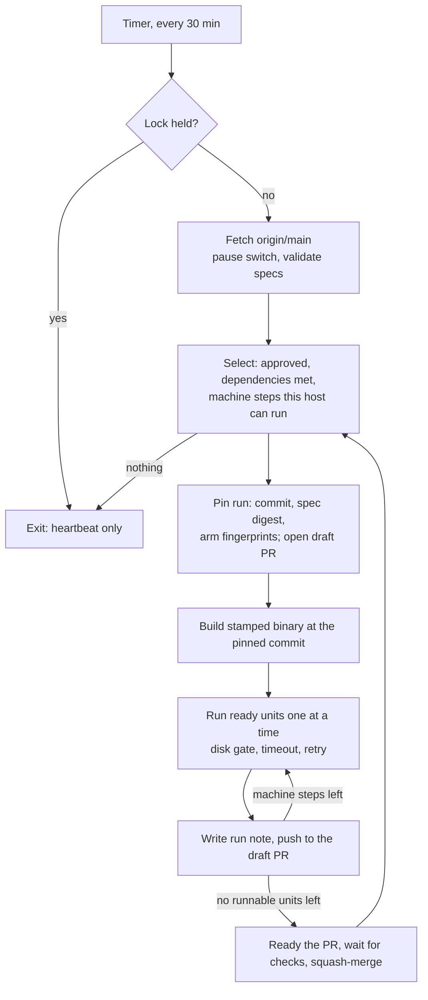

# Unattended experiment harness on the NAS

A design for a harness that runs the project's approved experiments on the NAS without an agent
or a person steering it. Every 30 minutes it reads `main`, works out which approved experiments
have machine work it can do, builds the code they need, runs their replays, evaluations and
sweeps, and publishes what it measured as a pull request that it merges itself. An agent then
reads the merged results, writes the report and decides what runs next. The harness is the
mechanical half of the experiment queue: it reuses the specs, units and job kinds that already
exist and replaces the shell lanes that every unattended run has rebuilt by hand.

- **Status:** Proposed, October 22, 2026. Nothing is built. The owner took all seven decisions in
  section 13 on October 22, 2026, so H1 can start
- **Canonical:** [Experiments](../../data/experiments/EXPERIMENTS.md)
- **Layers:** platform (jobs, workers, CI); every LiDAR layer as a subject
- **Related:** [experiment queue](platform-experiment-queue-plan.md), [worker pool and results hub](lidar-worker-pool-and-results-hub-plan.md) (D-30), [run-experiments skill](../../.claude/skills/run-experiments/SKILL.md), [experiment-review skill](../../.claude/skills/experiment-review/SKILL.md), [analysis worker](../lidar/operations/analysis-worker.md), [TrueNAS VM shared storage](../platform/operations/truenas-vm-shared-storage-runbook.md)

## 1. Goal and boundary

The owner asked for this on October 22, 2026. The harness runs on the NAS, reads the repository
on a schedule, finds the work that approved experiments need (sweeps, parameter sets, builds),
does it, and creates and merges a PR with what it found. It needs no agent: the agent reads the
results and decides which experiments come next. Experiments must keep running when no agent or
person is steering them.

Every experiment has a judgement half and a mechanical half. The harness takes the mechanical
half and none of the judgement half:

| The harness does                                                                                          | The harness never does                                              |
| --------------------------------------------------------------------------------------------------------- | ------------------------------------------------------------------- |
| Chooses approved experiments whose machine steps it can run                                               | Writes, edits or approves a spec, a rule or a status                |
| Builds a stamped binary at the commit it pins                                                             | Runs a branch other than `main`, or a command line taken from Git   |
| Runs replays, evaluations, screens and sweep grids from checked-in parameter sets                         | Writes a parameter set or changes `config/tuning.defaults.json`     |
| Keeps raw output on the NAS                                                                               | Commits raw output                                                  |
| Writes a run note: provenance, per-arm and per-case headline measures, failures, mechanical rule verdicts | Writes the report's interpretation, limitations or recommendations  |
| Opens, checks and merges a PR that adds only its run note                                                 | Closes a manual step, marks a spec `answered` or adopts a candidate |

So "without agent involvement" means that the NAS keeps working through every approved
experiment's machine steps, end to end, while no one is watching. Judgement stays with the agent
and the owner, and becomes cheaper: an agent starts from one merged run note in Git instead of
reconstructing a run from scratch evidence.

## 2. What the last ten days show

**The same lane was rebuilt for every run.** There were seven unattended runs between October
11 and 20 (`blend`, `overnight`, `followup`, `boxrot`, `consol`, `perf0002` and `exp-20261020`).
Each run built its lanes by hand under `~/vr-scratch/<run>/`, and together they left 110 shell
and Python scripts. The October 20 corpus lane says it was "adapted from" the October 18 one.
Every lane follows the same loop:

1. read the units with `experiments units`;
2. claim a unit by making a directory;
3. wait while the disk is short of space;
4. `mark` the unit `start`;
5. replay it with the arm's parameter set and replay options;
6. write the provenance;
7. run a screen;
8. move the evidence to the volume;
9. `mark` the unit `done` or `failed`.

A watchdog script sits beside the loop. That loop is the core of the harness, and today it exists
only as scratch copies.

**Specs are dominated by a few kinds.** Across the 76 specs (45 answered, 6 approved, 25
proposed) the steps are:

| Kind                        | Steps | Class                  | Executor today                                              |
| --------------------------- | ----: | ---------------------- | ----------------------------------------------------------- |
| `manual:write`              |    70 | manual                 | a person or agent                                           |
| `manual:implement`          |    54 | manual                 | a person or agent                                           |
| `state_estimation_baseline` |    51 | job kind               | the worker's checkout path; lanes call the tool directly    |
| `ground_truth_eval`         |    43 | planned                | `lidar-ground-truth-eval`, called by hand                   |
| `box_eval`                  |    32 | planned                | `lidar-box-eval`, called by hand                            |
| `corpus_screen`             |    17 | planned                | a new Python screen for each run (`screen_l8fol0001.py`, …) |
| `scene_variants`            |     6 | planned                | `make scene-variants`                                       |
| `pi_timing`                 |     6 | planned, needs a Pi    | by hand on the Pi                                           |
| others                      |    24 | job, planned or manual | mixed                                                       |

**None of the six approved specs can run unattended today.** l4clus0004, l3bg0024, l8fol0004
and ground0001 each begin with `manual:implement`, and three of them also use planned kinds.
perf0001 and perf0004 need a Pi. The harness has no work until two things exist:

- executors for the planned kinds that the approved specs use;
- a way for a manual step's closure to reach the NAS through Git.

The NAS cannot see a state file on the Mac.

## 3. What is reused

| Need                                   | Already there                                                                                                                                         | The harness adds                                                                         |
| -------------------------------------- | ----------------------------------------------------------------------------------------------------------------------------------------------------- | ---------------------------------------------------------------------------------------- |
| What may run                           | Specs, the validator, readiness and the critical path (`internal/experiments`), `experiments next`                                                    | A host filter: the worker's capabilities and the kinds it can execute                    |
| Units, order, refusals, stale, reclaim | [`progress.go`](../../internal/experiments/progress.go): units, state files, `mark`, `units`, `status`                                                | Called in-process from the tick; the state directory lives on the results share          |
| Arms                                   | Parameter sets in `config/experiments/`, the README-row test, the fingerprint and section 12's drift rule                                             | The fingerprint of each arm, recorded in the run note and checked again before each unit |
| Job contract                           | [Kinds](../../internal/lidar/jobs/kinds.go) with typed, validated params, `RunIdentity`, source manifests, bundles, attempts                          | Executors for the planned kinds, compiled into the binary as D-30 requires               |
| Tool invocation                        | [`executor.go`](../../internal/lidar/jobs/runner/executor.go)'s `baselineArgs`; the run-experiments skill's arrow-worker flags                        | One argument builder per kind, shared by the worker and the harness                      |
| Builds                                 | The Makefile's LDFLAGS stamp; D-30's rule that an unstamped build refuses analysis work                                                               | One stamped build per pinned commit, cached and checked with `version`                   |
| Scheduling and disk                    | The queue plan's critical-path priority and disk gate; the archived supervisor's free-space guard and budget cut                                      | The same rules, applied in the tick                                                      |
| Sweeps                                 | `internal/lidar/sweep` with its in-process `DirectBackend`; the auto-tuner's narrowing; sweep grids that section 12 moves under `config/experiments/` | `bench_sweep` as a kind that reads a checked-in grid                                     |
| Host facts                             | The run-experiments skill's arrow-worker profile: 8 cores, 5.8 GB of memory, about 17 GB free, a 2.9 GB `/tmp`, captures at `/mnt/captures/lidar`     | The same facts as an untracked host profile, like `local.mk`                             |
| Publishing                             | The skill's PR shape (§5.8), `make check-no-results`, the `main` ruleset (squash only, threads resolved, auto-merge allowed)                          | A PR restricted to run-note paths, made with a token whose PRs trigger CI                |
| Manual-step artefacts                  | Queue plan §7's table of the artefact each manual kind needs                                                                                          | Closures recorded in the spec in Git, where the NAS can read them                        |

The harness adds no second queue. The unit state files are already designed to map one to one
onto the hub's steps table ([queue plan §12](platform-experiment-queue-plan.md#12-keeping-a-spec-true-to-what-ran)).
The harness is the single-host worker that Phase 1 of the queue plan describes, running on the
NAS instead of on the Mac.

## 4. The tick

A timer starts `velocity experiments tick` every 30 minutes. A tick that finds another tick still
running exits at once, so a replay that lasts longer than 30 minutes is not interrupted, and a
tick that finds no work exits in seconds.

1. **Lock.** The tick takes an `flock` on the state directory. If the lock is held, it refreshes
   the heartbeat file and exits.
2. **Fetch.** It runs `git fetch` and a detached checkout of `origin/main` into a clone that only
   the harness uses and that it never edits. If the pause switch is set, it stops (section 11).
   If the specs fail validation, it does nothing and records why.
3. **Select.** An experiment is a candidate when all of the following hold:
   - it is `approved`;
   - its dependencies are met (section 5);
   - every remaining machine step has a kind this host can execute and capabilities this host has;
   - every manual step that comes before those machine steps is closed in Git;
   - the host has the spec's `disk_gb` free above its own floor.

   The candidates are ranked by the queue plan's critical path, then by age.

4. **Pin.** When an experiment's first unit starts, the tick records the run: the commit, the spec
   digest and each arm's fingerprint. The run id is `<yyyymmdd>-<sha7>`. Later ticks continue the
   run at the pinned commit even after `main` moves on. If `main` changes the spec digest or an
   arm's fingerprint, the remaining units are abandoned, the run note says that it was
   superseded, and the next tick starts a new run at the new commit. The tick opens a draft PR at
   the pin (section 8). The draft PR is the claim that other runners can see.
5. **Build.** It builds with `make` at the pinned commit into `builds/<sha>/` and refuses the
   build unless `version` reports the Makefile's `VERSION` and the pinned sha. Builds are cached
   by commit, and only the last few are kept.
6. **Run units.** The tick runs the ready units in the order `progress.go` already enforces. For
   each one it:
   - checks the disk gate;
   - marks the unit `start`;
   - runs the kind's executor;
   - writes the bundle and evidence to the results share;
   - marks the unit `done` or `failed`.

   It runs one heavy replay at a time, as section 5 of the worker-pool plan requires. A unit that
   runs past three times its estimate is stopped and marked failed. A failed unit is retried twice
   more, each retry as a new attempt, and after that its step is failed.

7. **Note.** After each step finishes, the tick rewrites the run note (section 7) and pushes it to
   the draft PR. That is a handful of pushes per run, not one per unit.
8. **Merge.** When the experiment has no runnable units left, the tick merges the PR:
   - this happens whether the machine steps are done, the next step is manual, or a step failed;
   - the tick marks the PR ready, waits for its checks, and squash-merges it;
   - it then selects again within the same tick.

## 5. What it reads from Git

The harness reads only `main`. Anything that should change what it does has to be merged.

**The approval gate is `approved`.** Section 12 of the queue plan planned to remove `approved`
because no spec had ever used it. Since then the October 18 and 22 decision reviews have
approved six specs. An unattended runner is exactly the consumer the status lacked. `approved`
stays, with one meaning: the owner allows this experiment to run with no one watching. Section 12
required a new decision for any approval gate, and the owner took it on October 22, 2026
(section 13, decision 1). The rule that the rule is written before any replay still holds:
approval comes after the rule commit, and a spec is approved only once its rule is written.

**Manual steps close in the spec.** Each step gains an optional `closed` field that holds the
artefact the queue plan's table names: a merged PR (`"#845"`), a `D-NN`, a pack or split digest,
or a capture's SHA-256. The validator checks what it can offline:

- a PR number must appear as the `(#NNN)` of a squash commit on `main`;
- a `D-NN` must exist in DECISIONS.md;
- a digest must have the right form.

The PR that implements a step can close the step itself, so l4clus0004's `implement` closes in
the same PR that adds the capped-frame counts. Local `mark … -artefact` keeps working on the Mac
and is not read on the NAS.

**Chains that need data, not an answer.** `depends_on` waits for `answered`, which takes a
report. A spec may also name `needs_runs: [slug, …]`: experiments whose run notes it consumes.
Such an experiment becomes ready once those run notes are merged, so a follow-up sweep can start
on the NAS the night its predecessor finishes, without waiting for anyone to write a report. A
`needs_runs` predecessor still needs an agent's report before anything is adopted from it.

**Sweeps are checked-in grids.** A `bench_sweep` step names a grid file under
`config/experiments/sweeps/`. The grid holds a base parameter set, the keys to vary, and their
values or ranges. The harness expands the grid into points and records each point's fingerprint.
That keeps sweeps under the AGENTS.md rule that every arm comes from a checked-in file, which is
where section 12 already moves the old sweep files. A grid may declare a narrowing rule, the
auto-tuner's, for later rounds (Phase H6).

**Builds are implied.** A spec never names a build: the pinned commit is the build. A spec that
needs a build tag or a profile names it in `params`, which the kind validates.

**Host profile, untracked.** The harness reads its paths and capabilities from an untracked file
on the host, as AGENTS.md asks for machine paths:

- the capture roots and the subdirectory of each corpus;
- the evidence root and the stage directory;
- the worker class and the cores;
- the disk floor;
- `reclaim`;
- the capabilities it offers (`pcap:s2`, `pcap:kirk`, `labels:kirk`, and on the NAS never `pi`
  or `macos-review`).

The corpus and site-index files that lanes have copied around (`first-segment-corpus.json` and
`first-segment-site-index.json`) are checked into `data/experiments/corpora/`, so a case set
resolves the same way everywhere. A source manifest's SHA-256 still verifies the bytes before
every replay.

## 6. Executors

An executor is Go code in the binary. It reads its kind's typed params and validates them with
the kind's `ValidateParams`. It never takes a command line. It writes one unit's evidence
directory and a `summary.json` of named headline measures. The run note reads only those named
measures, which is what keeps the note bounded.

| Kind                        | Order | Executor                                                                                                                                                                 | Approved specs it unblocks               |
| --------------------------- | ----- | ------------------------------------------------------------------------------------------------------------------------------------------------------------------------ | ---------------------------------------- |
| `state_estimation_baseline` | 1     | The lanes' invocation as code: corpus, index, `-pcap-root`, `-case`, `-tuning`, `-experiment`, `-source-manifest`, and `-evidence-per-case -discard-evidence` on the NAS | ground0001, l4clus0004, l8fol0004        |
| `box_eval`                  | 1     | `lidar-box-eval` with `-pcap`, `-tuning`, `-case` and `-experiment`                                                                                                      | l3bg0024                                 |
| `ground_truth_eval`         | 2     | `lidar-ground-truth-eval perframe` against a frozen split, with `split_role` and `retention` as in today's specs                                                         | l4clus0004, l8fol0004                    |
| `corpus_screen`             | 2     | One Go screen with a registry of named measures (confirmed vehicle tracks, spurious clusters a frame, frame-time percentiles, …), replacing a Python script per run      | l4clus0004, l3bg0024                     |
| `bench_sweep`               | 3     | `internal/lidar/sweep` through `DirectBackend` over a grid file                                                                                                          | none yet; it is what "sweeps" asks for   |
| `scene_variants`, `chart`   | later | Existing drivers                                                                                                                                                         | none                                     |
| `pi_timing`                 | never | Needs the `pi` capability, which the NAS does not offer                                                                                                                  | perf0001 and perf0004 stay with a person |

Until host0002 reports, the executors for tools that live in `cmd/tools/` run those tools from
the same stamped `builds/<sha>/` directory. A new `make build-experiment-tools` target applies
the same LDFLAGS to them. They are not built by the worker's checkout path, which D-30 freezes.
Once host0002 adopts in-binary kinds, each executor calls its package directly and the tool
binaries drop out of the build. Both forms record the build version, the git sha and the tuning
fingerprint in the bundle.

The `OnMain: false` flags in `kinds.go` are stale, because both tools are on `main`, and they are
corrected in Phase H1. `Campaign.Expand`'s dotted-key overrides are not used: arms are parameter
sets, as section 12 of the queue plan requires.

## 7. What it writes

**On the NAS, never in Git.** Everything raw goes under the evidence root on the results share
(`/mnt/results/velocity-harness/` by default, not the VM's 17 GB disk):

- `state/`: the unit files and the run records;
- `builds/<sha>/`;
- `runs/<slug>/<run-id>/<unit>/`: the bundle, the source manifest, logs and evidence.

Per-case staging uses the VM disk and is discarded after each case, as the skill's
`-evidence-per-case -discard-evidence` already does.

**In Git, one run note per run** at `data/experiments/runs/<slug>/<run-id>.md`. It is generated,
bounded (64 KB, enforced by a check), and written once. Its YAML header holds:

- the slug, the run id, the commit, the spec digest and the build version;
- each arm's parameter-set path and fingerprint;
- the host and worker class;
- start and end times;
- each step's wall time beside its estimate;
- units done and failed;
- the evidence location and the bundle digests.

Its body holds:

- a table per step of each arm's named headline measures, with one row per case where the step
  fans out over cases (the per-case summaries a report needs);
- failures, with each unit's last log line;
- the verdict on each mechanical rule clause, if the spec declares any (Phase H6);
- a fixed closing paragraph saying that the note is a measurement record, not a report: it holds
  no interpretation, adopts nothing, and leaves the spec's rule to the report.

**Why this is not a raw dump.** AGENTS.md bans generated metric dumps from Git and asks for the
summary tables and numerical findings that explain an experiment to go in a report. A run note
sits between the two. It holds a fixed, small set of named measures for each arm and case, never
rows per frame or per track. Because it is generated and not edited, AGENTS.md has to say so
explicitly; the owner decided to amend it, and the amendment lands with H3 (section 13, decision
3). Run notes are not reports and do not satisfy
`manual:write`: the report still cites the note and its provenance. `experiments next` reads
`runs/` to show "run merged, awaiting report", which is the queue the agent works from.

## 8. Publishing and merging

- **Identity.** A GitHub App installed on the repository, with contents and pull-request write
  access only. Its private key lives on the VM (mode 0600, owned by the harness user) and never
  in the repository. PRs made with `GITHUB_TOKEN` do not trigger CI
  ([release automation plan](release-json-automation-plan.md)), which is why the harness needs
  its own identity. The owner chose the App over a fine-grained PAT (section 13, decision 5).
- **Branch and commit.** The branch is `harness/<slug>/<run-id>`. The commit subject is
  `[exe][docs] <slug> run <run-id>: <n> units, <m> failed`, with a `Harness-Run:` trailer and a
  `Signed-off-by:` trailer. The commit is machine-generated, not AI-authored, so it has no
  `[ai]`.
- **The draft PR is the claim.** It opens at the pin with the run note's header and is updated at
  each step boundary. An agent about to run an experiment by hand checks `gh pr list --head
harness/` first. The skill's preflight already lists open PRs, so this is one more line in its
  §3.
- **The CI guard.** A new `harness-pr.yml` workflow does four things:
  - it fails a `harness/` PR that changes any path outside `data/experiments/runs/`;
  - it fails a run note over the size cap or one whose header does not validate;
  - it runs `make check-no-results`;
  - it fails any other PR that edits an existing run note, which keeps run notes write-once.

  The harness runs the same checks itself before it pushes.

- **Merge.** The ruleset has no required checks, so auto-merge would land the PR immediately. The
  harness therefore waits for the checks itself (`gh pr checks --watch`) and merges with
  `gh pr merge --squash --delete-branch` only when they are all green and no review thread is
  open. A Copilot comment leaves the PR open with a `harness-needs-review` label, and the harness
  moves on to other experiments. An agent addresses the comment. If Copilot proves noisy on run
  notes, the ruleset can exclude `data/experiments/runs/**` from its review; that is the owner's
  setting.
- **Shared files.** The harness edits no shared file. DEVLOG, spec status and `DEPENDENCIES.md`
  belong to the agent's report PR, so harness PRs cannot conflict with each other or with agents'
  branches. This is the bookkeeping-PR pattern from October 20.

## 9. The agent's side

The harness changes what an agent does, and leaves the decisions with the agent:

- **To queue work,** an agent writes a spec and its rule, has the owner approve it, and merges it.
  If the experiment has a `manual:implement` step, the agent merges the implementation with the
  `closed` artefact. The NAS picks the experiment up at its next tick.
- **To read results,** an agent runs `experiments next` to list run notes that are awaiting a
  report. It reads the note and, where the note is not enough, the evidence on the NAS. It then
  applies the rule, writes the report, marks the spec `answered`, adopts or does not, and proposes
  and approves follow-ups. The `/experiment-review` skill gains a section for run notes that have
  waited more than a week.
- **The run-experiments skill** keeps its judgement steps (§4, §5.1 to §5.3, §5.6 and §5.7). On
  the arrow-worker host profile, its lanes (§5.4) give way to "approve, merge and let the harness
  run it". Lanes stay for the Mac and the cloud, where no harness runs.

## 10. Deployment on the NAS

- **Where.** The VM `bansheeworker` on `arrow`. It already mounts `/mnt/captures` read-only and
  `/mnt/results` read-write over the local bridge, and the skill already runs experiments there as
  arrow-worker. The harness does not run on the TrueNAS host, whose middleware the runbook warns
  about, or on `swan`, which is intermittent. `swan` can join once the hub exists.
- **What.** A checked-in provisioning directory, `deploy/harness/`, holds:
  - a `velocity-harness` system user with no sudo;
  - Go, libpcap headers, Node and pnpm at the versions the Makefile expects, because
    `make build-radar-local` builds the embedded docs;
  - a systemd service and timer (`OnCalendar=*:00/30`, `Persistent=true`);
  - the clone and the host profile under `/var/lib/velocity-harness/`;
  - an example host profile.

  The timer is checked in. The host profile and the App key are not.

- **Capacity.** The VM has 8 cores and 5.8 GB of memory, so the harness runs one replay at a time,
  one case at a time. A new worker class, `arrow`, lets the estimate book calibrate this host
  apart from `m1pro`. The captures are on the NAS's own pool, so the VM reads them over the local
  bridge, not over the network share that doubled the Mac's replay times when it read captures
  from the NAS.
- **Status.** The heartbeat file and `experiments status` are written to
  `/mnt/results/velocity-harness/status/` on every tick. The read-only status page reserved in
  the worker-pool plan comes later.

## 11. Safety

- **What it executes.** It executes only `main`, after a fetch, and only kinds compiled into the
  binary built at the pinned commit. Anyone who can merge to `main` can run code on the VM, which
  is the same trust the Pi images already rest on. The VM:
  - reads captures read-only;
  - holds no credentials for the TrueNAS host;
  - opens no inbound port.
- **What it can publish.** It can publish only new run notes, which the CI guard and its own
  checks enforce. The App's scope is one repository.
- **Runaways.** The controls are:
  - a per-unit timeout of three times the estimate;
  - a retry cap per unit;
  - a daily machine-hour budget in the host profile;
  - the disk floor;
  - two pause switches: `config/harness.json` in the repository (`"paused": true`, merged by
    anyone), which stops every tick after the current unit, and a `PAUSE` file in the state
    directory for the console.
- **Broken `main`.** If the build or the validator fails, the tick records why in the heartbeat,
  starts nothing new, and tries the next commit.
- **Review before deployment.** Malory reviews the App's scope, the guard workflow and the VM's
  boundaries before Phase H5, as D-30 requires a review before any claim API.

## 12. Phases

| Phase | Work                                                                                                                                                                                                                                                                                | Size | Depends on |
| ----- | ----------------------------------------------------------------------------------------------------------------------------------------------------------------------------------------------------------------------------------------------------------------------------------- | ---- | ---------- |
| H0    | This plan                                                                                                                                                                                                                                                                           | S    | Nothing    |
| H1    | `velocity experiments run <slug>`: the lane loop in Go, with the disk gate, timeout, retry, provenance and evidence move, for `state_estimation_baseline` and `box_eval`; a shared argument builder per kind; `make build-experiment-tools`; `OnMain` corrected; corpora checked in | M    | H0         |
| H2    | `ground_truth_eval` and `corpus_screen` executors, with the named-measure registry that replaces the per-run Python screens                                                                                                                                                         | M    | H1         |
| H3    | `velocity experiments tick`: the lock, fetch, select, pin and build steps, the run note and its check, `closed` on steps, `needs_runs`, `approved` kept with its new meaning, the AGENTS.md amendment; dry-run on the Mac with `-no-publish`                                        | M    | H1         |
| H4    | Publishing: the App, the draft-PR claim, the `harness-pr.yml` guard, merge after checks, the review-thread hold                                                                                                                                                                     | S    | H3         |
| H5    | Deployment: `deploy/harness/`, the host profile, Malory's review, then a week's soak on one approved spec from approval to merged note                                                                                                                                              | S    | H2, H4     |
| H6    | Continuation: mechanical rule clauses in the spec, with verdicts in the note; `bench_sweep` and its narrowing rounds (HINT's loop without the person)                                                                                                                               | M    | H5         |

**Acceptance for H1.** It replays an answered kirk0 spec and reproduces its report's headline
numbers within the run-to-run band that the report states, with no scratch script.

**Acceptance for H3.** On the Mac, a dry run selects, pins, builds and runs an approved spec and
writes a run note that passes the guard.

**Acceptance for H5.** An approved spec merged on one day has a merged run note the next morning,
with no agent session in between. A replay that is killed partway through resumes at the next
tick without repeating its done units.

## 13. Decisions

The owner accepted the recommended answer to all seven on October 22, 2026, in the review of
this plan's PR.

| #   | Question                       | Decided                                                                                                                                                                                                         | Set aside                                                                  | Lands in |
| --- | ------------------------------ | --------------------------------------------------------------------------------------------------------------------------------------------------------------------------------------------------------------- | -------------------------------------------------------------------------- | -------- |
| 1   | The approval gate              | `approved` stays and means "may run unattended". This replaces the removal of `approved` that section 12 of the queue plan planned; that section's fingerprint rules stand                                      | Removing `approved` and gating on a separate field such as `harness: true` | H3       |
| 2   | Jobs on the NAS before the hub | Allowed. The harness is one worker with its own state that accepts no other worker's results, so it is not the hub D-30 defers. The Mac and the cloud keep running lanes for experiments the harness cannot run | Waiting for the one-queue row                                              | H5       |
| 3   | Run notes in Git               | AGENTS.md is amended to allow a bounded, generated, write-once run note under `data/experiments/runs/`. Raw output stays out of Git                                                                             | Everything on the NAS, with the numbers only in the PR body                | H3       |
| 4   | Merge authority                | The harness merges its own run-note PRs once its guard and every check is green and no review thread is open                                                                                                    | Leaving each PR for the owner                                              | H4       |
| 5   | Identity                       | A GitHub App with contents and pull-request write access on this repository only                                                                                                                                | A fine-grained PAT under the owner's account                               | H4       |
| 6   | Manual closures                | Recorded in the spec, in each step's `closed` field, and checked by the validator                                                                                                                               | A separate closures file                                                   | H3       |
| 7   | Data-only chains               | `needs_runs` lets an experiment start once its predecessors' run notes are merged; adoption from a predecessor still waits for its report                                                                       | `answered` as the only way one experiment unblocks another                 | H3       |

## 14. Risks

| Risk                                                    | Mitigation                                                                                                        |
| ------------------------------------------------------- | ----------------------------------------------------------------------------------------------------------------- |
| A wrong measurement merged with no one watching         | A run note adopts nothing and answers nothing; the report and the rule stay with the agent                        |
| The harness and a hand-run lane run the same experiment | The draft PR is the claim; the skill's preflight checks it; the unit files on the two hosts never merge           |
| PR noise                                                | One PR per run; the daily budget; failures are reported in the same PR rather than in new ones                    |
| An empty queue                                          | The tick idles cheaply; `/experiment-review` shows when no approved spec has machine work left                    |
| Results that differ between the NAS and the Mac         | Source-manifest digests, the build stamp and the fingerprint go into every bundle; host0003 measures what remains |
| `main` moves during a long run                          | The run is pinned; a change to its spec or its arms supersedes the run rather than mixing two commits             |
| The VM disk fills                                       | Evidence goes to the results share; staging is per case and discarded; the disk floor gates each unit             |
| Copilot or another reviewer comments on a run note      | The harness holds the PR and continues other work                                                                 |

## 15. Not in scope

| Item                                        | Rationale                                                               | Revisit when            |
| ------------------------------------------- | ----------------------------------------------------------------------- | ----------------------- |
| The hub, several workers, cross-host leases | Section 12 of the worker-pool plan and D-30 own them                    | The one-queue row lands |
| Pi timing                                   | The NAS has no Pi                                                       | A Pi worker exists      |
| Manual steps, reports, adoption             | Judgement, which stays with the agent and the owner                     | Never, for the harness  |
| Notifications beyond GitHub                 | GitHub's PR notifications reach the owner already                       | The status page         |
| Writing parameter sets or specs             | A rule must be written before its run, by someone who can be held to it | Never, for the harness  |
