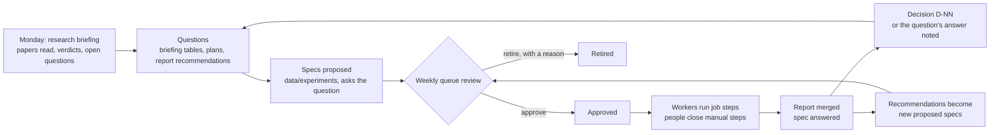

# Experiment queue: questions in, experiments queued, answers out

A design for running the project's experiments as a queue: each experiment a checked-in spec
with a slug, the questions it answers, explicit dependencies and a runtime estimate; workers that
claim its job steps, on this Mac, on `swan` or anywhere else, and take over orphaned work when
configured to; manual steps (labelling, annotation, review, a decision) as steps the queue waits
on; and a weekly cadence in which new papers pose questions, questions become specs, and answers
become decisions or further specs. It folds in what the job runner, the worker-pool plan, HINT,
the review workflow and the old campaign supervisor already do, rather than building beside them.

- **Status:** Proposed, 2026-10-13. Phase 0 is built (#746): the spec format, five areas, the
  validator, the dependency graph and fifteen specs. Phase 1's progress half is built: units, a
  state file per unit, `mark`, `units` and `status` (see [Progress](../../data/experiments/EXPERIMENTS.md#progress)).
  Expanding a spec into campaign submissions, and the hub queue, are not built
- **Canonical:** [Experiments](../../data/experiments/EXPERIMENTS.md)
- **Layers:** platform (jobs, workers, hub); every LiDAR layer as a subject
- **Related:** [job queue implementation](lidar-job-queue-implementation-plan.md), [worker pool and results hub](lidar-worker-pool-and-results-hub-plan.md), [vocabulary phase 2: jobs](platform-vocabulary-phase2-jobs-plan.md), [HINT sweep mode](../lidar/operations/hint-sweep-mode.md), [review workflow](lidar-review-workflow-plan.md), [priority review queue](lidar-visualiser-priority-review-queue-plan.md), [analysis worker](../lidar/operations/analysis-worker.md), [research briefing skill](../../.claude/skills/research-briefing/SKILL.md)

## 1. Why

The October L3 and geometry work ran as four hand-built shell lanes on one Mac over two days. It
answered its questions, and it showed what is missing:

- **No home for a proposal.** Proposals sit in briefing sections, `data/maths/proposals/`,
  `data/experiments/try/` and plan work items. A report's recommendations have no identifier, so
  nothing tracks whether they ran.
- **Dependencies live in people's heads.** "Stage B needs the held-out labels, the dwell policy
  and a Pi timing" is a sentence in a report, not something a scheduler can read.
- **No estimates.** Nothing said the corpus screen would take three hours or the held-out lane
  two, so neither could be planned against a four-hour window, and both overran it.
- **One machine, no recovery.** When the disk filled, two lanes were stopped by hand and resumed
  the next day by hand. The campaign supervisor's disk guard would have caught it, but the
  supervisor is archived on a branch and tied to one workstation's paths.
- **Manual steps are outside every plan.** Labelling, review, a frozen split and a decision gate
  most experiments, and no run plan names them. HINT waits for labels, but only in memory, so a
  server restart loses the wait.
- **Arms bypass the parameter sets.** Job campaigns and sweep files still carry inline overrides,
  against the AGENTS.md rule that every arm runs from a file in `config/experiments/`.

## 2. What is reused

| Need                               | Already there                                                                                                                                                 | What this plan adds                                                                |
| ---------------------------------- | ------------------------------------------------------------------------------------------------------------------------------------------------------------- | ---------------------------------------------------------------------------------- |
| Running work                       | The job contract (`internal/lidar/jobs`): a closed set of kinds that take typed parameters and never a command line; `RunIdentity`; attempts; bundles         | Experiment steps expand into job requests. No second execution path                |
| Fan-out over configurations        | Campaigns (`runner/campaign.go`): one base request and named configs, a child job each                                                                        | Arms × cases is a campaign, and every arm names a parameter set                    |
| Arms                               | `config/experiments/*.json` and the drift test                                                                                                                | The validator checks that every arm's file exists and is a parameter set           |
| A shared queue, claims and retries | The worker-pool plan: the hub on the NAS is the only state authority, workers pull, a retry is a new attempt; V11's claim `UPDATE … WHERE claimed_by IS NULL` | Experiment and step tables beside the jobs, leases that are renewed, orphan policy |
| Waiting on a person                | HINT: a named waiting state, a long-poll for change, a guarded continue, a browser notification, a per-round record                                           | One manual-step mechanism on the hub, persisted, that HINT then uses               |
| Closing a manual step              | Frozen splits (`annotation-split freeze`, with the `Tuned` ledger), review packs and propose-then-grade, `D-NN` decisions                                     | The artefact each manual kind must record before the experiment continues          |
| Scheduling a campaign              | The archived supervisor: `depends_on`, a free-space guard before each stage, a budget cut, edits only to pending stages                                       | Lifted into the hub's scheduler, with estimates and capabilities it never had      |
| Questions                          | Briefings' open-question tables, `D-NN` entries, plan checklists                                                                                              | `asks` links a spec to the question it answers                                     |

## 3. Vocabulary

"Experiment" already means three things in the repository: the named default-off options a replay
switches on (`-experiment`), the arm files in `config/experiments/`, and the hypothesis documents in
`data/experiments/try/`. This plan keeps the word for the third, which is what `data/experiments/`
was for, and qualifies the other two in new prose: a **replay option** for an `-experiment` name,
and a **parameter set** for an arm file (the vocabulary plan's "tuning config"). The code keeps its
names. The vocabulary table should gain:

| Term           | Meaning                                                                                                                     |
| -------------- | --------------------------------------------------------------------------------------------------------------------------- |
| experiment     | A checked-in spec under `data/experiments/`, named by a slug, that answers one or more questions through steps              |
| step           | One unit of an experiment: a job kind a worker runs, a planned kind no worker can run yet, or a manual step a person closes |
| arm            | One configuration an experiment compares: a parameter set and any replay options                                            |
| case set       | A named corpus of cases a step fans out over                                                                                |
| manual step    | A step closed by a person recording an artefact the hub checks                                                              |
| gate           | A manual step's numeric completion check (HINT's label thresholds)                                                          |
| capability     | Something a worker offers a step: data it can read, tools or hardware it has                                                |
| reclaim policy | An experiment's rule for who may take over one of its steps whose worker stopped renewing its lease                         |

A job, an attempt, a campaign, a run and a sweep keep their existing meanings.

## 4. The spec

A spec is a Markdown file at `data/experiments/<area>/<slug>.md`. Its YAML header is the
machine-readable part; its body is the proposal, in the shape the `try/` template already used
(question, method, success, risks) and, once answered, a short answer and the report link. One
file, so the prose and the plan cannot drift apart. The field reference, the step kinds and the
estimate rules are in [EXPERIMENTS.md](../../data/experiments/EXPERIMENTS.md); this section gives
the reasons.

**Slugs.** An area of four to six characters and a four-digit number: `l3bg0006`, `label0001`.
The area is a directory whose `README.md` header registers it, so the registry is the folder
tree and a slug cannot name an area that does not exist. Numbers are never reused, so a slug in a
report or a commit message always means the same experiment.

**Status is authoring state.** A spec is `proposed`, `approved` (the owner agrees; the hub may
schedule it once its dependencies are answered), `answered` (a report is merged and named) or
`retired` (with a reason). Whether it is queued, running or waiting on a person is the hub's
state. Writing that back to Git would make every heartbeat a commit and every branch a different
queue.

**Questions.** `asks` must name something that exists: the path of the Markdown that poses the
question (a briefing, a plan, a report's recommendations, a maths proposal), with an anchor, or a
`D-NN`. An experiment answers something, or it is not in the queue.

**Arms and cases.** An arm is a parameter set and replay options, never inline overrides. A case
set is a name from a short registry (`kirk-labelled`, `d2-first-segment`, `d2-second-segment`,
`held-out-site`, `lombard-laguna`), so "the 22 held-out segments" means one thing everywhere.
Case sets should become frozen splits where a split exists.

**Steps and kinds.** Three classes. A job kind is one the job runner already accepts, read from
its registry so there is one list. A planned kind (`bench_sweep`, `ground_truth_eval`,
`corpus_screen`, `scene_variants`, `pi_timing`, `chart`) is a tool that exists or is designed
but is not yet a job kind; an experiment that uses one can be specified and graphed now and becomes
runnable when the kind lands. A manual kind is closed by a person (Section 7). Steps form their
own small graph through `after`, so a side branch can run beside the main chain.

**Estimates.** Machine time per arm per case (`each`) or for the whole step (`total`), and person
time for manual steps, all in hours and minutes. Days are refused: a person's day is eight hours
and a machine's twenty-four, and mixing them produced a 196-hour total in the first draft of the
example specs. An experiment's estimate is its machine time along its longest chain of steps,
plus its person time. An answered spec may record what it took (`actual`), which is how
estimates get calibrated: the two October corpus screens ran 1.5 and 1.8 times their estimates on
a Mac shared with other lanes, and the kirk replays came in under theirs.

**Checks.** `go test ./internal/experiments` and `make check-experiments` validate every spec
(slug, area, file name, dates, status rules, questions that exist, dependencies that exist and do
not cycle, capabilities and case sets from their registries, arms that are parameter sets, step
kinds, fan-out and estimate rules) and require the generated
[DEPENDENCIES.md](../../data/experiments/DEPENDENCIES.md) to match a fresh render. The graph is
generated so that it cannot drift from the specs, as the parameter-set test keeps arm files
honest.

## 5. From a spec to jobs

Each job step of an approved experiment expands into job requests:

| Job request field  | Comes from                                                                |
| ------------------ | ------------------------------------------------------------------------- |
| `Kind`             | The step's kind                                                           |
| `CaptureManifest`  | The case set, resolved to captures by SHA-256 as frozen splits already do |
| `Tuning`           | The arm's parameter set, read whole and digested                          |
| `Experiments`      | The arm's replay options                                                  |
| `Code`             | The commit the experiment was approved at, or a later one the owner names |
| `Replay`, `Params` | The step's `params`                                                       |

A step over arms and cases is one campaign with a child per arm and case. Because a job's identity
is the digest of its inputs, two experiments that need the same replay (the shipped grid on the
kirk captures recurs across the example specs) share one job and one bundle rather than running it
twice.

Planned kinds become job kinds one at a time, each with typed parameters and never a command
line. In order of what the open specs need: `ground_truth_eval` (three open specs), then
`corpus_screen` (the label-free counts the October corpus lane computed with a scratch script),
`chart` and `pi_timing` (one each). `bench_sweep` and `scene_variants` have drivers already, the
frontier sweep's and `make scene-variants`, and wait until a spec needs them.

## 6. The queue

**Where it lives.** In the hub's `jobs.db` on the NAS, as the worker-pool plan sets out, beside
the jobs and attempts: an experiments table (slug, spec digest at approval, status read from
Git), a steps table (state: `blocked`, `ready`, `running`, `awaiting_human`, `done`, `failed`)
and a link from each job to its step. Until the hub exists, the Mac is hub and worker at once, as
the runner already is, and progress is a state directory with one file per unit: the step fanned
out over its arms and cases, which a lane marks started, done or failed, and a person closes with
its artefact. Each unit file maps to a row of the hub's steps table when the hub arrives.

**Claiming.** A worker pulls: it asks the hub for work, sending its capabilities, its worker
class, its free scratch space and whether it reclaims orphans. The hub picks the highest-priority
ready job whose experiment the worker can serve and claims it with V11's
`UPDATE … SET claimed_by, claimed_at WHERE claimed_by IS NULL`. The worker renews a three-minute
lease with a heartbeat every minute; the runner's lease is set today and never renewed, which is
the first thing to fix.

**Priority** follows the critical path: the job whose experiment heads the longest chain of
remaining work (machine and person time together) goes first, then age. A budget mode cuts from
the end of the chains, as the supervisor's `not_started_budget_exceeded` did. One heavy replay per
worker, and captures read where they are local when a worker advertises them.

**Disk.** A worker refuses a claim when its free scratch space is below the experiment's `disk_gb`
plus its own floor, and the hub never offers it one. Free space is reported today and gates
nothing; in October that let a run fill the disk and stop two lanes.

**Orphans.** A sweeper marks an attempt `lost` when its lease expires, and also flags one that
has run three times its estimate without progress. A lost job is requeued as a new attempt, up to
three. Who may claim it depends on the experiment's `reclaim` policy, which covers all of its job
steps, and the worker's own setting:

| Spec `reclaim` | A worker with `reclaim_orphans` on   | A worker with it off             |
| -------------- | ------------------------------------ | -------------------------------- |
| `any`          | May claim it, given the capabilities | Only its own, after a restart    |
| `origin`       | Only the worker that started it      | Only its own, after a restart    |
| `never`        | No one: the operator resolves it     | No one: the operator resolves it |

`origin` is for work tied to one machine (a long replay whose evidence is half-written on that
worker's disk, as l3bg0008's would be); `never` is for a person's half-finished labels. A worker
on the Mac would run with reclaim off and `swan` and remote workers with it on, so a laptop going
to sleep hands its work on and a blade restarting does not steal the laptop's.

**Remote workers** make outbound connections only, hold a bearer token, read captures from a
read-only mount, and upload bundles to the hub. Nothing a worker writes comes back to Git; reports
do, written by a person or an agent from the hub's results.

**Estimates and actuals.** The hub records each step's wall time by kind and worker class. The
estimate book it builds is what the next spec's estimate should come from, and a step running at
twice its estimate is shown in the queue view, at three flagged as suspect.

## 7. Manual steps, and what HINT gives them

A manual step has no job. When its predecessors finish it becomes `awaiting_human`, the hub
notifies (the web and macOS views, and a push), and it stays until a person records its artefact:

| Kind               | Closed by                                       | The hub checks                                                |
| ------------------ | ----------------------------------------------- | ------------------------------------------------------------- |
| `manual:implement` | The PR that built what the next step needs      | The commit is on main                                         |
| `manual:capture`   | A capture, selected by the rule the spec states | It is in the capture index, by SHA-256                        |
| `manual:label`     | Track labels on the step's reference run        | The step's gate (labelled share, class coverage, time spread) |
| `manual:annotate`  | An annotation pack                              | The pack digest exists                                        |
| `manual:review`    | A graded review pack (propose, then grade)      | Every proposal graded, the gate met                           |
| `manual:freeze`    | A frozen split                                  | `annotation-split verify`                                     |
| `manual:decide`    | A `D-NN` entry                                  | It is in `docs/DECISIONS.md` on main                          |
| `manual:write`     | The report                                      | It is merged at the spec's `report` path                      |

A person closes a step from the command line or the views (`velocity experiments complete
<slug>/<step> --artefact …`), and the hub reads the artefact back before the experiment moves on.

HINT already has every part of this except persistence: a named waiting status, a long-poll for
status changes, a continue that checks gates before it lets the run go on and can amend the next
round, a notification, and a record per round. The plan moves those onto the hub's manual step and
keeps HINT's API as a client of it. A HINT run then becomes an experiment template, its rounds
repeated steps of a reference replay (job), labels (`manual:label` with HINT's gates), a sweep (a
job) and a narrowing the hub computes from the sweep's results. It gains what it lacks: the wait
survives a restart. Auto-tune's suspend and resume becomes the way any long step resumes.

The review queues fit the same way. The priority review queue and model-assisted review produce
the items a `manual:review` step works through, and propose-then-grade is how it closes.

## 8. The weekly cadence

- **Monday, the research briefing.** The skill already ends with an open-questions table and
  sometimes a proposal. It should write each proposal it makes as a `proposed` spec whose `asks`
  points at its question, instead of free prose in the briefing, so every proposal is in one place
  and in the graph. A question answered by existing evidence links the report; a deferred one names
  what reopens it, as the skill already requires.
- **Through the week.** Workers run approved job steps; people close manual steps. The
  dependency graph and `experiments next` say what is waiting on whom.
- **The weekly queue review**, the [`/experiment-review` skill](../../.claude/skills/experiment-review/SKILL.md)
  (its first run is the [October 18 review](../lidar/operations/experiment-review-2026-10-18.md)): it proposes and the owner approves or retires proposed
  specs; read the open queue, the longest chain and every manual step waiting more than a week;
  compare estimates with actuals; turn answered experiments into decisions (`manual:decide`) and
  the briefing's decisions table; and write each report recommendation that calls for more work
  as a new proposed spec, so recommendations get identifiers.

## 9. Phases

| Phase | Work                                                                                                                                                                                                                                                                              | Size | Depends on |
| ----- | --------------------------------------------------------------------------------------------------------------------------------------------------------------------------------------------------------------------------------------------------------------------------------- | ---- | ---------- |
| 0     | The spec format, areas, validator, generated graph, `make check-experiments`, fifteen specs (seven answered from October with their actual times, eight proposed). This branch                                                                                                    | S    | Nothing    |
| 1     | Single-host execution: `velocity experiments plan <slug>` expands a spec's job steps into campaign submissions on the local worker; a local step-state file; `complete` for manual steps. Progress (units, state files, `mark`, `units`, `status`) is built; the expansion is not | M    | 0          |
| 2     | The planned kinds as job kinds, `ground_truth_eval` and `corpus_screen` first                                                                                                                                                                                                     | M    | 1          |
| 3     | The hub queue: experiment and step tables, worker pull with capabilities, renewed leases, the sweeper, orphan policy, the disk gate; overlaps the worker-pool plan's phase B                                                                                                      | L    | The hub    |
| 4     | Manual steps on the hub with notifications and artefact checks; HINT re-expressed as a template; review queues feeding `manual:review`                                                                                                                                            | L    | 3          |
| 5     | The cadence: the briefing skill writes specs; a weekly queue review; recommendations into specs; `try/` proposals moved into areas                                                                                                                                                | S    | 0          |

Phase 5 needs only Phase 0 and is worth doing first: it puts every proposal in one place before any
of the machinery exists.

## 10. Decisions needed

1. **The noun.** Keep "experiment" for the spec and qualify replay options and parameter sets in
   prose (recommended), or choose a new noun such as "study" and leave "experiment" to the code.
2. **The format.** A Markdown body with a YAML header (built), or a separate YAML file beside a
   Markdown proposal. The first keeps one file per experiment and renders on GitHub with its header
   as a table.
3. **Single-host first.** Run Phase 1 on the Mac before the hub exists (recommended), or wait for
   the hub and build the queue once.
4. **Remote defaults.** Whether `swan` and remote workers reclaim orphans by default, and whether
   any manual kind besides `manual:label` should carry a numeric gate.
5. **The review's home.** Answered 2026-10-18: its own skill, `/experiment-review`, which writes
   the review, proposed specs and backlog edits, and approves nothing; the owner approves in the
   spec's `status`.

## 11. Risks

- **A spec edited after approval** no longer describes what ran. The hub pins the spec digest at
  approval; a later edit re-plans only pending steps, and the report's provenance names the digest.
- **Ceremony for small runs.** A one-step spec is a dozen lines, and the validator asks for nothing
  a report's provenance does not already need.
- **Manual steps that never close.** The weekly review lists every step awaiting a person for more
  than a week, and a step can be retired with the experiment.
- **Estimates nobody believes.** Actuals sit beside them in the graph and the queue view; the
  October figures show how far a shared machine moves them.
- **Two queues during the transition.** The local runner and the hub must not both own a job: the
  vocabulary plan's acceptance test (two workers and the server cannot run one claimed job twice)
  holds the line.
