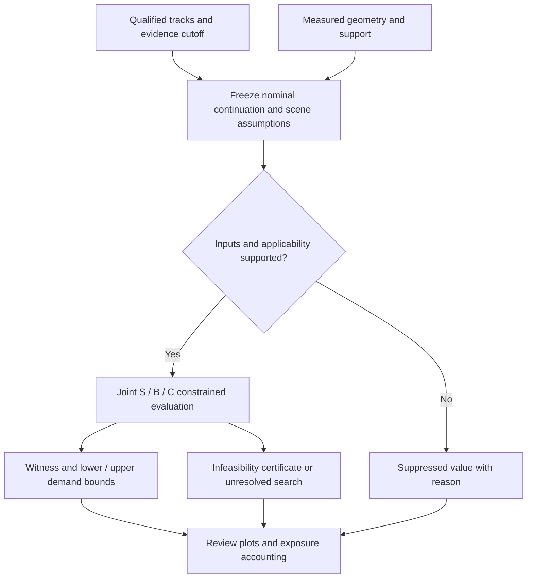
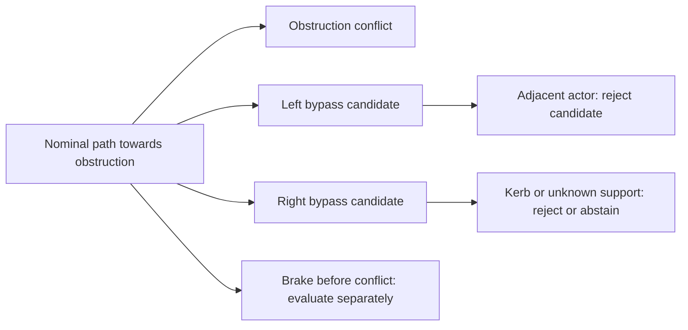

# SRAC: additional steering demand under a declared continuation

SRAC can usefully name a research programme around baseline-relative steering demand. It does
not yet justify a claim to a new class of collision-criticality metric. This proposal defines
what the quantity would mean, derives tractable reference cases, and identifies the evidence
needed before roadside LiDAR could support it.

- **Status:** Mathematical proposal; no implementation, experiment, threshold, or production adoption.
- **Canonical:** [Behaviour analytics](../plans/lidar-behaviour-analytics-plan.md).
- **Related:** [Follow-up plan](../plans/lidar-srac-research-plan.md),
  [metrics registry](../platform/architecture/metrics-registry.md),
  [distribution research](2026-11-12-driving-behaviour-distributions.md).
- **References:** `Westhofen2022`, `Jansson2005`, and the linked metric catalogue;
  [bibliography](../../data/maths/references.bib).
- **Provenance:** Repository contracts inspected at `da3c020fbf4e4a8068818c73a5df5af5e53c097b`.
  Literature inspected November 14, 2026 (UTC). Numbers below are illustrative arithmetic.
  The 6.35-second extension also checked the pipeline contracts at
  `436a5413a573e78354fbee9da944195a355d531e`; no runtime measurements were added.

## Recommendation

Use **required additional lateral acceleration**, with **SRAC** retained as the working project
name. Its unit is m/s². Given a nominal continuation, find the smallest maximum absolute change
to the vehicle's signed lateral acceleration that permits an admissible avoidance trajectory.
Every result is conditional on the prediction, longitudinal policy, geometry, horizon, delay,
capability, and terminal condition. It is a counterfactual control demand, not observed steering
input, crash probability, or a judgement about a driver.

Recommend a deterministic, nominal-scene research definition first. Report sensitivity under
explicit bounded alternatives separately. Do not present uncalibrated covariance or an arbitrary
occupancy inflation as a probability guarantee. General robust control, interaction-aware actor
predictions, and calibrated probabilistic evaluation are subsequent research tasks.

For the first implementation, support straight, forward-motion analytical scenarios and an
offline review evaluator. The general formulation below fixes semantics; it does not promise
that the current tracker supplies every input or that a global optimiser is practical.

## Evidence

The [review by Westhofen et al.](https://doi.org/10.1007/s11831-022-09788-7)
provides a catalogue and a method for selecting criticality measures for particular applications.
Its introduction explains why a measure suitable for one conflict geometry may be unsuitable
for another. This motivates an explicit applicability domain rather than a universal score.
The [accessible paper](https://elib.dlr.de/187762/1/Westhofen2022_Article_CriticalityMetricsForAutomated.pdf)
and the catalogue definitions below were inspected; no empirical validity rating is adopted.

[Jansson's thesis](https://www.diva-portal.org/smash/get/diva2%3A617438/FULLTEXT01.pdf),
Chapter 6, already treats multiple obstacles, admissible lateral accelerations, and combined
braking and steering. Section 6.2 illustrates a case where pure responses fail but a sequence
works. Section 6.3 explains that finite control/time discretisation can miss an existing escape.
Consequently, neither multiple actors nor a search over manoeuvres establishes SRAC's novelty.
The derivations below are independent, restricted reference problems, not claimed reproductions
of the thesis's full decision functions.

| Existing measure                                                                                                                   | Meaning and units                                                                                                               | Consequence for SRAC                                                                                                          |
| ---------------------------------------------------------------------------------------------------------------------------------- | ------------------------------------------------------------------------------------------------------------------------------- | ----------------------------------------------------------------------------------------------------------------------------- |
| [Required lateral acceleration](https://criticality-metrics.readthedocs.io/en/latest/acceleration-scale/alatreq.html)              | Minimum lateral acceleration magnitude needed for evasion; m/s²; catalogue gives a constant-acceleration following special case | Closest antecedent. A baseline-relative, maximum-over-time objective must be distinguished from its constant/average demand   |
| [STN](https://criticality-metrics.readthedocs.io/en/latest/index-scale/STN.html)                                                   | Required lateral demand divided by available directional capability; dimensionless                                              | A demand/capability ratio is established. Do not rename it or normalise additional demand as though it were total tyre demand |
| [TTS and TTM](https://criticality-metrics.readthedocs.io/en/latest/time-scale/TTM.html)                                            | Latest initiation permitting the specified avoidance manoeuvre; seconds                                                         | Reuse the concept; record feasible initiation intervals when one deadline is misleading                                       |
| [Required longitudinal acceleration / DRAC](https://criticality-metrics.readthedocs.io/en/latest/acceleration-scale/alongreq.html) | Longitudinal demand under a declared motion model; m/s²                                                                         | Compare steering with braking under matched assumptions; derive signs explicitly                                              |
| [BTN](https://criticality-metrics.readthedocs.io/en/latest/index-scale/BTN.html)                                                   | Required longitudinal demand divided by available braking capability                                                            | A ratio is conditional on its motion/capability model, not a portable risk threshold                                          |
| [Required acceleration](https://criticality-metrics.readthedocs.io/en/latest/acceleration-scale/areq.html)                         | Catalogue includes a norm of longitudinal and lateral demands                                                                   | Independently optimised component demands need not describe one feasible joint trajectory                                     |
| [Trajectory Criticality Index](https://criticality-metrics.readthedocs.io/en/latest/index-scale/TCI.html)                          | Optimisation of manoeuvre difficulty under constraints                                                                          | Optimisation-based difficulty is established; different objectives define different quantities                                |

The TCI comparison is limited to the authors' catalogue summary; its originating conference
paper's full objective was not independently checked. This prevents an exhaustive novelty claim.
The longitudinal catalogue's displayed special-case sign must not be copied mechanically:
with a constant-speed leader, positive closing speed and positive gap, braking has negative
signed acceleration. Section “Braking comparison” derives a positive deceleration magnitude.

The useful proposed contribution is an explicit baseline-relative objective, evidence/status
contract, and research workflow for qualified roadside observations. It is a measurement design
proposal, not evidence of improved crash prediction.

## Vocabulary and observability

| Term                        | Meaning here                                                | Avoid implying                                       |
| --------------------------- | ----------------------------------------------------------- | ---------------------------------------------------- |
| Reference actor             | Actor being evaluated at this instant                       | A sensor-equipped ego vehicle or persistent identity |
| Nominal continuation        | Frozen prediction or supplied planner trajectory            | What the driver intended                             |
| Additional demand           | Change from nominal signed lateral acceleration             | Total tyre loading or steering-wheel motion          |
| Total demand                | Maximum absolute lateral acceleration on the same candidate | The minimum for a different objective                |
| Feasible escape found       | A trajectory satisfying all declared checks                 | A globally minimal solution                          |
| Infeasible in model         | Certified empty admissible set                              | A physically inevitable crash                        |
| Collision-free over horizon | No predicted contact within stated support                  | Safe indefinitely                                    |

Paper wording: “The estimated required additional lateral acceleration was 2.0 m/s² under the
specified continuation and steering-only policy.” Graph label: “Additional lateral demand
(m/s²); nominal scene, fixed longitudinal policy.” Replace “the driver needed to swerve” with
“the nominal continuation conflicted with the predicted occupancy; a modelled lateral response
cleared it.” Replace “no collision risk” with “no nominal conflict within the evaluated horizon”.

The current [trajectory contract](../../internal/lidar/l8behaviour/trajectory.go) carries position,
velocity, their 4-by-4 covariance, body heading belief, extent beliefs, and observation/stage
provenance. It does not directly carry calibrated steering angle, tyre friction, yaw-rate dynamics,
or joint future occupancy. Body yaw and course are distinct. Derivatives of reconstructed
positions are estimates whose errors and smoothing support must be retained.

The [L8 package](../../internal/lidar/l8behaviour/doc.go) already owns value-versus-suppression
semantics and gates production emission on qualified final estimates. Final reconstruction can
use later evidence: it must not silently become a past-only prediction input. A future causal
adapter needs both capture time and evidence availability/cutoff. Geometry is measured spatial
data under the [geometry purpose contract](../geometry-priors-data-purpose.md); an absent return
does not establish clear road space.

## Mathematical specification

### Inputs, frame, and reference model

Let evaluation time be t and future elapsed time be s in [0,H]. Freeze the information set I_t,
all model versions, and nominal state/control functions x₀(s), u₀(s). Subscripts 0 denote the
baseline, not a zero value. Nominal and candidate start from the same state. A retrospective
mode may use a larger information set, but must receive a different mode identifier.

| Symbol       | Meaning                                                           | Unit            |
| ------------ | ----------------------------------------------------------------- | --------------- |
| p, ψ, v      | Rear-axle reference position, body yaw, forward speed             | m, rad, m/s     |
| δ, L         | Road-wheel angle, wheelbase                                       | rad, m          |
| b, ω         | Signed longitudinal acceleration, steering rate                   | m/s², rad/s     |
| q            | Signed body-lateral acceleration in the reference model           | m/s²            |
| H, τ         | Evaluation horizon, fixed response delay                          | s               |
| B(x), O_j(s) | Ego footprint and actor/static occupancy in a common ground plane | sets in m       |
| D(s), c      | Supported allowed road region and positive clearance margin       | set in m, m     |
| K_H          | Declared terminal-state set                                       | state-space set |

Use a planar kinematic bicycle only where forward speed and small slip justify it:

$$
\dot p=v(\cos\psi,\sin\psi),\qquad
\dot\psi=\frac{v}{L}\tan\delta,\qquad
\dot v=b,\qquad \dot\delta=\omega,\qquad
q=\frac{v^2}{L}\tan\delta.
$$

Footprints must be placed relative to the same reference point; converting a track anchor to a
rear axle requires calibrated or explicitly assumed offsets. This is a capability-model input,
not a fact supplied by a bounding box. The model excludes reversing, substantial sideslip,
rollover, road banking, and unmodelled tyre transients. It is not a vehicle-dynamics validation.

Declare bounds on δ, ω, b, q, and the rate of the signed lateral-acceleration component.
In this model:

$$
\dot q=\frac{2vb}{L}\tan\delta+
\frac{v^2}{L}\sec^2\delta\,\omega.
$$

Here $\dot q$ is a component rate in the rotating body frame. It is not the lateral
component of inertial jerk. With yaw rate $r=\dot\psi$, differentiating the acceleration
vector $b\mathbf{T}+q\mathbf{N}$ gives

$$
j_{\rm long}=\dot b-rq,\qquad j_{\rm lat}=\dot q+rb.
$$

A comfort limit on inertial jerk must state the reference point and use these components
(or their norm); it also requires sufficient regularity of b. A limit on $\dot q$ instead
constrains lateral control variation. The straight double-integrator examples below use a
fixed frame, where these distinctions disappear. Do not transfer their jerk bounds to a
curved bicycle trajectory without the frame terms.

A simple coupled capability constraint is $b^2+q^2\le(\mu g)^2$, with g gravitational
acceleration and μ an assumed friction coefficient. This circle is an approximation, not an
identified tyre envelope. Keep comfort bounds separate. No default μ or universal capability
is adopted. Conversion uses $\kappa=q/v^2$ and $\delta=\arctan(Lq/v^2)$ only for v above the
model's declared speed floor. Near rest, suppress this conversion rather than divide by zero.

### Feasible set and objective

Let F_M(I_t,H,τ) be the trajectories for manoeuvre family M which obey the model, initial state,
capability limits, and u(s)=u₀(s) before τ, and satisfy, for every s and every relevant j:

$$
\operatorname{dist}(B(x(s)),O_j(s))\ge c,\qquad
B(x(s))\subseteq D(s),\qquad x(H)\in K_H.
$$

The footprint condition includes its full swept motion. Unsupported road space is outside D;
if it would determine escape feasibility, report insufficient scene support instead of physical
infeasibility. Physical barriers and optional traffic-rule constraints are separately identified.
A painted line is not mechanically equivalent to a kerb.

For steering-only S, hold b(s)=b₀(s). Braking-only B retains the declared nominal curvature as a
function of path distance and, after τ, permits longitudinal reductions $b(s)\le b_0(s)$.
If b₀ is positive, this includes reducing acceleration before actual braking begins; label that
response longitudinal reduction while b remains positive. Combined C permits the same longitudinal
reductions plus lateral changes, including the unchanged nominal longitudinal policy. This avoids
comparing steering-only against an arbitrary straight-line brake on a curved road. Each family
still obeys actuator limits; expiry of the delay does not grant an instantaneous control reset.
All three share geometry, delay, horizon, and terminal requirements.
State any additional restrictions; C contains S and B only when those restrictions match.

Define the proposed demand:

$$
J_\Delta(x)=\max_{0\le s\le H}|q(s)-q_0(s)|,\qquad
R_M=\inf_{x\in F_M}J_\Delta(x).
$$

The primary SRAC candidate is R_S. Both scalars are signed body-lateral components at equal
elapsed times. Their difference is a **control-demand comparison**, not subtraction of world
acceleration vectors at different positions. It is unchanged by a rigid translation or rotation
of the entire scene. Changing time alignment, the reference point, or the nominal continuation
changes the estimand. A path-normal projection is an alternative measure and needs its own version.

On an optimal or returned candidate also report:

$$
J_{\rm total}(x)=\max_{0\le s\le H}|q(s)|.
$$

For every particular witness x, the triangle inequality gives

$$
J_{\rm total}(x)\le J_\Delta(x)+\max_{0\le s\le H}|q_0(s)|.
$$

Substituting R_M for the witness cost is valid only for a witness attaining that optimum.
For example, with q₀=0, an optimum of 1 m/s² and a returned witness costing 2 m/s², the
witness's total demand is 2 m/s², not bounded above by 1 m/s². For an ε-optimal witness, the corresponding bound is
$R_M+\varepsilon+\max|q_0|$. Equality is not generally attained: cancellation and the times
of extrema matter. If optima are nonunique, report total demand for the named witness, or its range over optimal witnesses. Do not silently
substitute a separately minimised total-demand solution.

Under braking on a curved path, q changes with speed even when road-wheel angle does not.
Thus R_B or R_C measures lateral-acceleration departure, not steering-actuator effort. Keep
steering-only R_S primary and describe combined results as strategy diagnostics. If only a
clearance margin or terminal constraint fails nominally, name that constraint conflict; do not
report a predicted physical collision without footprint contact evidence.

The maximum objective retains acceleration units and limits the largest departure. An integral
of absolute departure has units m/s; squared departure integrates to m²/s³. These measure different
features and can prefer large short pulses. They are optional companion research objectives,
not interchangeable implementations of R_S. In repository identifiers use `max`, not `peak`,
which the registry reserves for an explicitly filtered quantity.

### Direction, terminal behaviour, and existence

Specify F_L and F_R by signed displacement at the designated conflict-clearance cross-section
in the nominal path frame. Do not require a constant steering sign: recovery needs opposite
steering. A unique cross-section/path projection is required for directional labels. Multi-stage
or ambiguous bypasses use an unclassified family; only if L and R exhaust F_S does
$R_S=\min(R_L,R_R)$ hold.

Choose a finite-horizon terminal set explicitly. A useful restricted example is a straight,
supported escape corridor, zero lateral velocity, and a declared clear continuation interval.
That establishes only the stated interval. Indefinite avoidance requires an invariant safe set
or a proved safe continuation under continuing obstacle assumptions. Without either, label the
result horizon-limited. A solution that merely postpones contact past H is not durable avoidance.

Use positive c and a closed inequality. Strict non-contact alone may admit only an infimum.
For a bounded finite-parameter control family with compact parameter domain, continuous state
solutions, closed geometry/terminal constraints, and continuous cost, a nonempty feasible set
attains its minimum. This argument does not prove attainment or numerical tractability for every
infinite-dimensional control problem. Keep the infimum in the general definition.

Empty F gives mathematical infinity; numerical outputs instead carry an explicit status.
Unknown observations and failed searches do not establish emptiness. If the nominal trajectory
satisfies every constraint, R_S=0 follows by nonnegativity. Zero demand alone need not prove the
nominal trajectory is admissible in a richer combined family where longitudinal changes are free.
An initially overlapping footprint or inconsistent initial state has its own diagnostic status.

### Strategy and solver evidence

Report S, B, and C independently as feasible witness found, certified infeasible within model,
or unresolved. “Combined required” is justified only when C has a witness and both S and B have
infeasibility certificates. Restricted-library failure means only failure within that library.
A feasible candidate supplies an upper bound on R; a relaxation can supply a lower bound.
Report [lower, upper], the witness, tolerances, and termination reason. A solver's best objective
is not a proven minimum unless the gap is bounded.

For a candidate, a time-dependent utilisation can be defined as
$\max_s |q(s)|/A_{\rm lat}(s,b(s))$ when the denominator is positive and calibrated. It concerns
total demand. Zero available capability needs separate treatment. Since F already enforces
capability, a feasible witness cannot honestly report utilisation above one within tolerance.
A relaxed-demand calculation exceeding capability is a different diagnostic optimisation.
Equality is a boundary of this closed model, not a universal crash threshold.

For additional waiting d, define F_S(d) by freezing nominal controls until d+τ. The latest feasible
waiting time is $\sup\{d\in[0,H-\tau]:F_S(d)\ne\varnothing\}$. Return the feasible set or intervals
as well as its supremum. Under a fixed scene/horizon and controls that may continue nominal after
release, these sets are nested: an earlier release can reproduce a later response. Disconnected
windows require a different family, such as mandatory immediate evasive motion, and must not be
claimed for the nested definition. Empty, unknown, and nominally clear cases have distinct status.

## Analytical reference cases

### Crossing a lateral clearance boundary

Consider a fixed straight local frame with forward motion prescribed independently of lateral
control, fixed axis-aligned footprints, and zero nominal lateral acceleration. Let T be the first
longitudinal footprint-overlap time, h the required signed lateral position including margin,
y₀ initial lateral position, and w₀ initial lateral velocity. Hold zero lateral acceleration
until τ<T, then allow any acceleration bounded in magnitude by A. With D=T−τ:

$$
y(T)=y_0+w_0T+\int_\tau^T(T-s)a(s)\,ds
\le y_0+w_0T+\frac{AD^2}{2}.
$$

For a left boundary, the minimum maximum positive acceleration is therefore

$$
A_{\rm cross}=\frac{2\max(0,h-y_0-w_0T)}{(T-\tau)^2}.
$$

Constant positive acceleration attains this bound in this relaxed problem. Mirror coordinates
for the right boundary. This is an exact endpoint result with unconstrained final lateral
velocity and instantaneous acceleration changes. It bounds a stricter problem only if that
problem is proved to be a restriction of this one, with the same endpoint, time, and acceleration
objective. Here a is fixed-frame lateral acceleration; it is not automatically the bicycle's
body-lateral q. In the bicycle model, $\ddot p_y=b\sin\psi+q\cos\psi$, and changing yaw changes
forward progress and footprint projection. Even holding b=b₀ does not fix longitudinal overlap
time. Therefore this formula is a reference-model result, not a certified bound on general R_S.
Collision geometry before T and throughout the subsequent overlap interval still needs checking.
Recompute overlap times for each vehicle trajectory, including steering-only candidates.

For h=2 m, y₀=0, w₀=0.2 m/s, T=2 s, and τ=0.5 s, the residual is 1.6 m and D=1.5 s:
A=3.2/2.25=1.4222 m/s². Final lateral velocity is 2.3333 m/s. That large residual motion explains
why simply clearing a bumper is not a settled escape.

With w₀=0 and the same h and T, the delay sensitivity is:

| Delay τ (s) | Available time D (s) | Crossing demand (m/s²) | Settled demand below (m/s²) |
| ----------- | -------------------- | ---------------------- | --------------------------- |
| 0           | 2                    | 1                      | 2                           |
| 0.5         | 1.5                  | 1.7778                 | 3.5556                      |
| 1           | 1                    | 4                      | 8                           |

For a fixed positive residual r, the derivative with respect to delay is $4r/(T-\tau)^3>0$.
This proves monotonicity for this problem. Re-estimating the scene at successive observation
times changes inputs and does not inherit that monotonicity theorem.

### Settled lateral displacement

Require zero initial and final lateral velocity and displacement h>0 during D. Let η=s−τ
be time since release, from 0 to D. For $|a|\le A$, lateral velocity obeys
$w(\eta)\le A\min(\eta,D-\eta)$: both acceleration from rest and
braking back to rest constrain it. Integration gives $h\le AD^2/4$. Accelerating at +A for half
D and −A for half D attains equality:

$$
A_{\rm settled}=\frac{4h}{D^2}.
$$

This is twice the crossing-only demand. It is exact for a lateral double integrator without
jerk limits. With h=2 m and D=1.5 s it is 3.5556 m/s². Positive-margin footprint containment in
the escape corridor remains necessary, as does continued clearance from other actors.

A smooth candidate is $y=h(10z^3-15z^4+6z^5)$, z=η/D, with zero endpoint velocity and
acceleration. Differentiation gives maximum absolute acceleration $10h/(\sqrt3 D^2)$ and
maximum absolute jerk $60h/D^3$. The same example requires 5.1320 m/s² and 35.5556 m/s³.
These are candidate bounds, not an optimum with jerk constraints. The difference is a useful
warning against treating an instantaneous-acceleration lower bound as executable steering.

### Curved nominal motion

For a no-slip bicycle moving at v=10 m/s on radius 50 m, nominal q=2 m/s². If its footprint
and continuation satisfy all constraints, additional demand is zero despite total demand 2.
With illustrative L=2.7 m, nominal road-wheel angle is arctan(2.7/50)=0.05395 rad.
An admissible candidate with q=3 at that speed has additional demand 1 and road-wheel angle
arctan(0.081)=0.08082 rad; the angle change is 0.02688 rad. This arithmetic does not establish
that the candidate escapes any specified obstacle. It demonstrates why total and additional
acceleration, curvature, and angle must have separate names.

### Braking comparison and occupied escapes

For positive bumper gap g, closing speed c_v>0, constant leader speed, and a delay τ before
constant ego deceleration magnitude B, relative stopping distance is
$c_v\tau+c_v^2/(2B)$. With required residual gap m:

$$
B_{\rm req}=\frac{c_v^2}{2(g-m-c_v\tau)},\qquad g-m-c_v\tau>0.
$$

For g=20 m, m=1 m, c_v=10 m/s, τ=0.5 s, B=100/28=3.5714 m/s². The signed ego acceleration
is −B. If the denominator is non-positive, this delayed family cannot preserve the margin.
A braking leader requires a piecewise relative-motion calculation including stop times; the
constant-speed result cannot be carried over unchanged.

For an explicit blocked escape, let ego and obstruction each have width 1.8 m, centred initially
at y=0. Use the axis-aligned reference geometry above, with prescribed forward motion making
both obstacles overlap ego longitudinally at one common time T for every steering candidate.
Require 0.2 m lateral clearance during that overlap: ego must reach y≥2.0 m
or y≤−2.0 m. At T an adjacent actor of width 1.8 m occupies y=3.0 m and overlaps the
ego longitudinally. Clearance from it requires y≤1.0 m or y≥5.0 m. A supported road region
limiting ego centre to y≤3.0 m leaves no left escape at this cross-section. If a right kerb limits
ego centre to y≥−1.0 m, right escape is also excluded. This proves steering-only infeasibility
within that prescribed-forward-motion family. It does not certify bicycle-model infeasibility:
steering can change overlap timing, and rotated footprints change the admissible intervals.
With the constant-speed leader, gap, and closing speed from the braking example, and with both
other actors continuing ahead at that leader speed, B=100/28 m/s² preserves the 1 m longitudinal
gap. If the initial lane remains supported and unoccupied by other actors, ego can stay there
without a lateral bypass. Thus “steering required” would be misleading without its policy.

## Uncertainty, causality, and aggregation

Freeze exogenous actor trajectories for nominal evaluation. An interacting prediction model
conditioned on the ego response changes the optimisation and needs a separate version; a
counterfactual must not reuse observed actor reactions as if they would persist after an ego change.

For bounded uncertain scenes ξ in Ξ, distinguish $\sup_\xi\inf_u J(u,\xi)$, which grants the
response knowledge of ξ, from $\inf_u\sup_\xi J(u,\xi)$ subject to feasibility for every ξ,
which requires one open-loop response. Neither equals optimisation over a non-anticipating
feedback policy without further assumptions. The first can be an optimistic bound on the second.
Use nominal results plus an explicit sensitivity range initially; do not label that range a
confidence interval. Shared registration errors are correlated across actors and must not be
independently resampled. Unknown space, physical extents, path ambiguity, and calibration gaps
can alter feasibility rather than merely widen the numeric result.

For AV evaluation, a supplied candidate becomes the nominal continuation. Compare candidates
from the same initial physical state, with the same obstacle predictions, capabilities, delay,
horizon, and terminal rule. Candidates inconsistent with the measured initial steering state
are inapplicable, rather than granted an instantaneous reset. A low intervention demand does
not rank comfort, efficiency, or risk outside these assumptions. Human and AV results share
the definition only when their contracts match; differing information quality remains visible.

Past-only evaluation uses evidence available at t, including its availability latency. A later
smoother can be used for retrospective descriptive analysis or validation with provenance. Neither
mode reconstructs driver knowledge or intention. Observed lateral acceleration can be compared
with nominal demand only under matched reference points, support, and time conventions; a ratio
of observed to required response is undefined at zero demand and is not a driving-quality score.

Use one reference-actor scene opportunity per instant, with all relevant actors jointly present.
The current registry's pairwise `interaction` level is not an automatic fit; resolve this before
registration. Do not duplicate one scene into multiple pairwise votes. Report time-weighted
research distributions within identical contract versions and assumptions, plus eligible,
excluded, unknown, and horizon-censored duration. Define event grouping before reporting duration
or encounter extrema. Keep scene maxima and exposure-weighted quantiles distinct; do not average
percentiles. Review-only values remain outside published production distributions under current rules.

## A 6.35-second horizon on a 20 Hz evaluation grid

The proposed maximum evaluation horizon is H=6.35 s with Δ=0.05 s. Define nodes
sₖ=kΔ for k=0,…,127: **127 future intervals and 128 states including the current state**.
There are 127 future samples after now; 127 samples including now span only 6.30 s.
Actual acquisition timestamps remain authoritative. A 20 Hz prediction grid can be evaluated
from slower observations; interpolation does not turn them into 20 Hz measurements.
This is a proposed capability envelope, not evidence that this duration is currently supportable.

“Upper bound” has three separate meanings here. H caps the evaluated duration. A trajectory
enclosure bounds possible positions or footprints under stated assumptions. A checked feasible
response supplies an upper bound on minimum steering demand. None implies either of the others.
Report them separately, including the longest supported horizon when it is shorter than H.
Do not silently substitute that shorter problem for the requested 6.35-second result.

### Predicted future: information available at the evaluation instant

Freeze the evidence available at t, including acquisition time, processing latency, initial-state
uncertainty and the nominal continuation. If the latest acquisition predates t, propagate its
state and uncertainty to t before starting the future horizon; record that state age. Predict
every relevant actor, including plausible
entrants into the scene, over [t,t+H]. Declare the motion hypotheses, acceleration/yaw-rate bounds,
physical extents, occlusion treatment, measured geometry, ego-response dependence and terminal
support. A constant-velocity extrapolation is a nominal scenario, not an upper bound on motion.
An unqualified Kalman covariance is not a hard support set or a calibrated coverage guarantee.

For a simple constant-velocity prediction, if initial position and velocity errors have norm
bounds eₚ and eᵥ and the unmodelled acceleration has norm at most aₑ throughout the interval,
then integration and the triangle inequality give the conditional enclosure

$$
\|p(s)-\hat p(s)\|\le e_p+s e_v+\tfrac12 s^2 a_e.
$$

At H=6.35, the multipliers are 6.35 and 20.16125. Illustratively, eᵥ=0.5 m/s contributes
3.175 m and aₑ=1 m/s² contributes 20.16125 m before initial-position error. These are assumed
bounds, not measured sensor errors. Add footprint orientation/extent and calibration uncertainty
consistently; correlated scene errors should not be counted as independent noise. For the bicycle
model, use a validated integration enclosure with bounds on steering state, steering rate,
longitudinal acceleration and model discrepancy. A bare forward-Euler rollout has no certified
error envelope merely because its step is 50 ms.

A bounded formulation can supply a demand upper bound only when one admissible response is
verified against every scene in its declared uncertainty set, with an upper bound on its worst-case
objective. A finite list of sampled futures supplies scenario results unless it provably covers
that set. Distinguish the open-loop robust problem from a non-anticipating feedback policy;
future replanning cannot be assumed to rescue an otherwise unsupported witness. Physical
coverage of the assumed motion set is a separate qualification question.

### Recorded future: retrospective evaluation

Wait for observed scene support through t+6.35 s, plus the availability delay of the final required
record and any smoother look-ahead. Retain acquisition and availability cutoffs separately.
A fixed-lag state for the endpoint can need evidence beyond t+H; an end-of-recording flush must
report its shortened support rather than pretend the full lag was available.

Require stable identities, time-aligned actor extents, visibility/support masks, timestamp gaps,
and geometry over the whole response corridor. Preserve whether each state was observed,
interpolated, predicted through a gap, or revised retrospectively. A predicted-only state does
not count as an observed future frame. Interpolation needs a physical motion/error enclosure
between observations before it can support a continuous-time bound. Scene exit, occlusion,
missing entrants, or insufficient terminal support yield an explicit censored/unknown result.

Recorded actor paths describe the world under the actual ego motion. Holding them fixed while
changing the ego path is an **exogenous recorded-future scenario assumption**. It does not establish
what those actors would have done in response to that alternative path. Label this separately
from an interaction-aware counterfactual. The actual ego path is a feasible witness only if it
satisfies the chosen family's initial state, delay, longitudinal policy, capability, geometry and
terminal conditions; merely being recorded without an observed collision is insufficient.

At a constant 10, 20 or 30 m/s, 6.35 s spans 63.5, 127 or 190.5 m respectively. These arithmetic
examples concern required scene support, not sensor specifications. The existing
[observation budget](../plans/lidar-behaviour-analytics-plan.md#3-the-observation-budget)
reports a median 51 m observed passage in its historical cohort. Whole-passage duration is not
remaining future support at each evaluation instant, and that cohort does not establish a
6.35-second yield for all actors jointly. Audit eligibility by remaining duration, range, class,
occlusion and speed, including failures, before assuming this retrospective capability.

### What makes the demand value an upper bound

For the declared feasible family Fₘ, an independently checked witness xᵂ gives

$$
R_{\mathcal M}\le J_\Delta(x^W)\le U_W.
$$

Here Uᵂ is a certified upper enclosure of the continuous-time witness objective, including
numerical error. It need not be the optimum. Sampling the maximum at 128 nodes usually
underestimates that witness's true maximum; without a bound between nodes it is not Uᵂ.
If g(s)=q(s)−q₀(s) is Lipschitz with known constant Lg and node errors are at most εg, then

$$
U_W=\max_{0\le k\le127}|\hat g(s_k)|+L_g\Delta/2+\epsilon_g
$$

is sufficient. Bound Lg from the model and actuator envelope (including both nominal and
candidate acceleration rates), or use interval extrema on each control segment. State which
method certified the objective, dynamics and every constraint.

For geometry, a clearance Lipschitz bound V requires sampled clearance at both interval ends
of at least c+VΔ/2+εd, where εd encloses integration and geometry error. V must cover relative
translation and rotating footprint edges. With V=20 m/s, the between-node allowance alone is
0.5 m; V=40 m/s requires 1 m. These illustrative margins show why swept-footprint checking or
adaptive subdivision may be preferable to a uniform conservative inflation. Apply equivalent
checks to drivable-boundary containment and capability extrema. Refine around contacts, control
switches and tight curvature; the 20 Hz reporting grid need not be the integration/checking grid.

Keep the existing terminal rule: a witness certified only to H bounds the finite-horizon problem,
not durable avoidance afterwards. Any certified lower bound must concern the same model,
uncertainty quantifiers and terminal condition. No candidate before a compute deadline means
unresolved, not infinite demand, zero demand or proven infeasibility.

### Capability contract and first implementation shapes

| Requirement            | Predicted mode                                              | Retrospective mode                                             | Evidence needed before claiming capability                          |
| ---------------------- | ----------------------------------------------------------- | -------------------------------------------------------------- | ------------------------------------------------------------------- |
| Information cutoff     | Evidence available at t only                                | Explicit later cutoff and refinement stage                     | Leakage checks with acquisition/availability provenance             |
| Future support         | Declared prediction or reachable occupancy sets             | Observed coverage with bounded interpolation and labelled gaps | Horizon-wise support and exclusion ledger for all relevant actors   |
| Counterfactual meaning | Frozen exogenous or ego-conditioned model                   | Frozen recorded paths labelled exogenous                       | Versioned actor-response policy; no silent interchange              |
| Vehicle/scene inputs   | Uncertainty-qualified initial state and capability envelope | Same, with retrospective revisions identified                  | Position, yaw, extent, steering and geometry error qualification    |
| Bound certificate      | Feasible nominal or robust witness, as labelled             | Feasible witness for the declared recorded-future scenario     | Independent dynamics, swept geometry, objective and terminal checks |
| Runtime                | Deadline and stale-result policy                            | Bounded offline run and cancellation                           | Workload/tail measurements; timeout remains unresolved              |

A first offline tool can accept a scene window, model manifest, information mode and candidate
controls; produce a witness plus a certificate ledger; and render three aligned views: occupancy
and swept footprints, clearance/objective envelopes over 0–6.35 s, and supported horizon versus
requested horizon. Use separate facets for predicted and recorded-future results. Retain checks
for all 127 intervals and the terminal state, with the limiting actor/constraint and first
unsupported interval. This is a proposed data contract, not a schema migration.

For K candidates, M obstacles and U explicit scenarios, direct checking uses O(127KMU) interval
checks per query before adaptive refinement. At 20 queries/s that is 2,540KMU checks/s, not a
runtime estimate; unbounded branching or continuous robust optimisation has no such fixed cost.
Memory can stream candidate checks while retaining the selected witness and certificate. Cache
immutable geometry and reuse warm starts only with renewed feasibility checks. Put a future L8
worker behind bounded queues with input timestamps, cancellation and declared deadlines. A 20 Hz
sensor does not require SRAC recomputation at 20 Hz; qualify that extra workload separately.

The prerequisite order is input/support audit, nominal offline witnesses and independent checker,
retrospective coverage audit, then predicted-envelope qualification. Real-time scheduling follows
only after profiling those bounded workloads. The existing frame budget is 98 ms, and the live
stage timer omits work before its first stage; neither currently establishes room for this new
computation. The separate [20 Hz pipeline findings PR](https://github.com/banshee-data/velocity.report/pull/1030)
addresses that scheduling question. No experiments
or performance measurements were run for this extension; the equations and counts are derivations.

## Graphs and implementation shapes

These are conceptual diagrams, not simulated trajectories. Proposed plotted views:

| View                   | Axes and annotations                                                                                               | Question                                                       |
| ---------------------- | ------------------------------------------------------------------------------------------------------------------ | -------------------------------------------------------------- |
| Scene plan view        | x/y in m; footprints, nominal and witness trajectories; unknown space hatched; time and clearance labelled         | Does the same manoeuvre clear every relevant object?           |
| Delay curve            | Delay in s versus demand in m/s²; use the analytical table above; mark crossing versus settled boundary conditions | How does the response window change demand?                    |
| Curved-path comparison | Elapsed s versus nominal, candidate, and additional q in m/s²                                                      | Is ordinary curvature being mistaken for evasion?              |
| Capability frontier    | Maximum braking and lateral demand in m/s² for jointly feasible trajectories; show coupled limits                  | Which strategies remain available?                             |
| Encounter timeline     | Observation time versus demand interval and clearance; status and evidence-cutoff bands                            | Which changes are physical, model-driven, or missing evidence? |
| Distribution           | Demand in m/s² versus eligible-duration fraction; separate exclusion ledger and assumption versions                | What population and exposure do the values describe?           |

The smallest useful tool is an analytical worksheet with these boundary conditions. Next is an
offline evaluator producing witnesses and search evidence; a visualiser overlay follows only when
those outputs are interpretable. No new transport or persistence design is needed to validate
these definitions. Candidate field groups are:

| Group           | Proposed content                                                                    | Evidence requirement                                         |
| --------------- | ----------------------------------------------------------------------------------- | ------------------------------------------------------------ |
| Identity        | Evaluation time, episode-local reference actor, scene, contract and solver versions | No enduring identity; source/pack fingerprints               |
| Assumptions     | Nominal policy, information cutoff, delay, horizon, terminal rule, manoeuvre family | Frozen and comparable across evaluations                     |
| Physical inputs | Reference point, dimensions, heading/motion, supported road geometry                | Qualified or explicitly assumed; suppress unsupported claims |
| Capability      | Dynamics, wheelbase, steering/rate/jerk/friction bounds                             | Calibration or named sensitivity scenario                    |
| Demand          | Additional-demand bounds and witness total demand, units, direction                 | Numerical tolerances and optimality status                   |
| Feasibility     | Per-family status, clearance, relevant actors, terminal support                     | Witness/certificate or reason for unresolved result          |
| Uncertainty     | Nominal/bounded/probabilistic mode and dependence assumptions                       | No fabricated probability coverage                           |

## Open questions

| Decision             | Recommendation                                                                        | Remaining evidence or owner choice                                       |
| -------------------- | ------------------------------------------------------------------------------------- | ------------------------------------------------------------------------ |
| Name and novelty     | Keep SRAC as research label; use required additional lateral acceleration in prose    | Broader primary-source comparison before any novelty claim               |
| Cost                 | Maximum absolute signed lateral-control departure at equal elapsed times              | Compare sensitivity to nominal policy; do not mix with total demand      |
| Terminal condition   | Settled supported corridor for restricted examples; explicit horizon limits elsewhere | Which scene types can supply credible continuation support?              |
| Observation mode     | Retrospective review first, with causal evaluation separately versioned               | Availability-aware trajectory inputs and calibration                     |
| Capability           | Named assumptions and sensitivity arms                                                | Independent wheelbase, actuation, friction, and physical-motion evidence |
| First implementation | Analytical references, then offline witness evaluator                                 | Approve the linked staged plan before implementation                     |
| Production exposure  | Preserve suppression and opportunity accounting                                       | Resolve scene-level registry semantics and physical qualification gates  |

This pass establishes mathematical definitions and restricted analytical results. It establishes
neither general vehicle feasibility, current LiDAR measurement accuracy, nor crash-risk validity.
