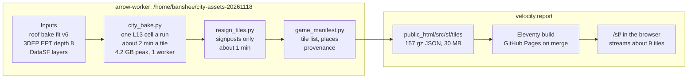

# San Francisco city map: levels of detail, decisions and next steps

The record of how the citywide San Francisco map behind the [driving view](sf-driving-view.md) was
built: every level of detail measured, the decisions taken and rejected, how the work was
validated, and what to improve next.

- **Status:** S6 chosen; citywide tiles baked and in the driving view
- **Companions:** [size study](sf-city-map-size-study.md) (round 1 measurements) and
  [review brief](sf-city-map-review-brief.md) (rounds 1–8 procedures and checklist)

## Summary

The whole of San Francisco now ships as a drivable map: 157 tiles, 30 MB, with lidar-fitted roofs, reconciled street trees, kerbed roads and named signposts, in PR [velocity.report #1085](https://github.com/banshee-data/velocity.report/pull/1085). The study's estimate for level S6 was about 9.5 MB in a compact binary encoding under Brotli, but for fewer layers (no ground, signposts or kerb widths) and scaled from three test windows; the [size reconciliation](sf-city-map-size-reconciliation.md) traces the 30 MB to it.

The work ran in nine rounds between 2026-11-18 and 2026-11-20, each driven by the owner's review of the last:

| Round | Asked for                                                                                                       | Result                                                                                                         |
| ----- | --------------------------------------------------------------------------------------------------------------- | -------------------------------------------------------------------------------------------------------------- |
| 1     | What Gerardus plans and what exists citywide; how small buildings and roads can get                             | Size ladder L0–L8, from 300 MB meshes down to 0.22 MB skyline blocks ([size study](sf-city-map-size-study.md)) |
| 2     | A viewer comparing levels at three intersections, with a car-follow view                                        | SF Level Compare viewer at Mission & Beale, Sunset Blvd & Noriega, Sheridan & Montgomery                       |
| 3     | Between L2 and L3, true apexes, jagged edges simplified                                                         | V1–V5: topology-first roof rebuild; V5 at 54 % of L2's bytes                                                   |
| 4     | Right angles snapped to the street grid and DataSF outlines                                                     | W1–W5: rectilinear steps on DataSF eaves, lattice snap                                                         |
| 5     | Fix trees fitted as roofs, missing Salesforce Tower, impossible acute angles; a 10–15 MB set and a review brief | S1–S5 with lidar canopy, 3DEP-only and rebuilt buildings, despike; [review brief](sf-city-map-review-brief.md) |
| 6–7   | No trunks in the road; under 10 MB with roofs still accurate                                                    | S6 at about 9.5 MB: fit-bounded merge, plane code, trunks off the carriageway                                  |
| 8     | Street Tree List as the tree reference; visible roads and kerbs; ideas for curved towers                        | Reconciled trees, asphalt between kerbs, tower slice trial and cross-validation plan                           |
| 9     | The whole city as a driving game at velocity.report/sf, L13 tiles, street names and signposts                   | `/sf/` page, citywide tile bake, PR #1085                                                                      |

Merging PR #1085 to main publishes the game at velocity.report/sf. The bake scripts are not in a repository yet: they live in `/home/banshee/city-assets-20261118/` on arrow-worker (Reference, below).

## Sources

Every layer comes from public-domain or PDDL data, read through Gerardus's caches on arrow-worker; the oldest input, the City's 2010 building heights, is the main source of error.

| Input                                                | Date             | What it gives                                                                                               | Licence             | Quirks found                                                                                                 |
| ---------------------------------------------------- | ---------------- | ----------------------------------------------------------------------------------------------------------- | ------------------- | ------------------------------------------------------------------------------------------------------------ |
| DataSF Building Footprints `ynuv-fyni`               | 2010 heights     | 177,023 outlines with median height and lowest ground                                                       | PDDL-1.0            | Lots rebuilt since 2010 keep their old height (Salesforce Tower's lot: 2.6 m)                                |
| Gerardus city roof bake (`bake-roofs`, fit v6)       | 2026-11          | 831 units, 165,267 buildings, 774,310 roof faces as a ring plus plane z = ax + by + c, ENU per unit, NAVD88 | derived, CC0 intent | Raster staircase edges; canopy fitted as roof faces; one median offset per unit to the DataSF outlines       |
| Gerardus city tiles, epoch 20261105                  | 2026-11-05       | 3D Tiles at L10/L13/L16: ground, box buildings, street lines                                                | CC0                 | Baked before the roof bake, so boxes only; 277 MB gzip                                                       |
| USGS 3DEP `CA_SanFrancisco_1_B23` (EPT)              | flown April 2023 | 13.1 billion points, EPSG:3857, NAVD88                                                                      | public domain       | Classes 1, 2 and 7 only: roofs and trees are both class 1; coarse EPT depths over-sample multi-return points |
| DataSF Streets `3psu-pn9h`, Street Nodes `vd6w-dq8r` | current          | 15,671 active segments, 1,960 km; names and node types                                                      | PDDL-1.0            | Presidio intersections are typed ENDS; placeholder names such as UNNAMED 186                                 |
| DataSF Curbs and Islands `emxt-b6yg`                 | 2016             | citywide kerb lines                                                                                         | PDDL-1.0            | None in the Presidio                                                                                         |
| DataSF Right of Way `h8n7-e4ns`                      | 2014             | street-area polygons, sidewalks included                                                                    | PDDL-1.0            | Sidewalks inside, so it cannot alone separate road from footpath                                             |
| DataSF Street Tree List `tkzw-k3nq`                  | current          | 144,651 trees, 138,896 with positions, species and trunk diameter (inches)                                  | PDDL-1.0            | Street trees only; none in the Presidio                                                                      |

All positions in the game share one planar frame: EPSG:7131 (NAD83(2011) San Francisco CS13) less the origin at −122.44, 37.76.

## Levels of detail

The chosen level is S6: about 9.5 MB for buildings, trees, lidar-only structures and roads, breaking 1.2–2.8 % of well-fitted lidar roof points. Each family below was built in answer to a review of the one before.

Whole-city size by level (compact encoding, brotli). L0 (about 300 MB as a mesh, 28.2 MB as planes) and L1 (about 90 MB) are larger still. City sizes come from `out/round4-city.json` and the round 1–4 level labels; they are scaled from three 520 m windows, except L2–L8, which were measured citywide.

| Family                                                 | Level  | What it is                        | Whole city |
| ------------------------------------------------------ | ------ | --------------------------------- | ---------- |
| Roof planes with trees, lidar-only buildings and roads | C0     | cleaned full detail               | 22.0 MB    |
|                                                        | S1     | welded, 0.5 m steps               | 15.2 MB    |
|                                                        | S2     | small faces absorbed              | 14.5 MB    |
|                                                        | S3     | 0.25 m lattice                    | 12.7 MB    |
|                                                        | S4     | 0.5 m lattice                     | 11.0 MB    |
|                                                        | S5     | compact                           | 10.1 MB    |
|                                                        | **S6** | **fit-bounded merge, plane code** | **9.5 MB** |
| Roof planes and roads, no trees                        | L2     | planes, 0.25 m outlines           | 18.8 MB    |
|                                                        | W1     | right angles, 0.25 m steps        | 15.5 MB    |
|                                                        | L3     | planes, 1 m outlines              | 13.8 MB    |
|                                                        | V4     | apex-true, free-angle steps       | 13.7 MB    |
|                                                        | V5     | apex-true, compact                | 10.5 MB    |
|                                                        | W5     | right angles, 0.5 m lattice       | 9.8 MB     |
| Boxes and blocks with roads                            | L4     | boxes, full outlines              | 5.7 MB     |
|                                                        | L5     | boxes, 0.5 m outlines             | 4.0 MB     |
|                                                        | L6     | boxes, 1 m, no sheds              | 2.4 MB     |
|                                                        | L7     | blocks, 5 m                       | 0.67 MB    |
|                                                        | L8     | skyline blocks                    | 0.22 MB    |

The three families are not like for like: the S levels carry trees (about 1.6 MB) and 3DEP-only buildings (about 0.6 MB) that L2–L8 and the V and W rounds do not. What each level keeps and drops:

| Level       | Keeps                                                 | Drops                                                         | Good lidar points broken, Presidio / Sunset / downtown |
| ----------- | ----------------------------------------------------- | ------------------------------------------------------------- | ------------------------------------------------------ |
| L0 raw bake | every fitted face, raster edges                       | nothing; canopy faces stay as roofs                           | 0.06 / 0.06 / 0.13 %                                   |
| L1          | as L0 on a 15 cm vertex grid                          | sub-15 cm detail                                              | not scored                                             |
| L2          | roof planes on 0.25 m outlines                        | seams between faces appear                                    | 0.22 / 0.17 / 0.23 %                                   |
| L3          | roof planes on 1 m outlines                           | small faces, eave detail                                      | about 2 %                                              |
| V1–V5       | apexes at plane intersections, straight ridges        | free-angle steps, jagged eaves                                | V5: 1.42 % (three-site mean)                           |
| W1–W5       | DataSF eaves, steps on the building axis              | off-axis steps; W4–W5 snap steps to a 0.25–0.5 m lattice      | W1: 1.00 %, W5: 2.29 % (means)                         |
| C0          | S-level base: canopy and steep faces absorbed         | faces the lidar shows are trees                               | reference                                              |
| S1–S5       | C0 rebuilt, despiked, lattice-snapped                 | steps under 0.5–1.25 m, faces under 1–4 m²                    | S1 0.66 / 1.10 / 0.98 %; S5 1.20 / 3.60 / 3.10 %       |
| S6          | S5 look, faces merged only where one plane still fits | angle-only merges; plane precision beyond 0.5° / 0.25° / 2 cm | 1.17 / 2.82 / 2.47 %                                   |
| L4–L6       | DataSF outlines as flat-topped boxes at 2010 height   | every roof shape; L6 also sheds and 1 m detail                | not scored (no roofs)                                  |
| L7–L8       | merged blocks, a skyline                              | individual buildings                                          | not scored                                             |

The S-level totals are estimates: roofs and trees scaled from the three windows, with no ground, signposts or kerb widths. The game tiles carry S6 roofs as gzipped JSON in integer decimetres, with those extra layers, 30,169,632 bytes in all; the [size reconciliation](sf-city-map-size-reconciliation.md) accounts for the difference.

## Roof geometry decisions

Roofs are rebuilt from the bake's planes, not simplified from its outlines: the topology is fixed first, so apexes, ridges and eaves stay where the planes put them while the jagged raster edges go. The S6 pipeline (`scripts/roofsimplify.py`, driven by `viewer_prep2.proposal`) runs per building:

1. Move the bake unit onto the DataSF outlines by its median offset, as Gerardus city tiles do.
2. Absorb canopy and steep faces into their longest-edge neighbour (lidar test, next section); this is level C0.
3. Simplify the DataSF outline at 0.5 m and use it as the eaves, falling back to the fitted edge where a plane would extrapolate past it.
4. Node every face edge into one graph. Where three or more faces meet, move the junction to the point where their planes meet; where two meet, straighten the ridge, hip or valley.
5. Run Douglas–Peucker only on steps and eaves (0.75 m outline, 1.25 m chain tolerance in S6), then turn steps square to the building's axis, taken from its outline's length-weighted edge directions.
6. Snap step vertices to a 0.5 m lattice along that axis; apexes and ridge ends are exempt.
7. Merge neighbouring faces, cheapest pair first, only while one least-squares plane over both stays within 18 cm of the surface at the 90th percentile and 45 cm at worst.
8. Despike: remove vertices shared by exactly two faces whose wedge is under 1 m²; absorb wedges (corner under 15° and under 4 m², or under 10° and under 12 m²), slivers (thinness under 0.12, under 2 m²) and faces under 4 m².
9. Code each plane as its direction against the building axis (0.5°), pitch (0.25°) and height at its first corner (2 cm), and store the roof as one welded vertex graph whose apex and ridge-end vertices the planes reproduce (`enc_graph2`).

| Decision                                      | Why                                                                                                    | Rejected alternative, and what it did                                                      |
| --------------------------------------------- | ------------------------------------------------------------------------------------------------------ | ------------------------------------------------------------------------------------------ |
| Apexes at plane intersections                 | The owner asked for true apexes; the bake's raster edges overshoot ridges by up to a step              | Simplifying outlines with Douglas–Peucker (L3): apexes drift and seams open                |
| DataSF outlines as eaves                      | Right angles on the street grid; the same edges as the box layer, so they cost nothing extra           | Fitted eaves: free angles that read as wrong (V1–V3)                                       |
| Steps on the building axis, 0.5 m lattice     | Removes off-axis steps and makes step vertices cheap to code                                           | S3's 0.25 m lattice and finer steps: 3.2 MB more than S6 for about one point less breakage |
| Merge by fit, not by angle                    | S5's angle rule (5° and 25 cm) had merged planes that do not fit and caused most of its breakage       | Angle merge: Sunset breakage 3.60 % against 2.82 % by fit                                  |
| Plane code against the building axis          | 28 % fewer plane bytes, fit unchanged within 0.1 point                                                 | Raw a, b and c at a far origin: 28 % more plane bytes                                      |
| Plane snapping off                            | Moving planes to round directions shifted faces up to 10 cm and broke points for no gain in regularity | `regular={"planes": True}`, kept as an option                                              |
| Despike limited to 2-face vertices under 1 m² | Wider despiking removed real geometry such as hips                                                     | Despiking every sharp vertex                                                               |
| Score against the lidar, not L0               | L0's staircase sits above the true ridge, so plane-intersection apexes scored as errors                | Apex error against L0's highest vertex                                                     |

What remains: about 3–6 % of faces still have a corner under 20° (L2 had 0.9 % downtown), mostly where junction moves and shallow eave meetings leave wedges.

## Lidar layers

The 2023 lidar corrects the 2010 City data in three ways: it removes tree canopy the bake fitted as roof, adds structures the City outlines lack, and redraws lots rebuilt since 2010. In the citywide bake 15 % of roof faces were absorbed as canopy (each tile counts the faces in its overlapping window, so only the share is meaningful), 1,296 structures were added and 2,932 lots redrawn. Code: `scripts/lidar_layers.py`, `scripts/ept.py`.

| Rule                | Test                                                                                                                                                                                                          | Why this form                                                                                                                                       |
| ------------------- | ------------------------------------------------------------------------------------------------------------------------------------------------------------------------------------------------------------- | --------------------------------------------------------------------------------------------------------------------------------------------------- |
| Canopy face         | Share of multi-return points above a threshold, more than a set share of core points (0.75 m inside the edge) over 1 m below the plane, and under 40 m above ground. Near-vertical faces under 15 m² go too   | Multi-return alone flagged downtown tower roofs, which are about 50 % multi-return; real canopy lets pulses through, so points fall below the plane |
| 3DEP-only structure | Solid, planar 1 m cells at least 3 m above ground outside every outline, with no ground returns under them; tall towers pass with a p75 height over 45 m, multi-return under 0.75 and ground share under 0.75 | A column test missed Salesforce Tower; the ground-return gate keeps tall Presidio trees out                                                         |
| Rebuilt lot         | Lidar p90 top above the 2010 height + max(10 m, 50 %)                                                                                                                                                         | Salesforce Tower's lot is 2.6 m in the 2010 data; the lidar finds 330.6 m                                                                           |
| Shape of both       | Flat tiers at 1.5 m steps on the 1 m cells, 75th-percentile top                                                                                                                                               | Stacked concave slices lost to tiers on 5 of 6 downtown towers (Known gaps, item 6)                                                                 |
| Ground              | 3DEP class-2 ground from Gerardus city tiles at 4 m, shipped at 8 m                                                                                                                                           | 8 m holds the street grades the car drives on at a quarter of the 4 m size                                                                          |

Reading depth was a measured trade. The per-site studies read EPT depth 9 (all points the hierarchy holds at that level); the citywide bake reads depth 8 to fit in memory, where the canopy test flagged about 30 % of faces against 16–18 % at depth 9. Swept against depth 9 on the Sunset tile:

| Depth-8 thresholds (multi-return, below-plane) | Faces flagged                | Precision | Recall    |
| ---------------------------------------------- | ---------------------------- | --------- | --------- |
| 0.25, 0.15 (depth-9 values)                    | 804                          | 0.38      | 0.97      |
| 0.35, 0.15                                     | 478                          | 0.56      | 0.86      |
| **0.40, 0.20 (used)**                          | between the rows either side | about 0.7 | about 0.7 |
| 0.45, 0.15                                     | 246                          | 0.79      | 0.62      |
| 0.45, 0.25                                     | 234                          | 0.80      | 0.60      |

The depth-9 reference flagged 313 faces. The 0.40 / 0.20 row was chosen between swept points and was not itself measured; it is set by `CANOPY_MULTI` and `CANOPY_BELOW` in `city_bake.py`.

## Trees

The city has 343,046 trees in the game: inside the street right of way the DataSF Street Tree List is the authority, elsewhere lidar canopy tops are, and no trunk stands on the carriageway. Each tree is a position, height and crown radius (0.5 m positions, 1 m sizes; about 1.6 MB in the compact bundle).

The layer took four rounds of correction, each from something the owner saw:

| Problem seen                   | Cause                                                                            | Fix                                                                                                                                                                                                                                                         |
| ------------------------------ | -------------------------------------------------------------------------------- | ----------------------------------------------------------------------------------------------------------------------------------------------------------------------------------------------------------------------------------------------------------- |
| Trees fitted as roofs          | Canopy over houses fitted as roof planes                                         | Canopy faces absorbed into roofs (Lidar layers); tops kept as trees                                                                                                                                                                                         |
| False trees on tower facades   | Oblique facade returns land in street cells                                      | A top needs ground returns nearby; capped at 15 m within 4 m of buildings and 30 m near them; over 45 m only in groves 30 m from any building                                                                                                               |
| Trunks in the road             | Canopy tops over the street, and the canopy's centre is not the trunk            | `fix_trunks`: a trunk is on the carriageway when it lies in the right of way, the line to its centreline crosses no kerb and it is not inside a closed kerb ring. It moves to the nearest listed tree within 8 m, else 0.9 m past the kerb, else is dropped |
| Every Presidio tree dropped    | No kerbs or right of way there                                                   | Without kerb data, within 3.5 m of a centreline counts as road                                                                                                                                                                                              |
| Trees along Presidio rooflines | Tops on the eaves of roofs the lidar sees                                        | No top on or beside a lidar-detected roof unless it stands 2 m above it; this also removes some backyard trees no taller than the house                                                                                                                     |
| Far more trees than reality    | Every canopy local maximum became a tree (about 0.96 million scaled to the city) | Reconciled with the Street Tree List (below); crowns off the street merged when tops sit closer than 45 % of their combined radii                                                                                                                           |

Reconciliation inside the right of way (`reconcile_trees`): each listed tree takes the nearest unclaimed lidar top within 4 m for its height and crown; one without a match is sized from its trunk diameter D in inches, height 2.5 + 0.45 D (3–20 m) and crown 0.6 + 0.12 D (1–6 m), which mostly covers young trees planted after the 2023 flight. An unlisted lidar top in the street stays only if it is at least 6 m tall and more than 6 m from any listed tree, which keeps large unlisted trees such as Sunset Boulevard's median.

The size rule is an assumption, not fitted to the list's heights, and the 343,046 total is not checked against an independent city count.

## Roads, kerbs and signposts

Roads add almost nothing to the size: the asphalt, kerbs and signs are all derived from centrelines, kerb lines and street nodes that cost 0.46 MB for the city.

- **Carriageway width.** At every centreline vertex a ray runs perpendicular to the street until it meets the first kerb on each side, up to 20 m; the two distances are median-smoothed along the street. Without a kerb (the Presidio, private roads) each side defaults to 3.5 m (`viewer_prep2.carriageway`).
- **Drawn as** asphalt ribbons between those widths, kerbs as 0.3 m ribbons raised 15 cm, a dashed yellow centreline on two-way streets, footpaths as narrow pale strips. The owner asked for this after roads and kerbs were hard to see as lines.
- **Names.** DataSF street names in title case (`display_name`); placeholders such as UNNAMED 186 read as "Unnamed street" in the readout and stay off signs.

Signposts were rebuilt on 2026-11-20 after the owner asked for them to look real and stand on the corner, not in the road:

|                     | Before                                                                                                                    | Now                                                                                                                                                                                                                                                                                      |
| ------------------- | ------------------------------------------------------------------------------------------------------------------------- | ---------------------------------------------------------------------------------------------------------------------------------------------------------------------------------------------------------------------------------------------------------------------------------------- |
| Where               | One per intersection, at the node or the nearest kerb point; in the road where no kerb was near, and none in the Presidio | Two per intersection, on opposite corners: on the bisector of the widest gap between the streets and the gap most opposite it, 1 m past the first kerb along that line. Median-island kerbs are skipped; with no kerb within 25 m, a spot clear of 3.5 m half-widths and a 1.5 m footway |
| Which intersections | Nodes typed INTERSECTIONS in `vd6w-dq8r`                                                                                  | Any node where two or more named streets meet; Presidio nodes are typed ENDS, and nodes missing from the table take the segments' shared end                                                                                                                                             |
| Look                | A floating billboard 4.6 m up listing the names                                                                           | A 3.3 m grey pole with a 0.3 m green blade per street, lined up with that street and lettered on both faces, the second blade above the first                                                                                                                                            |
| Cost                | a texture per name set                                                                                                    | one texture atlas and three draw calls per tile                                                                                                                                                                                                                                          |
| Count               | 7,075                                                                                                                     | 15,046 posts at 7,523 intersections                                                                                                                                                                                                                                                      |

The signs can be recomputed in about a minute without re-reading the lidar: `scripts/resign_tiles.py <tiles dir>`.

## City tiles and the driving view

The game is a static page that streams one gzipped JSON tile per S2 level-13 cell (about 1.1 km across) around the car; the tiles are baked once on arrow-worker and committed with the page.

The bake took about 6 hours for all 157 land cells with no failures. It runs one worker because a dense downtown tile peaks at 4.2 GB, and arrow shares its 9.9 GB with the live Gerardus server; an earlier two-worker run capped at 2.8 GB failed 115 of 157 tiles. A lean lidar reader (`ept.points_split`) and chunked 2 m grids made one worker fit. Most of each tile's time is lidar decoding (about 90 s of 120–220 s).

**Tile contents.** Ground on an 8 m grid in decimetres (gaps marked −32768); buildings as roof faces on outlines plus boxes and violet 3DEP tiers; trees as position, height and crown; road centrelines with per-vertex kerb widths, class and one-way flag; kerb lines clipped to the cell; signposts; and the tile's name list. A tile owns what falls in its cell (a building by its representative point), so nothing is drawn twice, and all tiles share the EPSG:7131 frame, so they meet without seams.

**The page** (`public_html/src/sf/`, three.js 0.186.1, vendored):

| Part      | Behaviour                                                                                                                                                                                                |
| --------- | -------------------------------------------------------------------------------------------------------------------------------------------------------------------------------------------------------- |
| Streaming | Tiles within 900 m of the car's tile edge, nearest first, three fetches at a time, every 400 ms; tiles 1.6 km past their edge are dropped and their geometry and textures freed                          |
| Car       | A bicycle model, 27 m/s forward and 6 m/s reverse; it rides the ground grid, pitches between its axles and waits until the ground under it has loaded                                                    |
| Cameras   | A chase camera 10 m back and 3.6 m up that snaps back when it falls more than 40 m behind or the car jumps; a high view (V); a rear-view mirror (M) drawn in a scissor rectangle with the car hidden     |
| Readout   | The street under the car (the nearest centreline within 14 m that is most aligned with the heading), the next signposted cross street within 140 m ahead and its distance, speed, compass and tile count |
| Places    | Eight starting intersections, 40 m back along the first street, chosen from a list or with `?at=`                                                                                                        |
| Controls  | Arrow keys or WASD, space to brake, R to reset; a touch pad on phones                                                                                                                                    |

**Testing.** Eight Node tests cover tile selection, ground height with gaps, car motion, street lookup, the next crossing and signpost rows. The built site was served locally and driven in headless Chromium at five intersections, plus jumps across the city that loaded nine tiles each and dropped the old ones. Fixes found that way: the car starting in empty space, the camera under Lombard Street's slope, the car sinking into hills, and missing Presidio signs.

**Publishing.** Merging PR #1085 to main publishes `/sf/` through the site's GitHub Pages deploy. All 13 CI checks pass.

## Validation

One fidelity measure held up: the share of well-fitted lidar roof points a level misses by more than 25 cm. Every other number is a guard against a specific failure, and none of them is independent truth.

| Measure                 | Definition                                                                                                                                          | Catches                                                                            | Misses                                                                         |
| ----------------------- | --------------------------------------------------------------------------------------------------------------------------------------------------- | ---------------------------------------------------------------------------------- | ------------------------------------------------------------------------------ |
| Points broken           | Of 3DEP class-1 points the full-detail fit explains within 25 cm (the good points), the share a level misses by more than 25 cm or no longer covers | Surface error where the roof is truly seen                                         | Errors the reference fit shares; roofs under canopy, which have no good points |
| Apex error              | Highest model vertex against the 99.5th percentile of the building's good points                                                                    | Large apex drift                                                                   | Chimneys and plant dominate it (p90 about 1 m at every level)                  |
| Sharp corners           | Share of faces with a corner under 20°                                                                                                              | Spikes, wedges, slivers                                                            | Real acute lots in the DataSF outlines count too                               |
| Off-axis edges          | Roof edge length not within 3° of the building axis, its perpendicular or 45°                                                                       | Free-angle steps and eaves                                                         | Hips between unequal slopes are off-axis by design                             |
| Bytes                   | brotli-11 of each level's own columnar encoder                                                                                                      | Relative size between levels                                                       | Real formats; no decoder was written, so nothing is round-tripped              |
| City size               | Three-window byte ratio against L2's measured 18.0 MB of roofs, plus measured boxes and roads; trees and lidar-only buildings scaled by area        | Order of magnitude                                                                 | The three windows over-weight downtown; this scaling put L3 5 % low            |
| Canopy flags at depth 8 | Precision and recall against depth-9 flags on the Sunset tile                                                                                       | The coarser bake reading                                                           | Depth 9 is itself an untested rule                                             |
| Owner review            | The SF Level Compare viewer and the driving view at named intersections                                                                             | What reads wrong to a person: trees in the road, missing towers, signs in the road | Anything not looked at                                                         |

The scoring windows are three 520 m squares: Mission & Beale (downtown), Sunset Blvd & Noriega (Outer Sunset) and Sheridan & Montgomery (Presidio), 0.81 km² of the city's roughly 121 km². The citywide tiles use the same code but were not scored against the lidar outside those windows.

A trap found on the way: scoring apexes against the raw bake's highest vertex penalised the true plane-intersection apexes, because the bake's raster edges overshoot the ridge. Score against the lidar instead.

## Known gaps and future improvements

The largest gap is evidence, not geometry: every fidelity number compares levels with the bake's own fit on three windows, so the first two improvements below are measurements, and the rest are ranked by how much they change what a reader sees.

| #   | Improvement                      | What it fixes                                                                                   | Approach                                                                                                                                                                                                         | Effort        |
| --- | -------------------------------- | ----------------------------------------------------------------------------------------------- | ---------------------------------------------------------------------------------------------------------------------------------------------------------------------------------------------------------------- | ------------- |
| 1   | Score the whole city             | City sizes and breakage are scaled from 0.81 km²                                                | Run the lidar test inside `city_bake.py` per tile and record broken share, sharp corners and canopy flags in each tile's stats                                                                                   | medium        |
| 2   | A hand-labelled truth set        | Errors shared by every level are invisible                                                      | 20–30 traced roofs per kind of place, scored by polygon overlap and vertex distance (CITY-BUILDINGS C3 / W9); a few hundred labelled canopy faces                                                                | medium        |
| 3   | Binary tiles                     | 30 MB of JSON; three times the measured compact size                                            | Write the decoder for `enc_graph2`, round-trip the three windows, ship columnar binary tiles or meshopt glTF                                                                                                     | medium        |
| 4   | Move the pipeline into Gerardus  | Scripts in a work directory, unreviewed and not tied to the fit version                         | A city-roofs export keyed to FIT_VERSION with tests; the game tiles as its consumer; rebake on schedule                                                                                                          | large         |
| 5   | Canopy at full density           | Depth-8 thresholds catch about 70 % of canopy faces with about 70 % precision                   | Bake at depth 9 or deeper off arrow (or with the server quiet); calibrate on labelled faces                                                                                                                      | medium        |
| 6   | Curved towers                    | Salesforce Tower and other post-2010 towers are flat 1.5 m tiers                                | Split returns by local normal, read full-depth points inside tall components, fit superellipse lofts per shaft, check against published heights                                                                  | large         |
| 7   | Cross-validation datasets        | Stale 2010 outlines and heights found only by the lidar                                         | DataSF building permits and the Assessor roll (year built, stories), Planning height and bulk districts, earlier USGS lidar, NAIP orthoimagery, our own street-level scans; OSM and Overture for comparison only | medium        |
| 8   | Per-building placement           | One median offset per bake unit; downtown faces spill 0.5–1.5 m over streets                    | Fit each building's offset to its DataSF outline                                                                                                                                                                 | medium        |
| 9   | Remaining sharp corners          | 3–6 % of faces keep a corner under 20°                                                          | Limit junction moves by the angles they create; snap ridge ends to eave vertices                                                                                                                                 | small         |
| 10  | Lanes and markings               | One dashed centreline per two-way street                                                        | Lane counts and directions from the lanes plans (gerardus #66, velocity.report #917); stop lines and crossings at signposted nodes                                                                               | medium        |
| 11  | Trees that clear signs and roads | Crowns are spheres from low on the trunk, so blades sit inside some crowns                      | A clear trunk height for street trees, and a crown shape from species in the Street Tree List                                                                                                                    | small         |
| 12  | Driving details                  | No collisions; the next-crossing distance is measured to the far signpost, not the intersection | Kerb and building collision from the tile's outlines and kerb lines; store the node position with each signpost                                                                                                  | small         |
| 13  | Fresher data                     | 2010 heights, 2016 kerbs, 2014 right of way                                                     | Re-run when DataSF or 3DEP publish newer data; the manifest already records inputs and script hashes                                                                                                             | small per run |

Open questions for the owner: whether trees and 3DEP-only buildings belong in the CC0 Gerardus release, and whether the next step is the binary tiles (faster game) or the citywide scoring (trustworthy numbers).

## Reference

Everything before the game lives in `/home/banshee/city-assets-20261118/` on arrow-worker (`README.md` there points to each piece); the game lives on velocity.report branch `claude/sf-driving`.

| What                      | Where                                                                                                                          |
| ------------------------- | ------------------------------------------------------------------------------------------------------------------------------ |
| Size study (round 1)      | [sf-city-map-size-study.md](sf-city-map-size-study.md)                                                                         |
| Review brief (rounds 1–8) | [sf-city-map-review-brief.md](sf-city-map-review-brief.md)                                                                     |
| Level viewer (rounds 2–8) | SF Level Compare, an interactive page: `viewer/sf-level-compare.html` with data in `viewer/data2/*.json` in the work directory |
| Driving view              | [design note](sf-driving-view.md); [PR #1085](https://github.com/banshee-data/velocity.report/pull/1085)                       |
| Roof rebuild, encoders    | `scripts/roofsimplify.py`                                                                                                      |
| Lidar reader, layers      | `scripts/ept.py`, `scripts/lidar_layers.py`                                                                                    |
| Levels and scoring        | `scripts/viewer_prep.py`, `viewer_prep2.py` (S levels), `roof_variants.py` (V and W)                                           |
| Tile bake                 | `scripts/city_bake.py`, `resign_tiles.py`, `game_manifest.py`; tiles in `tiles-game/`                                          |

To rebuild the game tiles from the work directory:

1. `OPENBLAS_NUM_THREADS=1 BAKE_DEPTH=8 venv/bin/python -I scripts/city_bake.py tiles-game` — skips tiles whose `.stats.json` exists; delete those to re-bake. Run in the background with `setsid`; about 6 hours, one worker.
2. `venv/bin/python -I scripts/resign_tiles.py tiles-game` after any change to the sign rules (about 2 minutes).
3. `venv/bin/python -I scripts/game_manifest.py tiles-game`.
4. Copy `tiles-game/*.json.gz` and `manifest.json` into `public_html/src/sf/tiles/` on the branch, build with Eleventy and drive it locally before committing.

Traps on arrow-worker:

- The Gerardus server holds 4–6 GB of the 9.9 GB. Never build shapely Point objects for millions of lidar points (use `contains_xy` on arrays); two out-of-memory kills pushed the server 4.6 GB into swap.
- A process guard's `pkill -f` pattern must not match its own command line; anchor it (`'^venv/bin/python -I scripts/city_bake.py'`).
- The repository pins Prettier 3.10.1; the main checkout's 3.9.10 formats Markdown tables differently and fails CI.
- WebGL screenshots need Chromium with `--use-gl=swiftshader --enable-unsafe-swiftshader`; at its frame rate the car barely moves, so test from start places near what you want to see.
